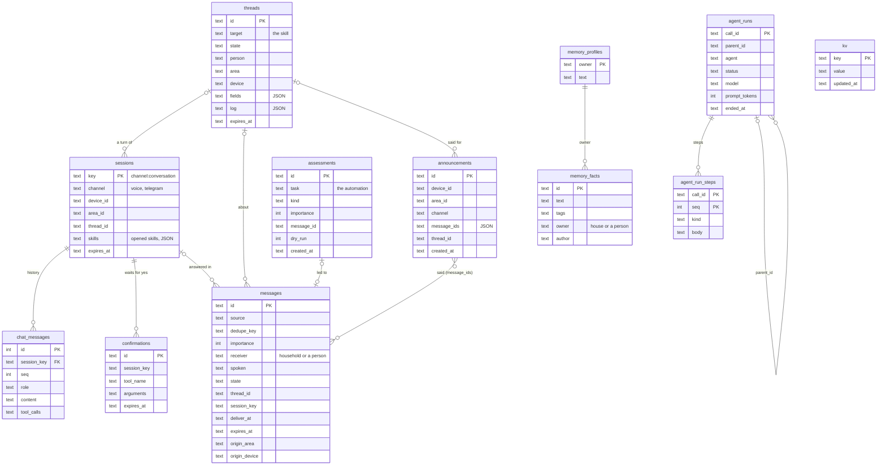

# Mira's database

Mira keeps her state in one SQLite file (`store.path`, by default `mira.db` in the data folder), written only by the
Mira service through `internal/store`. The schema grows by migrations (`internal/store/migrations.go`, applied at
start, listed in `schema_migrations`).

## Overview

Only `chat_messages` → `sessions` is a foreign key in SQLite; the other relations are ids kept as text.

## The tables

| Table | What it holds | Written by | Read by |
|---|---|---|---|
| `sessions` | One per conversation (a satellite's turn, a Telegram chat): its device, area, language, open thread and opened skills | the channels (`haconv`, Telegram) | the conversation engine |
| `chat_messages` | The history of a session, turn by turn, with tool calls | the conversation engine; history compaction drops the oldest | the conversation engine |
| `confirmations` | A tool call that waits for the user's yes | the tool policy | the next turn of the session |
| `threads` | A thread ("Vorgang"): its target, fields, log and state ([Threads](spec/threads.md)) | `internal/threads` | threads, the notifier, the page "Plans" |
| `messages` | What Mira has to say: reminders, task and schedule results, messages left; its state from scheduled to acked ([Messages](spec/messages.md)) | tasks, schedules, reminders, threads, voicemail | the notifier, the page "Messages" |
| `announcements` | What was said where and when, for a follow-up ("what did you say?") | the notifier | the conversation engine |
| `assessments` | The model's judgements of a task, with what came of them ([Tasks](spec/tasks.md)) | `internal/tasks` | the page "Tasks" |
| `agent_runs`, `agent_run_steps` | Runs of Mira's helpers with their steps and cost ([Agents](spec/agents.md)) | the agent runtime | the page "Agents", a run taken up after a restart |
| `memory_facts` (+ `memory_facts_fts`) | What Mira remembers, per owner (the house or a person), with a full-text index | the memory tools, the page "Memory" | the memory tools, the profile rebuild |
| `memory_profiles` | The profile per owner, built from the facts at night | the profile rebuild | every prompt |
| `kv` | Small settings and states by key: setup and pairing, quiet mode, exposed entities, the last run of each schedule (`schedule:<skill>:<name>[:<person>]`, [Schedules](spec/schedules.md)) | several | several |
| `schema_migrations` | The migrations applied | the store at start | the store at start |

## What is kept, and for how long

Decided 2026-10-30 (code review); built in `internal/store/prune.go` and `PurgeExpiredSessions`. Every 10 minutes
Mira removes what has long been finished. Nothing open is ever removed.

| Table | Removed | After |
|---|---|---|
| `messages` | not pending or scheduled any more (delivered, acked, expired, cancelled, failed); a pending one expires by its `expires_at` first | 90 days without a change |
| `assessments` | all | 90 days |
| `announcements` | all | 7 days |
| `threads` | done, cancelled or expired | 30 days without a change |
| `sessions` with their `chat_messages` | past their time: a voice session after `sessions.voice_ttl` (5 minutes) without a turn; a Telegram session has none | at once |
| `confirmations` | with their session, or when the next turn takes or drops them | at once |
| `agent_runs` with their steps | ended | 60 minutes |
| `memory_facts`, `memory_profiles` | never by Mira: what she remembers is removed by the user (page "Memory", "forget") | – |
| `kv` | never; each key is overwritten, so it does not grow (a removed person leaves the last run of their schedules) | – |

A Telegram session keeps its session row; its history does not grow without end, since compaction folds old turns
into a summary and drops them ([Context](spec/context.md), section 5).

SQLite reuses the space of removed rows: the file does not shrink, but stays near its largest size.
