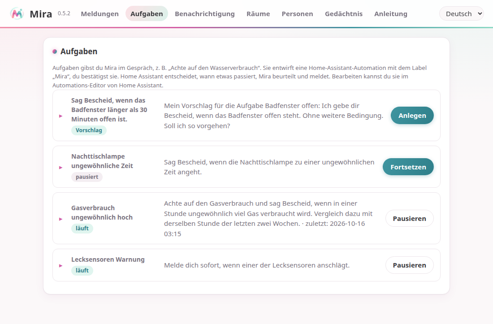
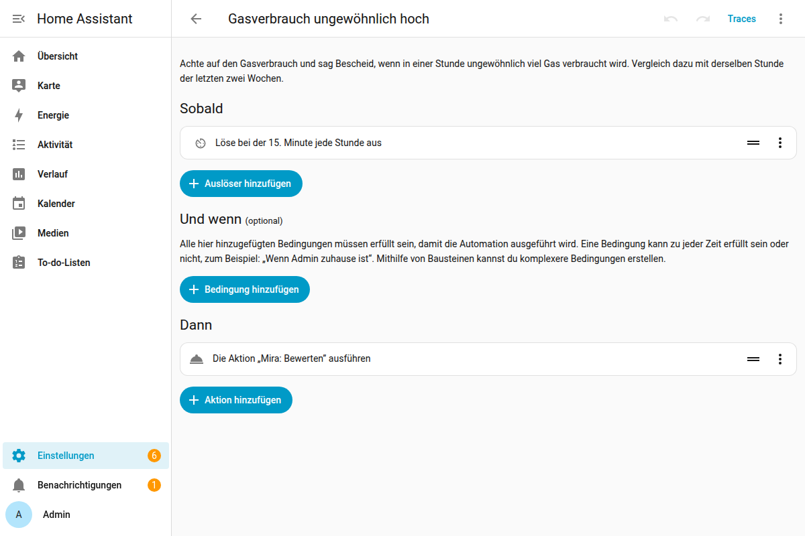
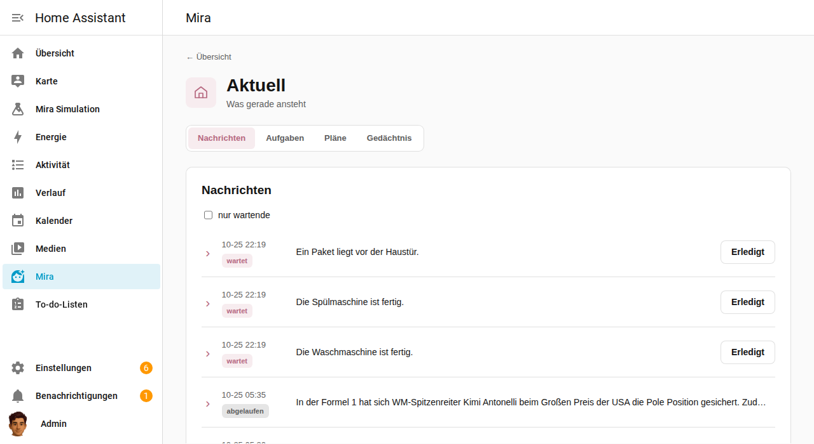
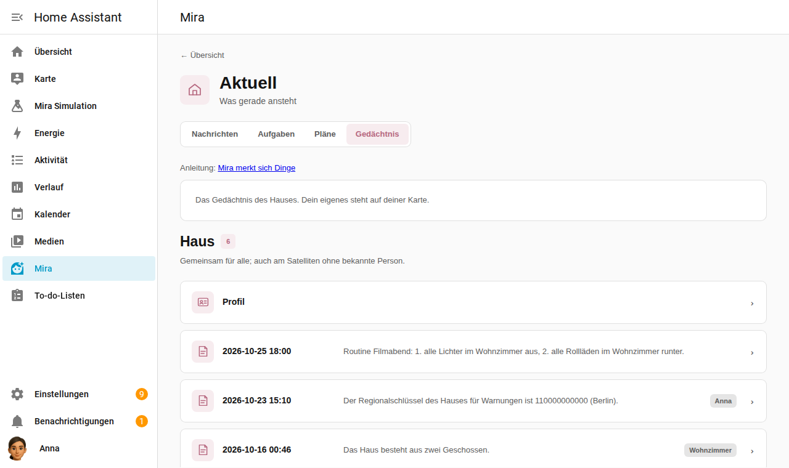
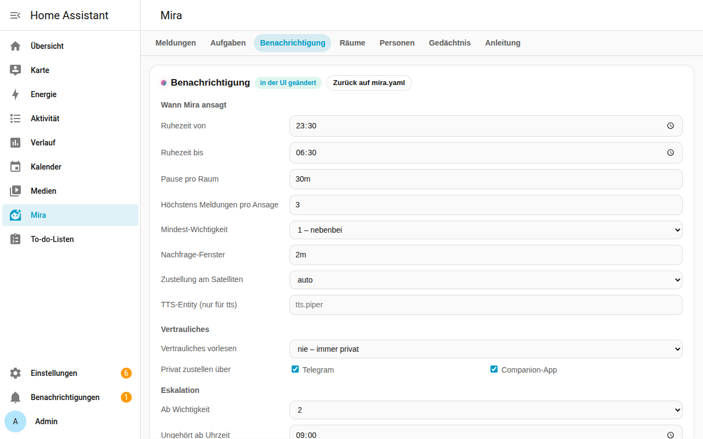
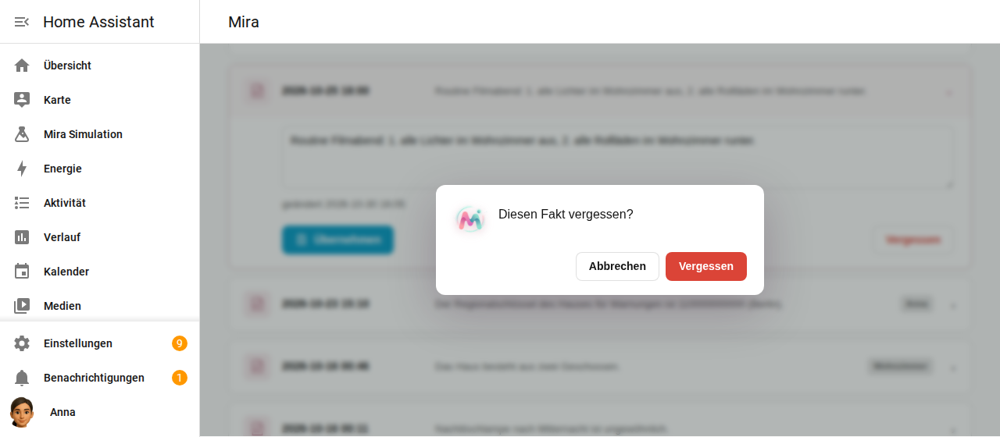
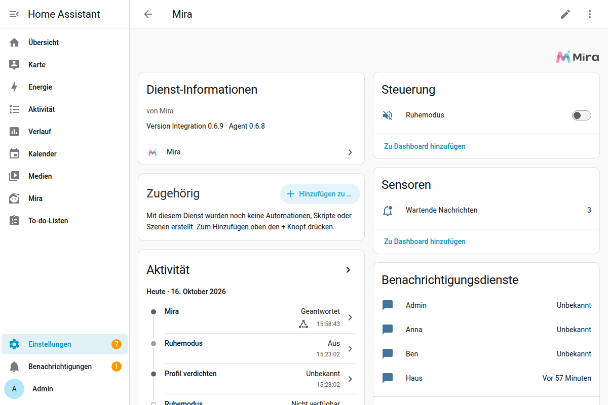
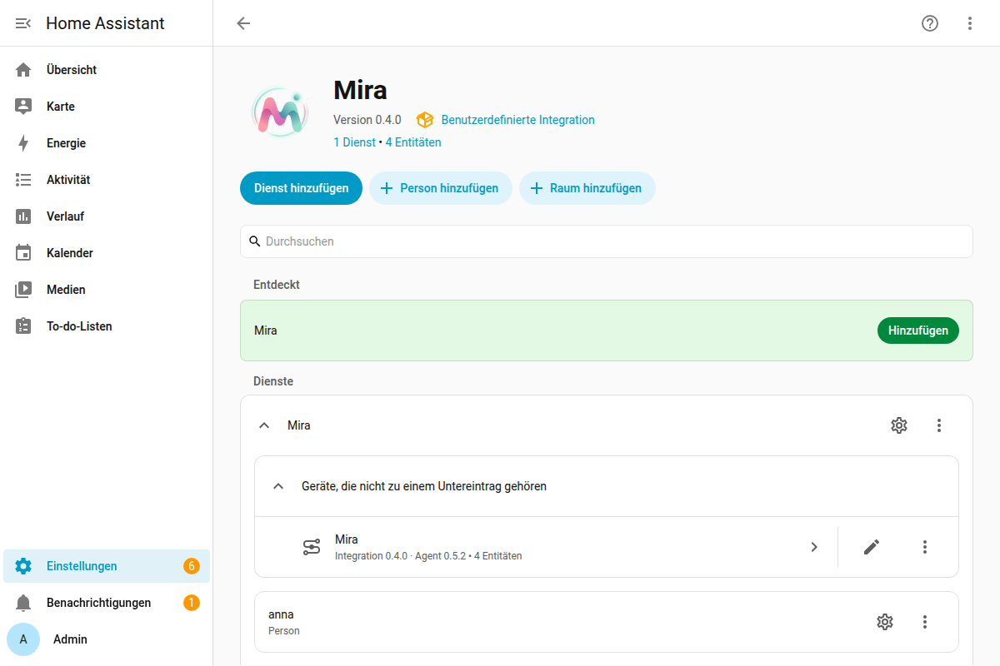
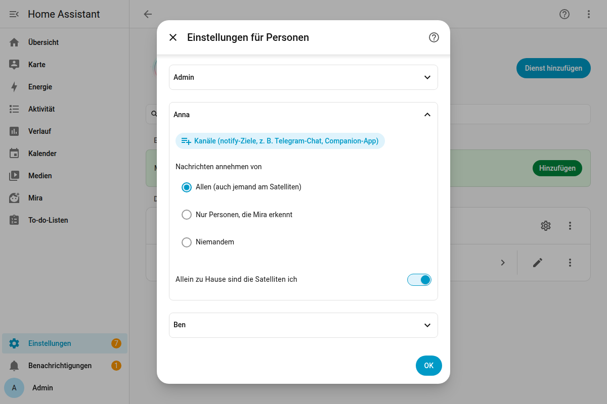

# Mira – Anleitung

Mira ist die Sprachassistentin, wie sie immer hätte sein sollen. Du sprichst mit ihr wie mit einem Menschen: Sie versteht, was du meinst, fragt nach, wenn etwas fehlt, und bleibt beim Thema, auch über mehrere Sätze. Sie merkt sich, was dir wichtig ist, schaut im Internet nach, kennt deinen Müllkalender – und sie passt von sich aus auf dein Zuhause auf und meldet sich, wenn etwas ist.

Home Assistant ist dabei ihr Werkzeugkasten: Lampen, Sensoren, Sprach-Satelliten. Dass Mira das Licht einschalten kann, ist selbstverständlich. Was sie ausmacht, steht hier vorne.

## Was Mira anders macht

- **Echte Gespräche.** Keine festen Kommandos. Mira fragt zurück, statt zu raten, und weiß im nächsten Satz noch, worum es ging.
- **Sie passt auf.** Sag ihr einmal „Achte auf den Wasserverbrauch“ – ab dann behält sie das im Blick und meldet sich, wenn etwas ungewöhnlich ist.
- **Sie meldet sich im richtigen Moment.** Im Raum, in dem du gerade bist, nicht mitten in der Nacht, und Dringendes sofort.
- **Sie merkt sich Dinge** – fürs ganze Haus und für jeden persönlich.
- **Sie kann mehr als das Haus.** Skills wie der Abfuhrkalender, eine Websuche, schwierige Fragen an ein stärkeres Modell.

## Ein Gespräch mit Mira

> 🎬 **Aufnahme folgt:** ein Sprachdialog am Satelliten – eine Frage, für die Mira im Internet nachschaut, eine Nachfrage dazu, und am Ende ein Auftrag fürs Haus.

So klingt das, zum Beispiel beim Einrichten einer Aufgabe:

> **Du:** Sag Bescheid, wenn die Nachttischlampe zu einer ungewöhnlichen Zeit angeht.
>
> **Mira:** Welche Uhrzeit ist für dich ungewöhnlich, etwa zwischen Mitternacht und 6 Uhr?
>
> **Du:** Zwischen eins und vier.
>
> **Mira:** Mein Vorschlag: Wenn die Nachttischlampe zwischen 1 und 4 Uhr angeht, sage ich dir Bescheid. Soll ich das so einrichten?
>
> **Du:** Ja.
>
> **Mira:** Alles klar, die Aufgabe ist eingerichtet.

Und bei einer Frage, die das Haus gar nicht betrifft:

> **Du:** Was wird nächste Woche abgeholt?
>
> **Mira:** Nächste Woche werden am Montag der Wertstoff, am Dienstag der Restabfall und am Donnerstag der Bioabfall abgeholt.

## So sprichst du mit Mira

- **Per Sprache**: über einen Sprach-Satelliten (z. B. den Echo im Wohnzimmer). Sag das Aktivierungswort und dann, was du möchtest. Mira weiß, in welchem Raum der Satellit steht: „Mach das Licht an“ meint das Licht in diesem Raum. Ist ihre Antwort eine Frage, hört der Satellit gleich weiter zu.
- **Per Telegram**: schreib dem Bot, den du in Home Assistant eingerichtet hast (Integration „Telegram bot“). Damit Mira antwortet, muss dein Chat bei deiner Person als Kanal eingetragen sein (siehe unten). Antworten dürfen hier länger sein, mit Listen und Links. `/neu` beginnt ein neues Gespräch.
- **In der Home-Assistant-App**: Der Assist-Chat der Companion App spricht ebenfalls mit Mira, getippt oder gesprochen.

Mira antwortet in der Sprache, in der du sie ansprichst.

## Mira passt aufs Haus auf: Aufgaben

Gib Mira eine dauerhafte Aufgabe, und sie behält etwas für dich im Blick:

- „Achte auf den Gasverbrauch und sag Bescheid, wenn in einer Stunde ungewöhnlich viel verbraucht wird.“
- „Sag Bescheid, wenn nachts ungewöhnlich viel Strom verbraucht wird.“
- „Melde dich sofort, wenn einer der Lecksensoren anschlägt.“

So läuft das Einrichten ab:

1. Fehlt Mira etwas, fragt sie zurück, statt zu raten – etwa „Welche Uhrzeit ist für dich ungewöhnlich?“. Antworte einfach; das Gespräch bleibt beim Thema, auch über mehrere Sätze.
2. Dann plant sie. Geht das schnell, nennt sie dir den Vorschlag gleich; sonst sagt sie „Ich plane das“ und meldet sich, sobald sie fertig gesprochen hat – im selben Raum oder auf Telegram.
3. Der Vorschlag sagt, was sie beobachtet, und nennt die Bedingung: „Wenn die Nachttischlampe angeht, sage ich dir Bescheid. Bedingung: nur zwischen 1 und 4 Uhr. Soll ich so vorgehen?“
4. Sag **„Ja“**, dann richtet sie die Aufgabe ein. Mit „Nein, lass es“ bricht sie ab. Antwortet niemand, verfällt der Vorschlag nach einer Viertelstunde.

Beim Beurteilen vergleicht Mira zum Beispiel den Verbrauch der letzten Stunde mit derselben Stunde der vergangenen zwei Wochen, weiß, wer zu Hause ist, kennt, was du ihr gemerkt hast, und erinnert sich, was sie zu dieser Aufgabe schon gesagt hat. Dieselbe Sache meldet sie nicht ständig wieder, nur wenn es schlimmer wird.

- „Welche Aufgaben hast du?“ – „Pausier die Gas-Aufgabe.“ – „Lösch die Aufgabe mit dem Strom.“ – „Mach einen Probelauf der Gas-Aufgabe.“
- In Home Assistant unter Mira → **Aufgaben** siehst du alle Aufgaben mit an/aus, Probelauf und dem Protokoll ihrer Urteile, dazu Vorschläge, die noch auf dein Ja warten.



Unter der Haube ist jede Aufgabe eine ganz normale **Automation in Home Assistant** mit dem Label „Mira“: Home Assistant entscheidet, *wann* etwas passiert (stündlich, wenn ein Sensor auslöst, nur nachts …), Mira entscheidet, *was* davon dich interessiert. „In Home Assistant bearbeiten“ öffnet sie im Editor; dort kannst du sie auch selbst ändern.



Eigene Automationen können Mira genauso nutzen: die Aktionen **Mira: Bewerten** (`mira.assess`), **Mira: Entscheiden** (`mira.decide`, eine Ja/Nein-Antwort für Bedingungen) und **Mira: Nachricht senden** (`mira.send_message`). Aufgaben gehören vorerst dem ganzen Haus und nutzen beim Beurteilen das Haus-Gedächtnis.

## Mira meldet sich von selbst

Mira meldet sich, wenn etwas passiert: ein Lecksensor schlägt an, die Waschmaschine ist fertig, morgen wird der Müll abgeholt, eine Aufgabe findet etwas Ungewöhnliches. Wie sie dir das sagt, hängt vom Raum und von der Wichtigkeit ab.

> 🎬 **Aufnahme folgt:** Der LED-Ring pulsiert, du fragst „Hast du eine Benachrichtigung?“, Mira liest vor.

Pro Satellit stellst du ein:

- **Anzeige**: Ein LED-Ring (z. B. des Echo) pulsiert in Türkis, solange etwas wartet – ganz ohne Bewegungsmelder. Ein Satellit mit Bildschirm wie die Echo Show blendet stattdessen „Mira · 1 Nachricht wartet“ ein, sobald etwas Neues kommt, und nimmt es weg, wenn alles gehört ist; das erkennt Mira von selbst. Frag dann: **„Hast du eine Benachrichtigung?“** oder „Gibt es was Neues?“.
- **Beim Hereinkommen ansagen**: Merkt ein Bewegungsmelder, dass jemand den Raum betritt, sagt Mira von selbst an, was ansteht; die erste Bewegung nach der Ruhezeit beginnt mit „Guten Morgen“. Ohne Bewegungsmelder oder ausgeschaltet spricht sie dich nicht von sich aus an.

Mehrere Nachrichten fasst Mira zu einer Ansage zusammen, das Wichtigste zuerst und mit Uhrzeit, wo sie hilft („heute Nacht um drei …“).

**Nebenbei**: Wenn du ohnehin mit dem Satelliten sprichst, hängt Mira Wartendes an ihre Antwort an – „Das Licht ist an. Übrigens: Morgen wird der Wertstoff abgeholt.“ Danach gilt die Nachricht als gehört, und die Anzeige geht aus. Fragst du nach („Was genau?“), bekommst du die Details.

**Wichtigkeit**:

| Stufe | Bedeutung | Was passiert |
|---|---|---|
| 1 | nebenbei | wartet auf die nächste Gelegenheit |
| 2 | heute wichtig | geht morgens nach 9 Uhr privat raus, wenn bis dahin niemand sie gehört hat |
| 3 | dringend | sofort, auch nachts: angesagt auf allen Satelliten und privat an alle |

Wenn Mira von sich aus spricht, leuchtet der LED-Ring des Raums ruhig, solange sie spricht.

**Ruhezeit**: In der Ruhezeit (z. B. 23:30–6:30) sagt Mira nichts an – außer Dringendem und deinen Erinnerungen. LED-Ringe leuchten trotzdem; was nachts kommt, siehst du morgens.

**Ruhemodus**: Der Schalter „Ruhemodus“ in Home Assistant stellt alle Ansagen ab, bis du ihn wieder ausschaltest.

**Vertrauliches und Persönliches**: Nachrichten können für eine Person bestimmt oder vertraulich sein. Vertrauliches liest Mira nur vor, wenn die Einstellung es erlaubt (z. B. nur wenn die Person allein zu Hause ist); sonst kommt es privat über die Kanäle der Person (Telegram, Companion-App).



## Mira merkt sich Dinge

- „Merk dir, dass der Schornsteinfeger im März kommt.“
- „Merk dir mal was.“ – Mira fragt „Was denn?“, und du sagst es im nächsten Satz.
- „Was weißt du über den Schornsteinfeger?“ – „Vergiss das mit dem Schornsteinfeger.“

Was Mira weiß, nutzt sie auch beim Aufpassen: Sag ihr „Merk dir, die Nachttischlampe nach Mitternacht ist ungewöhnlich“, und ihre Aufgaben beurteilen danach.

Es gibt ein Gedächtnis fürs **Haus** und eins für **jede Person**:

- Weiß Mira, wer spricht, merkt sie sich es für diese Person. Ins Haus-Gedächtnis kommt es nur, wenn du es ausdrücklich sagst („merk dir fürs Haus …“).
- Mira weiß, wer spricht: über Telegram, im Chat der HA-App (über deinen HA-Benutzer) und am Satelliten nur, wenn du allein zu Hause bist und das bei deiner Person eingeschaltet hast („Allein zu Hause sind die Satelliten ich“). Sonst ist es am Satelliten das Haus.
- Dein persönliches Gedächtnis sieht nur Mira im Gespräch mit dir. Das Haus-Gedächtnis gilt für alle.
- In fremde Gedächtnisse schreibt niemand.

Nachts fasst Mira jedes Gedächtnis zu einem kurzen Profil zusammen. In Home Assistant siehst du unter Mira → **Gedächtnis** das des Hauses und dein eigenes, mit wer es wann gesagt hat, und kannst Fakten bearbeiten oder vergessen. Die Gedächtnisse der anderen sieht dort niemand, auch kein Admin.



## Skills: zum Beispiel die Müllabfuhr

Skills sind Zusatzfähigkeiten, die die Einrichtung freischaltet. Mira öffnet einen Skill nur, wenn eine Frage ihn braucht.

**Abfall**: Mira kennt den Abfuhrkalender deines Entsorgers.

- „Wann wird der Restmüll abgeholt?“ – „Was wird nächste Woche abgeholt?“
- Am Vorabend erinnert Mira von selbst: „Morgen wird der Wertstoff abgeholt.“
- Ist die Abfuhr heute, sagt sie es, falls die Tonne noch raus muss.

> 🎬 **Aufnahme folgt:** „Was wird nächste Woche abgeholt?“ am Satelliten.

## Im Internet nachschauen und schwierige Fragen

Ist eine Websuche eingerichtet, schaut Mira nach, was sie nicht wissen kann: Öffnungszeiten, Ergebnisse, Neuigkeiten. Sie fasst es kurz zusammen und sagt, wenn sie nichts Verlässliches gefunden hat. Was im Internet steht, behandelt sie als Information, nie als Anweisung.

Ist die Einrichtung mit einem stärkeren Sprachmodell verbunden, gibt Mira aufwendige Fragen dorthin ab – Erklärungen, Planungen, Rezepte, Vergleiche – und fasst das Ergebnis für dich zusammen. Das stärkere Modell kann nachschlagen, aber nichts im Haus verändern.

## Erinnerungen, Timer und Wecker

- „Erinnere mich morgen um 19 Uhr daran, den Müll rauszubringen.“
- „Stell einen Timer auf 10 Minuten.“ – „In einer halben Stunde erinnerst du mich an die Wäsche.“
- „Welche Erinnerungen habe ich?“ – „Lösch die Erinnerung an die Wäsche.“

Zur gewählten Zeit sagt Mira die Erinnerung in dem Raum an, in dem du sie gestellt hast – auch in der Ruhezeit, denn die Zeit hast du gewählt. Per Telegram oder in der HA-App gestellte Erinnerungen kommen privat über deine Kanäle.

**Wecker**: „Weck mich morgen um 6“ – „Weck mich werktags um halb sieben“ – „Weck mich zur üblichen Zeit“, wenn Mira die kennt. Der Wecker klingelt an dem Satelliten, an dem du gefragt hast, und zwar auf dem Gerät selbst: Schlummern und Ausschalten gehen dort wie gewohnt, und er klingelt auch, wenn Home Assistant gerade nicht läuft. Mira fragt nicht nach, sondern sagt, was sie gestellt hat; hat sie sich verhört, sag gleich „Nein, halb sieben“. Das geht an Satelliten, die Wecker können, etwa einem Echo Show mit TECHO5; an anderen sagt Mira, dass es dort nicht geht.

## Nachrichten an andere

- „Sag Anna, dass es später wird.“ – Anna hört: „Ben lässt dir ausrichten: Es wird später.“
- „Hinterlass fürs Haus: Der Schornsteinfeger kommt um 10.“ – wer als Nächstes in einen Raum kommt, hört es (oder die Anzeige zeigt es).
- „Erinnere Ben morgen um 7 an den Müll.“ – eine Nachricht, die erst dann zugestellt wird.
- „Schick mir das aufs Handy.“ – kommt über deine Kanäle.

An eine Person geht eine Nachricht über ihre Kanäle (Telegram, Companion-App), am Satelliten nur, wenn sie dort als sie erkannt ist. Jede Person stellt ein, von wem sie Nachrichten annimmt: von allen, nur von Personen, die Mira erkennt, oder von niemandem; Miras eigene Nachrichten (Aufgaben, Erinnerungen, Warnungen) kommen immer an. Wer etwas von jemandem im Wohnzimmer hinterlässt, ohne erkannt zu sein, erscheint als „jemand im Bereich Wohnzimmer“. Ob eine Nachricht gehört wurde, erfährt der Absender nicht.

Eine **Durchsage** („Sag allen, das Essen ist fertig“) ist etwas anderes: Sie geht sofort über alle Satelliten und wird nicht gespeichert.

## Und natürlich: das Haus steuern

- „Mach im Wohnzimmer das Licht an.“ – „Dimm die Stehlampe auf 30 Prozent.“
- „Wie warm ist es im Bad?“ – „Welche Fenster sind offen?“ – „Wie wird das Wetter morgen?“

Mira fragt Werte immer frisch ab, statt sie zu schätzen. Kann sie etwas nicht nachsehen, sagt sie das ehrlich.

**Wichtige Aktionen bestätigen**: Schlösser, Alarmanlage, Garagentor und Ähnliches führt Mira erst aus, wenn du auf ihre Rückfrage ausdrücklich „Ja“ sagst.

## Mira in Home Assistant

Mira steht in Home Assistant im Seitenmenü. Du bist dort schon angemeldet, sie sieht aus wie dein HA-Theme (hell oder dunkel) und spricht deine HA-Sprache; das klappt auch unterwegs in der App.

- **Nachrichten**: offene und zugestellte Nachrichten ansehen und quittieren.
- **Aufgaben**: was Mira für dich im Blick behält; an/aus, Probelauf, Protokoll, löschen, „In Home Assistant bearbeiten“.
- **Benachrichtigung**: Ruhezeit, Pausen, Eskalation, Vertrauliches, dringende Nachrichten.
- **Satelliten** und **Personen**: alle aus Home Assistant, mit dem, was Mira zusätzlich braucht; als Admin stellst du es hier direkt ein (siehe unten).
- **Gedächtnis**: das des Hauses und dein eigenes; bearbeiten und vergessen.
- **Anleitung**: diese Seite.

Wer kein Admin ist, sieht nur **Gedächtnis** und **Anleitung**. Damit Mira weiß, wessen Gedächtnis du bist, muss deine Person mit deinem HA-Benutzer verknüpft sein (Einstellungen → Personen).



Bevor Mira etwas löscht, fragt sie nach:



**Mira für sich allein**: Dieselbe Oberfläche gibt es auch direkt bei Mira unter `http://<mira>:8787/ui`, gedacht für den, der Mira betreibt. Sie macht ein paar Dinge anders: Sie kommt in Miras eigenen Farben, fragt beim ersten Aufruf nach dem Zugangs-Token, zeigt die Gedächtnisse aller Personen und lässt dort Satelliten und Personen bearbeiten, solange die Integration sie nicht verwaltet.

## In Home Assistant

- **Gerät „Mira“** mit dem Schalter **Ruhemodus**, dem Sensor **Wartende Nachrichten** und der Taste **Profil verdichten**; die Versionen von Integration und Agent stehen in den Geräte-Informationen.
- Mira ist ein Gesprächsagent: Unter Einstellungen → Sprachassistenten wählst du sie für deine Satelliten aus.
- Automationen können Mira Nachrichten geben: mit HAs eigener Aktion `notify.send_message` an **Mira Haus** oder **Mira ‹Person›** (je eine notify-Entität fürs Haus und pro Person), oder mit `mira.send_message`, wenn es mehr braucht (Wichtigkeit, vertraulich, Ablauf).
- **Mira im Seitenmenü** (siehe oben). Ausschalten in den Optionen der Integration; jeder kann sie auch nur in seinem eigenen Seitenmenü ausblenden.



Mira kennt deine Personen und Satelliten von selbst, anlegen musst du nichts: Jede Person aus Home Assistant ist auch für Mira eine Person, und jeder Assist-Satellit spricht in seinem Bereich.



Was Mira darüber hinaus braucht, stellst du am einfachsten im Mira-Panel unter **Satelliten** und **Personen** ein; dasselbe geht in Home Assistant unter Einstellungen → Geräte & Dienste → Mira → **Konfigurieren**, mit einem aufklappbaren Abschnitt pro Person oder Satellit. Gespeichert wird es direkt an der Person oder am Satelliten, und es verschwindet mit ihnen.

- **Einstellungen für einen Satelliten**: Bewegungsmelder (auch mehrere, etwa Flur und Wohnzimmer), beim Hereinkommen ansagen, Anzeige (LED-Ring). Der Raum ist der Bereich des Satelliten.
- **Einstellungen für eine Person**: **Kanäle** (notify-Ziele, z. B. der Telegram-Chat aus HAs Telegram-Integration und die Companion-App; persönliche Nachrichten gehen an den ersten, der klappt), **Nachrichten annehmen von** (allen, nur Personen, niemandem) und „Allein zu Hause sind die Satelliten ich“.

**Zwei Arten von notify-Entitäten:** **Mira Haus** und **Mira ‹Person›** (`notify.mira_…`) sind Miras Briefkästen. Was dort ankommt, wird eine Nachricht, und Mira entscheidet, wie sie ankommt: angesagt, angezeigt oder privat, mit Ruhezeit und Wichtigkeit. Die **Kanäle** einer Person sind dagegen Transporte, die direkt zustellen, etwa der Telegram-Chat oder die Companion-App. Automationen schicken an die Briefkästen, als Kanal trägst du Transporte ein; Miras eigene Briefkästen bietet die Auswahl dort gar nicht erst an.



- **Persönlichkeit** (unter **Allgemein**): wie Mira klingt, als freier Text: Ton, Humor, wie knapp sie bei Gerätebefehlen antwortet, ein paar Beispiele für ihren Ton. Sie hängt ihn an ihre festen Regeln an, er gilt für Sprache, Telegram und ihre Ansagen. Was je Kanal gilt (kurze Sätze am Satelliten, Listen bei Telegram) und welche Sprache, regelt sie selbst; das gehört nicht hinein.
- **Nachfragen**: Hängst du in Home Assistant das Label **„Mira: nachfragen“** an eine Entität, etwa das Garagentor, schaltet Mira sie nur nach deinem „Ja“, und Aufgaben schalten sie nie. Schlösser und Alarmanlagen sind das ohnehin.

Im Assist-Chat der HA-App und im Seitenmenü erkennt Mira dich an deinem HA-Benutzer, über die Person, mit der Home Assistant ihn verknüpft.

## Weitere Werkzeuge über MCP

Mira kann zusätzliche Werkzeuge nutzen, die ein MCP-Server anbietet, etwa eine Websuche. Die Einrichtung trägt sie in `mira.yaml` unter `mcp_servers` ein; Mira verbindet sich beim Start und gibt dem Modell die Werkzeuge mit, mit dem Servernamen davor (`search__…`). Das funktioniert mit jedem Sprachmodell.

Ein Server läuft entweder für sich und wird über HTTP erreicht, oder Mira startet ihn selbst als Programm (stdio):

```yaml
mcp_servers:
  - name: ha                       # Home Assistant, ist immer dabei
    transport: http
    url: "http://homeassistant.local:8123/api/mcp/assist"
    token: ${HA_TOKEN}
  - name: search                   # Mira startet den Server selbst
    transport: stdio
    command: /usr/bin/node
    args: ["/opt/web-search-mcp/dist/index.js"]
    env: ["MAX_RESULTS=5"]         # optional
    read_only: true
    web_content: true
  - name: notizen                  # läuft für sich, über HTTP
    transport: http
    url: "http://localhost:9100/mcp"
    token: ${NOTIZEN_TOKEN}        # optional
    disabled: true                 # vorübergehend aus
```

Zwei Schalter entscheiden, wie vorsichtig Mira mit einem Server umgeht:

- **`read_only: true`**: Der Server liest nur und ändert nichts. Nur solche Werkzeuge stehen auch Hintergrundarbeiten (Beurteilen von Aufgaben, abgegebene schwierige Fragen) zur Verfügung. Ohne den Schalter gibt es die Werkzeuge nur im Gespräch.
- **`web_content: true`**: Was der Server liefert, ist fremder Text, zum Beispiel aus Webseiten, und könnte versteckte Anweisungen enthalten. Sobald Mira ein solches Werkzeug benutzt hat, sind für den Rest der Anfrage kritische Aktionen gesperrt: alles, was unter `security` als bestätigungspflichtig eingetragen ist, etwa Schlösser, Alarmanlage, Garage.

Neue oder geänderte Server gelten nach einem Neustart von Mira. `mira check` prüft, ob alle erreichbar sind.

## Gut zu wissen

- Mira erfindet keine Werte: Fehlt ihr etwas, sagt sie es oder fragt nach.
- Nach einer Websuche führt Mira keine kritischen Aktionen aus, bis du den Befehl noch einmal direkt gibst.
- Bei Spracherkennungsfehlern hilft es, deutlich und in einem Satz zu sprechen.
- Ein Gespräch per Telegram läuft weiter, solange du schreibst. Mira sieht davon die letzten Wechsel (etwa 30 bis 50) und alles zum Anliegen, an dem ihr gerade arbeitet; Älteres fällt heraus, was sie sich gemerkt hat, bleibt. `/neu` beginnt von vorn.
