# Mira – Guide

Mira is the voice assistant as it always should have been. You talk to her like to a person: she understands what you mean, asks when something is missing, and stays on the subject, over several sentences too. She remembers what matters to you, looks things up on the internet, knows your waste collection calendar – and she looks after your home on her own and speaks up when something is up.

Home Assistant is her toolbox: lights, sensors, voice satellites. That Mira can switch on the light goes without saying. What makes her different comes first here.

## What makes Mira different

- **Real conversations.** No fixed commands. Mira asks instead of guessing and still knows in the next sentence what it was about.
- **She keeps watch.** Tell her once "Keep an eye on the water usage" – from then on she watches it and speaks up when something is unusual.
- **She speaks up at the right moment.** In the room you are in, not in the middle of the night, and urgent things at once.
- **She remembers things** – for the whole house and for everyone personally.
- **She can do more than the house.** Skills like the waste calendar, a web search, hard questions for a stronger model.

## A conversation with Mira

▶ [Explainer video: Mira asks (0:50)](https://mira-assist.com/videos/erklaer/rueckfragen-en.mp4)

> 🎬 **Recording to follow:** setting up a task – Mira asks back, proposes, and sets it up after your yes.

This is how it sounds, for example when setting up a task:

> **You:** Let me know when the bedside lamp turns on at an unusual time.
>
> **Mira:** Which time is unusual for you, say between midnight and 6 am?
>
> **You:** Between one and four.
>
> **Mira:** My proposal: when the bedside lamp turns on between 1 and 4 am, I'll let you know. Shall I set it up like that?
>
> **You:** Yes.
>
> **Mira:** All right, the task is set up.

And with a question that has nothing to do with lights and switches:

> **You:** What gets collected next week?
>
> **Mira:** Next week the recycling is collected on Monday, the residual waste on Tuesday and the organic waste on Thursday.

## How to talk to Mira

- **By voice**: through a voice satellite (e.g. the Echo in the living room). Say the wake word and then what you want. Mira knows which room the satellite is in: "Turn on the light" means the light in that room. If her answer is a question, the satellite keeps listening. If you interrupt a long answer with the wake word, Mira knows how far you heard it: "How did it go on?" goes on from there. "Stop" or "Be quiet" means she says nothing more at all, not even "okay".
- **On Telegram**: write to the bot you set up in Home Assistant (integration "Telegram bot"). For Mira to answer, your chat must be one of your person's channels (see below). Answers can be longer here, with lists and links. `/new` starts a new conversation.
- **In the companion app**: the Assist chat of the companion app (Home Assistant's app on your phone) talks to Mira too, typed or spoken.

Mira answers in the language you speak to her in.

## Mira looks after the house: tasks

Give Mira a standing task and she keeps an eye on something for you:

- "Keep an eye on the gas usage and tell me if an unusually large amount is used in an hour."
- "Tell me if a lot of electricity is used at night."
- "Speak up at once when one of the leak sensors goes off."

This is how setting one up goes:

1. If something is missing, Mira asks instead of guessing – "Which time is unusual for you?". Just answer; the conversation stays on the subject, over several sentences too.
2. Then she plans. If that is quick, she tells you the proposal right away; otherwise she says "I'll plan that" and comes back with the proposal once she has finished planning – in the same room or on Telegram.
3. The proposal says what she watches and names the condition: "When the bedside lamp turns on, I'll let you know. Condition: only between 1 and 4 am. Shall I go ahead?"
4. Say **"Yes"** and she sets up the task. "No, leave it" cancels. If nobody answers, the proposal lapses after a quarter of an hour.

When judging, Mira compares, for example, the last hour's usage with the same hour over the past two weeks, knows who is at home and what you asked her to remember, and recalls what she already said about this task. She does not report the same thing again and again, only when it gets worse.

- "Which tasks do you have?" – "Pause the gas task." – "Delete the electricity task." – "Do a dry run of the gas task."
- In Home Assistant under Mira → **Tasks** you see all tasks with on/off, dry run and the log of their judgements, plus proposals still waiting for your yes.

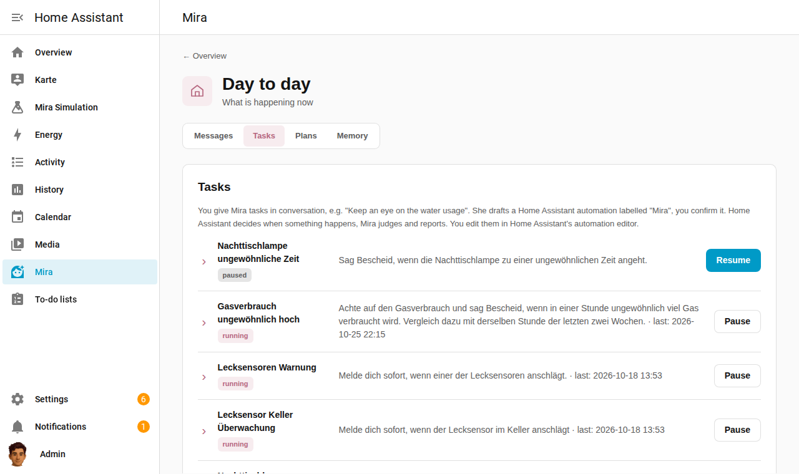

Under the hood every task is an ordinary **automation in Home Assistant** labelled "Mira": Home Assistant decides *when* something happens (hourly, when a sensor fires, only at night …), Mira decides *what* of it interests you. "Edit in Home Assistant" opens it in the editor; you can change it there yourself too.

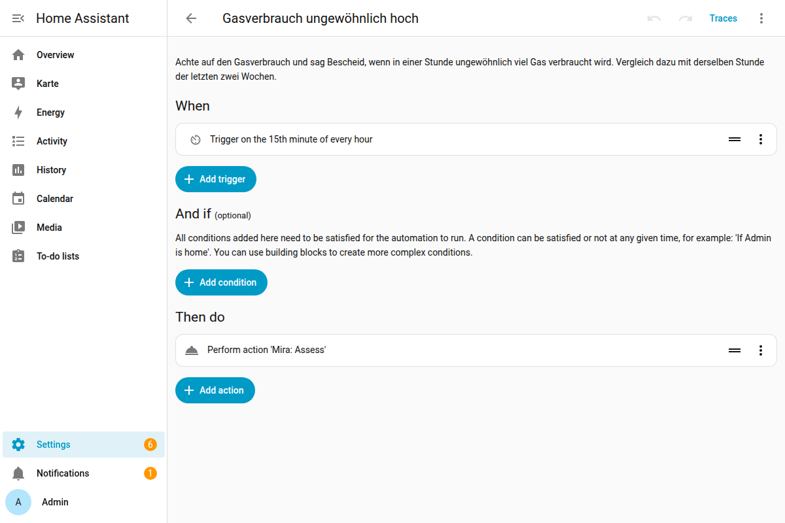

**Changing tasks, your own as well:** Mira changes every task saved in Home Assistant's automation editor, not only her own. Just say what should be different:

- "The evening light in the living room should only come on 30 minutes after sunset."
- "In the task with the water, take out the sensor in the basement."

Mira looks the task up, asks when two fit, and tells you the change: "The task Evening light living room: so far at sunset, now 30 minutes later. Shall I change it like this?" Only after your **"Yes"** does she save it. If the task then switches something new, Mira names it first, and the same rules as when setting one up apply to what is new. What a task has always switched stays allowed. Anyone Mira knows can change a task; when she does not recognise the voice, she changes nothing. Tasks from YAML files Mira cannot change; she tells you so.

**What a task may switch:** lights, radio, blinds and the like, plus push messages. Before you say "yes", Mira names everything the task switches besides, scenes too. A task never switches locks, the alarm panel or what is labelled "Mira: confirm first", not through a scene or group that holds one either. A task starts a script only if it is exposed to Assist. Raw commands such as MQTT messages or REST commands Mira cannot check and does not call directly in tasks: create a script for them and expose it to Assist.

Your own automations can use Mira the same way: the actions **Mira: Assess** (`mira.assess`), **Mira: Decide** (`mira.decide`, a yes/no answer for conditions) and **Mira: Send message** (`mira.send_message`). For now tasks belong to the whole house and use the house's memory when judging.

With **Mira: Agent** (`mira.agent`) an automation starts one of Mira's agents, for example `delegate` with the input `{"input": "Plan a menu for Saturday."}`. Without further settings the automation waits up to 60 seconds for the answer; read it with `response_variable`. When the time is up, Mira cancels the run; with `on_timeout: run_on` she lets the agent finish and delivers the result later, as in the mode async. With the mode **async** it goes on at once: the result then comes as the event `mira_agent_done`, which an automation can wait for, or with **Delivery: message** as a message from Mira. **Mira: Agent result** reads a run by its call id, **Mira: Cancel agent** ends it.

### Watches: Mira looks after your devices

▶ [Explainer video: Mira keeps watch (1:04)](https://mira-assist.com/videos/erklaer/mira-passt-auf-en.mp4)

For much in the house Mira needs no rule from you: she knows how a device usually behaves and speaks up when it does something else. For this she has ready-made **watches**:

- **Water runs without a pause**, say a tap left open in the garden or a burst hose.
- **The water meter never stands still**: a dripping tap or a toilet that keeps running.
- **A device with a fixed daily routine** like the aquarium's light or a pump, suddenly on or off at other times.
- **A device that switches on and off all day**, like a fridge or a freezer: it runs far too long in one go (door open?) or not at all any more (power gone?).
- **A device with programmes** like a dishwasher or a washing machine: it runs longer than usual, or finishes without having heated.

All Mira needs is what Home Assistant measures anyway: a water meter, or a plug with power measuring (in watts) on the device.

> **You:** Keep an eye on whether water keeps running.
>
> **Mira:** Will do: if the water meter runs for half an hour without a pause, I'll tell you. All right?
>
> **You:** Yes.

Mira does not guess the numbers. She looks at how the device ran in the last days and proposes something from that:

> **You:** Watch the aquarium.
>
> **Mira:** The aquarium's light is on every day from about 7:40 to 11:40 and from 14:20 to 21:00, at around 50 watts. Shall I tell you when it does something else?
>
> **You:** Almost, in the afternoon it only comes on at half past two.
>
> **Mira:** Then from 7:40 to 11:40 and from 14:30 to 21:00. Shall I set it up like that?

For the fridge she tells you how long it runs and pauses at most, and speaks up only when it is clearly longer. If she knows a device too little yet, say a dishwasher that has not run in the last days, she waits:

> **You:** Watch the dishwasher.
>
> **Mira:** I'll take the dishwasher into the watching after its next run.

After the next wash she leaves you a message and asks whether she should watch the dishwasher now. Say **"Yes"** and she tells you her proposal; say **"No, leave it"** and she does not offer the device again. If you want it later after all, "Do watch the dishwasher" is enough. If the device does not run for a month, she forgets the offer.

**What could Mira watch?** Just ask her: "Are there devices you could watch?" She looks at the house's water meters and power measurements and tells you what she would keep an eye on for which device. What she watches already, or what you declined, she does not name again. It takes a few seconds.

When a watch speaks up, it is an ordinary message from Mira, as the next section describes, for example "Water has been running for half an hour, the meter reads 81,240 litres". You can answer right away: "Ben is in the bath."

A watch is a task like any other and is in the list of tasks:

- "Stop watching the water for now" switches it off, for example while the garden is watered; "Watch the water again" switches it back on.
- "Don't watch the water any more" deletes it.
- Changing it works as for any task: "For the water watch, take an hour instead of half an hour."

The watches themselves are **blueprints** in Home Assistant: ready-made, checked templates for automations. You find them under **Settings → Automations & scenes → Blueprints**; their names begin with "Mira:". Mira brings them herself and keeps them up to date; do not change them there, a new version of Mira overwrites them. Every watch you set up is an automation made from such a blueprint, with the label "Mira".

### Watches for groups: all lights, windows and doors, batteries

Some things are not about one device but a whole group: a light that stays on somewhere for ages, a window open while nobody is home. Mira has ready-made watches for this too:

- **Lights left on**: a lamp has been on for hours (if you like, only while nobody is home).
- **Open while nobody is home**: a window or a door is open and everyone is out.
- **Open at night** and **open too long**.
- **Motion while nobody is home** and **motion at night**.
- **Too cold or too warm**, say in the cellar.

> **You:** Let me know if a window is open and nobody's home.
>
> **Mira:** Will do: all windows and doors. I'll send it to your phones.

While nobody is at home, Mira sends such a message to each of you on your phone (over the channels you set for the persons). Otherwise she says it in the house, like any message.

Which sensors belong to it you say in your own words: all of the house, only certain rooms ("in the cellar") or a floor ("all windows on the top floor"). Mira knows the floors and rooms from Home Assistant. If you made a **group** in Home Assistant, say "Guest room windows", you can name that as well. A window added later is in at once. For "at night" Mira asks from when to when:

> **You:** Tell me about motion in the garden at night.
>
> **Mira:** From when to when is night?
>
> **You:** 11 pm to 6.
>
> **Mira:** Will do.

**Exceptions.** For lamps Mira leaves out the outside lighting (terrace, garden, driveway) and the voice devices' light rings and screens by herself, and says so in her proposal. To leave something else out, just say it: "Tell me when a light is on for ages somewhere, but not the terrace." What you leave out gets the label **"Mira: don't watch"** in Home Assistant and is then in no group watch. You can also set or remove the label in Home Assistant yourself (at the entity under **Settings → Devices & services → Entities**), or tell Mira: "Watch the terrace again."

**Is everything closed?** Just ask Mira before you leave or go to bed: "Is everything closed?", "Is a window open upstairs?", "Is a light still on anywhere?" She looks at the same windows and doors (or lamps) as her watches and tells you what is open, for example "Everything is closed except the bathroom window". If a sensor does not report, she says that too.

**From an automation.** The same check is the action **"Mira: Check"** (`mira.check`) for your own automations and scripts, for example when you leave the house or in a "Good night" script. If something is open you get a message from Mira; the list also comes back as the action's response for your automation to work with:

```yaml
- action: mira.check
  data:
    scope: openings  # windows and doors; lights for lamps, motion for motion sensors
    floors: [upstairs] # optional, else the whole house; likewise areas for areas
  response_variable: check
- if: "{{ check.open | count > 0 }}"
  then:
    - action: notify.mobile_app_your_phone
      data:
        message: "Still open: {{ check.open | map(attribute='name') | join(', ') }}"
```

The message goes to the house; with `receiver: anna` (the person's ID in Home Assistant) to a person, with `notify: false` to nobody, and only the response counts.

**Batteries and reachability.** Two watches for groups look after the devices themselves: once a day (normally at 9 in the morning) Mira looks at every battery in the house and at every device Home Assistant can no longer reach, and tells you what she finds.

> **You:** Tell me when a battery runs low.
>
> **Mira:** Will do: every morning at 9 I'll look at the batteries and tell you which are below 20 percent. Already low: smoke detector in the hall. All right?

> **You:** Let me know when a device can't be reached any more.
>
> **Mira:** Will do: every morning at 9 I'll tell you which devices have not been reachable for at least an hour.

Mira names the devices by their names, say "Battery low: smoke detector hall (12 %)". As long as a battery stays low or a device stays away, she says so again every day, until you change the battery, the device is back or you leave it out. Phones, cars, robot vacuums and whatever else is charged rather than changed she leaves out by herself and tells you so in her proposal. A device you switch off on purpose you leave out like this: "Leave out the plug in the garage." After Home Assistant restarts, Mira waits for the set time again before she names a device; a restart brings no flood of messages.

These watches are tasks like all others too: "Stop watching the windows for now" switches one off, say on holiday while someone looks after the plants; your own "We're on holiday" script can do the same.

## Mira speaks up on her own

Mira speaks up when something happens: a leak sensor goes off, the washing machine is done, the bins are collected tomorrow, a task finds something unusual. How she tells you depends on the room and the importance.

> 🎬 **Recording to follow:** leaving a message for the house, and asking for messages later.

Per satellite you set:

- **Indicator**: an LED ring (e.g. the Echo's) pulses teal while something is waiting – no motion sensor needed. A satellite with a screen like the Echo Show shows "1 message waiting – ask: 'Do I have new messages?'" for a minute instead, as soon as something new arrives; once everything is heard, the hint goes at once (with TECHO5 that can take it down), otherwise after its minute. Mira finds out by herself that a satellite has a screen. Then ask: **"Do I have new messages?"** or "Anything new?". Mira tells you everything that waits; when different things wait (mail, the answering machine, a new device), she asks what to start with and then goes through them with you one after the other.
- **Announce on entry**: when a motion sensor notices someone entering the room, Mira says by herself what is pending; the first motion after quiet hours starts with "Good morning". Without a motion sensor, or switched off, she does not speak up on her own.

Several messages become one announcement, the most important first and with times where they help ("tonight at three …").

**By the way**: when you talk to the satellite anyway, Mira adds what is waiting to her answer – "The light is on. By the way: the recycling is collected tomorrow." After that the message counts as heard and the indicator goes off. If you ask ("What exactly?"), you get the details.

**Importance**:

| Level | Meaning | What happens |
|---|---|---|
| 1 | in passing | waits for the next opportunity |
| 2 | important today | goes out privately after 9 am if nobody has heard it by then |
| 3 | urgent | at once, even at night: announced on all satellites and privately to everyone |

When Mira speaks up on her own, the room's LED ring glows steadily while she speaks.

**The ring's colors:** **teal** while a message from Mira waits (and steady while she speaks), **amber** for a new message on the answering machine, **red** for a missed call. Teal, the effect and the brightness are set in `mira.yaml`; amber and red are fixed:

```yaml
notifier:
  indicator: { rgb_color: [32, 201, 176], effect: Pulse, brightness: 160 }
```

What the Echo shows while it listens, thinks and replies is set on the Echo itself (Wake word effect, Thinking effect, Replying effect). Effects without colors of their own, like Pulse or Ripple, run in the color the ring was given last, usually that of Mira's last hint; effects with their own colors, like Ice Comet or Ocean Ripple, keep theirs. If **Ring follows the room** is set to an effect on the Echo, the ring shows the room instead of Mira's hint; leave it at **None** for the indicator.

**Quiet hours**: during quiet hours (e.g. 23:30–6:30) Mira announces nothing – except urgent things and your reminders. LED rings still glow; what came in at night you see in the morning.

**Quiet mode**: the "Quiet mode" switch in Home Assistant turns off all announcements until you turn it off again.

**Confidential and personal**: messages can be meant for one person or be confidential. Mira reads confidential messages out only when the setting allows it (e.g. only when that person is alone at home); otherwise they go privately over that person's channels (Telegram, companion app).

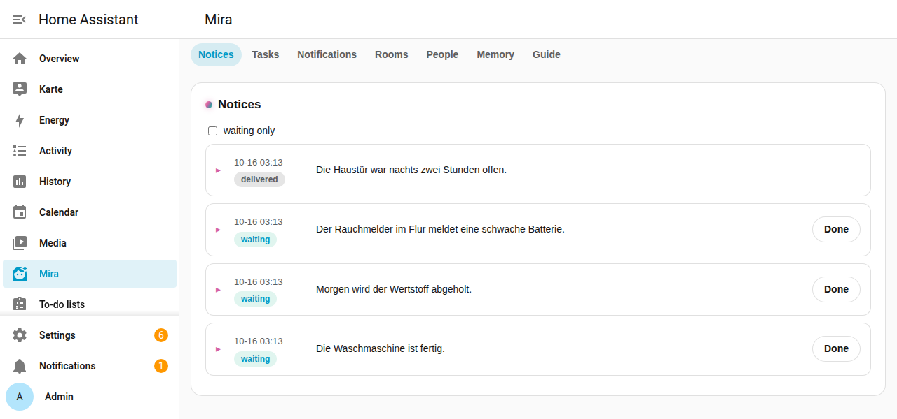

## Mira remembers things

▶ [Explainer video: Mira's memory (0:33)](https://mira-assist.com/videos/erklaer/gedaechtnis-en.mp4)

- "Remember that the chimney sweep comes in March."
- "Remember something." – Mira asks "What is it?", and you tell her in the next sentence.
- "What do you know about the chimney sweep?" – "Forget the thing about the chimney sweep."

What Mira knows she also uses when keeping watch: tell her "Remember, the bedside lamp after midnight is unusual", and her tasks judge by it.

There is one memory for the **house** and one for **each person**:

- When Mira knows who is speaking, she remembers it for that person. It goes into the house's memory only when you say so ("remember for the house …").
- Mira knows who is speaking on Telegram, in the companion app's Assist chat (through your HA user), and at a satellite by your voice when speaker recognition is set up (see below), or when you are alone at home and switched that on on your card ("When you are alone at home, Mira knows it is you"). Otherwise a satellite is the house.
- Your personal memory is only seen by Mira when talking to you. The house's memory is for everyone.
- Nobody writes into someone else's memory.

At night Mira condenses each memory into a short profile. In Home Assistant you see the house's memory under Mira → **Memory** and your own on your card (at the top of the overview, with your name), each with who said it and when, and can edit or forget facts. Nobody sees the others' memories there, not even an admin.

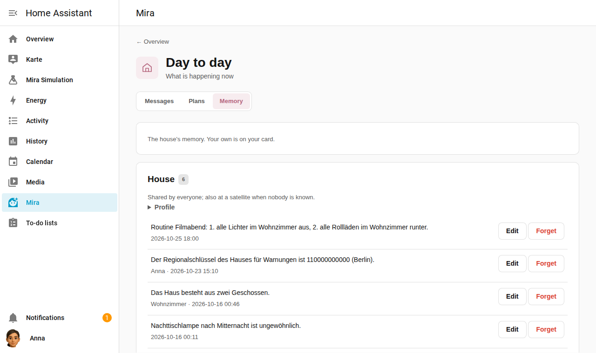

**Editing as a file.** Under **Memory**, **Export** downloads everything you see there as the file `mira-gedaechtnis.md`: a heading per memory (`# House`, `# Anna`), below it one fact per line, tags as `#word` at the end. Change it in a text editor and upload it with **Import**. Mira first shows what changes ("House: 3 new, 1 removed, 26 kept") and applies it only after your OK. As when loading a file into an editor, each section replaces that memory completely; memories without a section stay as they are. This is also how you fill a new house at once with what Mira should know:

```markdown
# House

- The fuse box is in the cellar, left of the door. #technik
- The chimney sweep comes every November.
```

## Who is speaking: Mira recognizes voices

At a satellite Mira otherwise does not know who is talking to her. With **speaker recognition** she knows by the voice: "Remind me to take out the bins tomorrow" becomes a reminder for whoever said it, even with the whole family at home. When Mira does something personal for you, she says your name ("Noted that for you, Anna"): if she mixes you up, you notice right away. For "lights on" she says no name.

Speaker recognition is **optional**. Without it Mira works as before; **Enroll the voice** on your card is greyed out then.

- **No audio is kept**, only a voice print: a few hundred numbers per sentence, from which the voice cannot be recovered. The voice prints are kept by the recognition service, not in Mira's database, and everyone can delete theirs.
- Only what is said to a satellite after the wake word is looked at, the same that goes to speech recognition anyway.
- A recognized voice counts like "alone at home": your memory, your reminders, tasks and messages. **It is no login**: it opens no locks, alarm or purchases.
- When Mira is not sure (an unknown voice, two voices too alike, a very short sentence), the satellite stays the house.

**Enrolling your voice.** On the overview everyone has a card with their name. There, **Enroll the voice**: the card shows four sentences, such as "What time is it right now?". At a satellite say the wake word and one of them each time, best all of them. Each sentence shows on the card; tap **That was me** for each, then **Done**. For three minutes the card shows only these sentences, said from the click on, and not in someone else's voice. Nobody sees there what else is said in the house. If your voice is often not recognized later, just enroll a few more sentences.

**For children and others without a login** an admin enrolls the voice: on Mira's page under Setup → **People** → the person → **Enroll the voice**; the person speaks, the admin taps **That was Ben**. There an admin also sets a person's **voice threshold**: lower when their voice is often not recognized, higher when it is mistaken for another. Without one, 0.7 applies.

**Setting it up** (for whoever runs Mira). Speaker recognition is a small service of its own, a container (`ghcr.io/miraassist/speaker-id`). It sits in front of your speech recognition (faster-whisper, say), passes the audio on unchanged and recognizes the voice beside it; it needs no graphics card.

1. In an empty folder save the [compose.yaml](https://raw.githubusercontent.com/miraassist/mira/main/services/speaker-id/compose.yaml) and next to it create a `.env` with a long random token (`SPEAKER_TOKEN=…`), and if needed `SPEAKER_UPSTREAM=tcp://<whisper>:10300`, the address of your speech recognition so far. Then `docker compose up -d`. On its first start the service downloads its model (about 25 MB). The voice prints are then kept in `~/.local/share/speaker-id` (`SPEAKER_ID_DATA` changes that).
2. In Home Assistant: Settings → Devices & services → add **Wyoming Protocol**, the service's address, port **10310**. Then under Settings → Voice assistants, in the assistant with Mira, choose the new entry **speaker-id** as **Speech-to-text**. The text stays the same as before.
3. In Mira's `mira.yaml`:

   ```yaml
   speaker_id:
     url: http://<service>:10311
     token: ${SPEAKER_ID_TOKEN}   # the same token as in the service's .env
   ```

   and restart Mira. The voice can now be enrolled on the cards.

## Skills: the waste collection, for example

▶ [Explainer video: Waste collection (0:42)](https://mira-assist.com/videos/erklaer/muell-en.mp4)

Skills are extra abilities the setup switches on. Mira opens a skill only when a question needs it.

### Waste

Mira knows your waste collector's calendar. It is a calendar in Home Assistant (for example through the "Remote Calendar" integration with your collector's iCal link); in `mira.yaml` the skill `abfall` names it (`calendar`). With `types` you name only the kinds of waste you care about, such as `"Restabfall, Wertstoff"`; empty means all.

- "When is the residual waste collected?" – "What gets collected next week?"
- On the evening before, Mira reminds you on her own: "The recycling is collected tomorrow."
- If the collection is today, she says so in case the bin still has to go out.

> 🎬 **Recording to follow:** "When is the residual waste collected?" and "What gets collected next week?"

### Briefing

A short overview of what is coming, in three or four sentences.

- In the morning Mira puts together what is on today: weather, appointments, waste collection and, if you name topics, two headlines. She says it the first time someone enters a room with "announce on entry"; otherwise the indicator lights up or she mentions it in passing. In the evening the same comes for tomorrow, but only when something is on tomorrow, and without the waste collection: the skill **Waste** reminds you of that on the evening before. To be reminded of the bins in the evening, turn it on as well.
- **Your own briefing:** if Mira can reach you personally (your phone or Telegram under "Configure → Persons", or "alone at home is me"), you also get a message of your own in the morning. It has your appointments for today if you have a calendar of your own (one named like your Home Assistant login or like you as a person; with the login `stefan`, "Stefan"), your parcels of today if you have a parcel calendar of your own ("Pakete stefan", see "Parcels"), your to-dos due today or overdue for up to 30 days if you have a to-do list of your own (one named like you, as with the calendar), and two headlines on your topics if Mira knows them: "Remember that I'm interested in football and electric cars." With none of these, nothing comes.
- "What's on today?" – "What's on tomorrow?" – "Give me my briefing." On request Mira adds your own calendar and your due to-dos too when she knows who is speaking.
- When the briefings come is set under **Capabilities → Schedules** (see "Schedules").
- In `mira.yaml` the skill `briefing` names the house's calendars (`kalender`) and the news topics (`themen`). Without `kalender` the house briefing reads every exposed calendar, personal ones too, and the whole house hears their appointments.

### Parcels

▶ [Explainer video: Parcels (0:35)](https://mira-assist.com/videos/erklaer/pakete-en.mp4)

Mira reads the shipping mails of the parcel services and knows when which parcel comes (skill `pakete`).

- "When is my parcel coming?" – "Is anything coming today?" – "Has the parcel from Amazon arrived?"
- In the briefing: "Your parcel from Amazon comes today between 10 and 12."
- A newer mail changes the entry (new day, time window, ready for pickup), a cancellation removes it. A delivered parcel gets a dot before its title ("● Paket von Amazon") and is gone the next day. Mira never says pickup codes.

To set it up:

1. In Home Assistant, add the **IMAP** integration with your mailbox.
2. When setting it up, enter a **search** for the parcel services only, for example `OR OR FROM dhl.de FROM hermesworld.com FROM gls-group.eu`.
3. After setup Home Assistant shows the new device ("IMAP (your address)"). Rename the **device** to **"Pakete"** (for everyone in the house) or to **"Pakete" and your login name**, such as "Pakete stefan" (just for you).

If the calendar "Pakete" (or "Pakete stefan") is missing, Settings → Repairs shows "Mira needs the calendar …"; clicking Submit creates it. You see the parcels in the calendar view there too. Mira reads only mails that arrive from now on.

Good to know: the model that reads the mails sees what is in them (names, address, orders). A local model keeps that in the house; in `mira.yaml` it goes under `agents` for `mail.read` and `mail.match` (`{ model: main }`). Gmail needs an app password; Outlook.com and Microsoft 365 do not work with the IMAP integration.

### Paperless

▶ [Explainer video: Searching your documents (0:38)](https://mira-assist.com/videos/erklaer/dokumente-suchen-en.mp4)

Mira searches your documents in [Paperless-ngx](https://docs.paperless-ngx.com/) and reads out what you want to know.

- "Search my documents for the chimney sweep's invoice and tell me the amount."
- "Search Paperless for the tax office's notice. By when do I have to pay?"
- "When is the next chimney inspection?" – if Mira finds the notice, she answers with the document's sender and date.
- "How many invoices has Wipfler sent me, and how much did I pay in total?" – Mira finds them all, reads them and adds up.

For this Mira researches with a helper of her own in the background: it searches, reads the documents and returns only the result with its sources. If that takes more than a few seconds, Mira says she will come back and announces the result once it is there. She reads out only what was asked, never whole pages.

How to set it up:

1. Start the MCP server for Paperless as a container next to Mira:
   ```sh
   docker run -d --name paperless-mcp --restart unless-stopped -p 3000:3000 \
     -e PAPERLESS_URL=http://paperless:8000 ghcr.io/baruchiro/paperless-mcp --http --port 3000
   ```
   `PAPERLESS_URL` is the address of your Paperless.
2. In Paperless, create an **API token** under **Profile**. Mira sees exactly the documents this user sees.
3. Switch the skill on in `mira.yaml`:
   ```yaml
   skills:
     paperless: { url: http://localhost:3000/mcp, token: ${PAPERLESS_TOKEN} }
   ```
   Set the token as the environment variable `PAPERLESS_TOKEN` for Mira. Then restart Mira.

Good to know:
- Mira can only **search and read** in Paperless, never change or delete anything. The one exception is her inbox (below): there she sets the tag "Mira gelesen".
- What the documents say counts as **third-party text**, like a web page: Mira follows no instructions in it and asks before she keeps or passes on anything from it.
- The documents' text goes to the helper's model, the main model; only the result enters the conversation. A local model keeps it in the house (see "Several models").
- Mira searches best with one distinctive word (the sender, the matter). The text is recognized from scans; if an amount is unclear, Mira says so.

### Mira's inbox

▶ [Explainer video: Mira's inbox (Paperless, 0:50)](https://mira-assist.com/videos/erklaer/postfach-paperless-en.mp4)

What you give the tag **"Mira"** in Paperless, Mira reads, and she looks at what there is to do in it. She tells two things apart: an **appointment** that takes place at a time (parents' evening, a doctor's appointment) goes into your calendar; a **to-do** you must do by a day (a deadline, an invoice, a call to return) goes onto your to-do list, with the day as its due date. She asks you first. She reads only those documents, no others.

- The letter from school comes by post. You scan it with the Paperless app and give it the tag "Mira".
- Shortly after, on Telegram or at a satellite where Mira recognizes you: "The letter from school has the parents' evening on Thursday at 7:30 pm in the hall and a reply about the trip due Friday. Shall I enter the appointment and put the reply on your list?"
- "Yes." Mira enters the parents' evening into your calendar and puts the reply on your list. "Only the appointment" works the same way, "The parents' evening is at 8 pm" enters it at the new time, "No" leaves it.
- If a practice offers three appointments to choose one, Mira reads them out and asks which suits; she enters the one you choose.
- The morning briefing names your due to-dos (see "Briefing").

Paperless already reads your mailboxes and files the attachments. With a **mail rule** or its automatic matching you give documents the tag "Mira" there too, for example everything from the school. Then Mira reads along by herself.

How to set it up (the skill **Paperless** above already runs; Paperless needs workflows with a webhook action):

1. In Paperless, under **Tags**, create two tags: **"Mira"** and **"Mira gelesen"**. Set the **matching to "None"** on both, so Paperless never sets them by itself, and under **Permissions** let the Paperless user Mira works with **view** them.
   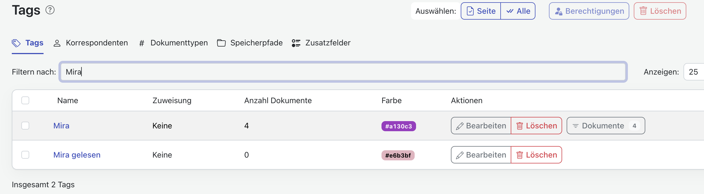
2. Under **Workflows**, create a workflow "Mira" with two **triggers**: "Document Added" and "Document Updated". On both, under **Advanced filters**: "Has any of these tags: Mira" and "Does not have these tags: Mira gelesen".
   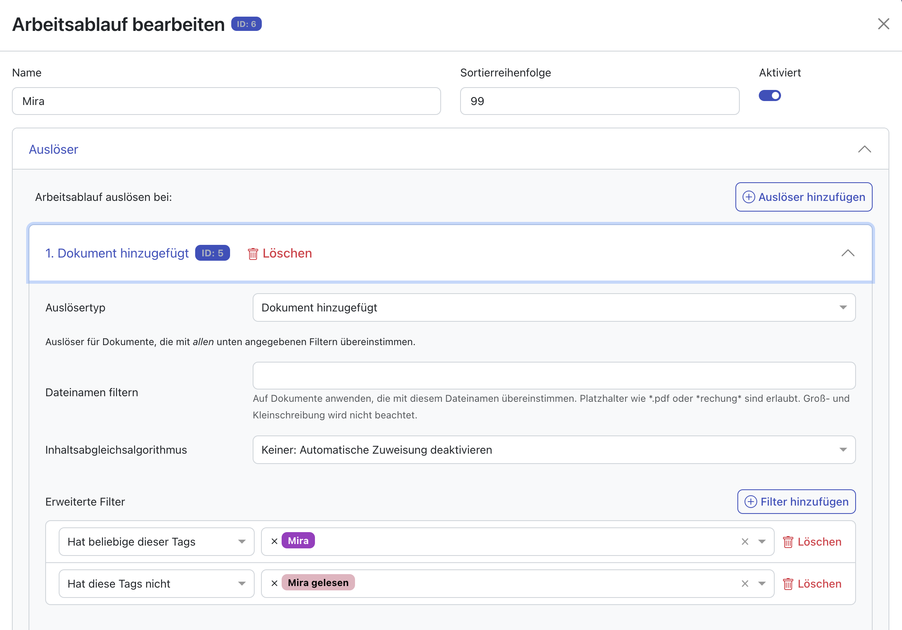
3. As the first **action**, an **Assignment**: under **Assign edit permissions**, Mira's user. So Mira may mark exactly the documents in her inbox as read, and no others.
   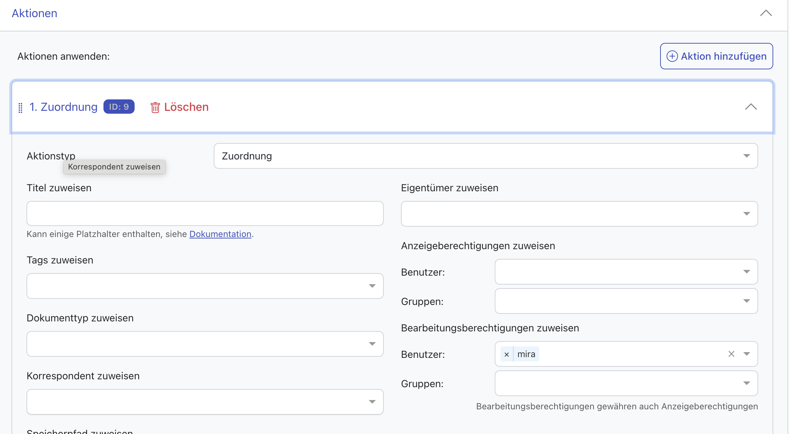
4. As the second **action**, a **Webhook**: as the URL Mira's address with `/v1/inbox/paperless`, "Use parameters for webhook body" and "Send webhook payload as JSON" on, three parameters `doc_id` = `{{doc_id}}`, `title` = `{{doc_title}}`, `owner` = `{{owner_username}}`, and a header `Authorization` = `Bearer ` followed by a password you make up.
   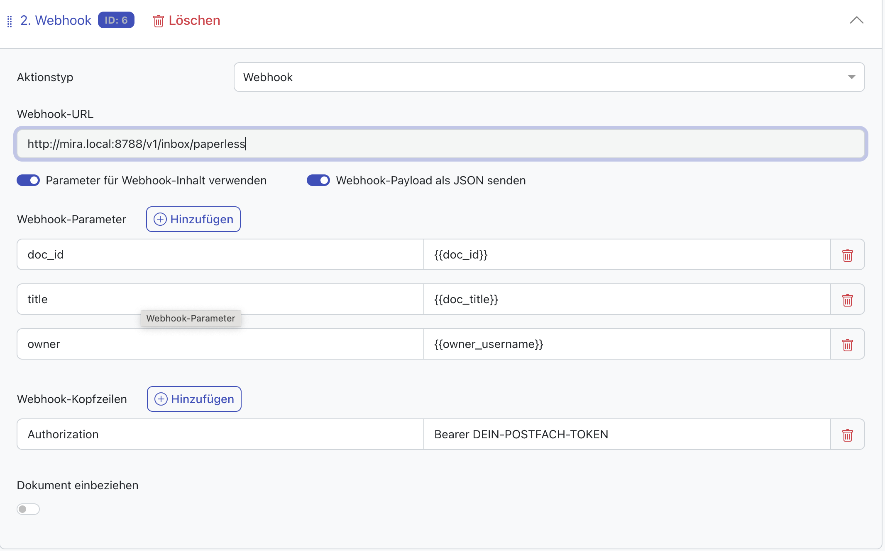
5. Enter the same password at Mira in the skill **Paperless** as the **inbox token**, in `mira.yaml` like this:
   ```yaml
   skills:
     paperless: { url: http://localhost:3000/mcp, token: ${PAPERLESS_TOKEN}, inbox_token: ${MIRA_INBOX_TOKEN} }
   ```
   Then restart Mira.
6. Try it: give a document with an appointment the tag "Mira".

Good to know:
- Mira asks the person the document **belongs to** in Paperless: their Paperless user name is their login name or their name in Home Assistant. If it belongs to none of them, Mira only sends a message with what she found and asks what to do with it. Appointments go into your own calendar, to-dos onto your own list (the one named like you); without one, Mira asks where when entering, and remembers it on request. She never adds anything to another person's calendar or list. A list that cannot keep a due date (such as Home Assistant's shopping list) she does not take for a to-do with a due date.
- After reading, Mira sets the tag **"Mira gelesen"**; "Mira" stays, so you see in Paperless what went through her inbox. For Mira to read a document again, remove "Mira gelesen".
- If Mira finds nothing to do, she says nothing. What is neither an appointment nor a to-do she does not say on its own; it is in the description of the appointment or to-do it belongs to, and otherwise in the document itself. An appointment waits for your answer until it begins, a to-do until its day, one without a day for a day.
- If Mira could not be reached when the webhook came, she catches the document up at her next start, if she knows its owner from an earlier document; otherwise just set the tag "Mira" again.
- The document's text goes to the model that reads it (`inbox.read` under `agents`). A local model keeps it in the house.
- If Paperless runs with `PAPERLESS_WEBHOOKS_ALLOW_INTERNAL_REQUESTS=false` or a list of allowed ports, Mira's address must be allowed there.

### Mira's inbox for mails

▶ [Explainer video: Mira's inbox (mail, 0:45)](https://mira-assist.com/videos/erklaer/postfach-mail-en.mp4)

Without Paperless it works with a mail folder too. What lands in that folder, Mira reads as above and asks about the appointments and to-dos; she does not read attachments here, those go through Paperless.

1. In your mailbox, create a folder **"Mira"**. Move there what Mira should read: by hand, with a filter rule (for example everything from the school) or with a forward to an address of its own.
2. In Home Assistant, add the **IMAP** integration with this mailbox. Enter **"Mira"** as the **folder** and **`ALL`** as the **search**. With the default search "UnSeen UnDeleted" Home Assistant never reports a mail you already read and then moved. If Home Assistant says "Selected folder is invalid", the mail server keeps the folder under the inbox: then enter "INBOX/Mira", on some servers "INBOX.Mira".
3. Rename the new **device** to **"Postfach" and your login name**, such as "Postfach anna". "Postfach" alone belongs to the house: then Mira only sends a message with what she found.

Good to know:
- Mira remembers the last 100 mails she has read and does not ask about any of them a second time, even when you tidy up the folder. The mail itself stays in the folder as it is.
- A mail that comes while Mira is not running is not caught up; after Mira's start Home Assistant reports only the last one. Whoever wants to miss nothing takes the way through Paperless.
- Gmail needs an app password; Outlook.com and Microsoft 365 do not work with the IMAP integration.

### Research

For thorough research Mira hands the question to a research agent in your home network, such as [Hermes Agent](https://github.com/NousResearch/hermes-agent), when you name it: by its name ("Ask Hermes, …") or as the research agent. Without that, Mira mostly looks it up herself with the skill Nachdenken (see "When two skills can do similar things"). The agent searches the web for a few minutes, compares the sources and writes an overview with a recommendation and its sources. It comes as a message: at the satellite where you asked, Mira announces the summary; without a satellite the whole overview goes to your phone.

- "Ask Hermes which heat pump suits our old house of 140 square metres, and give me an overview."
- If the agent lacks something important, it asks back ("Hermes asks: How large is the living space?"); Mira passes your answer on.
- "Forget the research" cancels it. If the agent cannot be reached, Mira says so and offers to look it up herself.

How to set it up:

1. Run an agent with **A2A** in your home network. For Hermes, switch on the platform A2A in its `config.yaml` (`gateway.platforms.a2a.enabled: true`, port 9900). Give it only web search and reading pages for its research, no tools that run commands or change files. A research often takes longer than the 300 seconds Hermes waits for its model on its own: `A2A_REPLY_TIMEOUT=1800`.
2. Without a token Hermes takes requests only from its own machine. If Mira runs on another device, give it a token: `A2A_PEER_TOKENS=mira:<token>`, `A2A_TRUSTED_PEERS=mira` and `A2A_HOST=0.0.0.0`.
3. Switch the skill on in `mira.yaml`, with the agent's address and, if it wants one, the token:
   ```yaml
   skills:
     recherche: { url: http://192.168.1.20:9900, token: ${HERMES_TOKEN} }
   ```

Good to know: the agent works with its own model and its own tools; Mira gives it only your question. What it writes counts as third-party text from the web. Over `http` anyone in the same network can read along, the token too.

### More bundled skills

They run once you switch them on: on Mira's page under Capabilities → Skills → **Switch on**, or in `mira.yaml` under `skills`; most need no setting, since Mira knows from Home Assistant where the house is. Their sources are German ones (tagesschau.de, OpenLigaDB, the German school holidays, NINA).

| Skill | What you ask | Setting |
|---|---|---|
| `nachrichten` | "What's going on in the world today?" – "What's new in sport?" Headlines from tagesschau.de and sportschau.de, summed up briefly. | none |
| `fussball` | "How did KSC play?" – "When does KSC play?" – "Where are they in the table?" If someone has their own club in memory ("Remember, I'm a Bayern fan"), theirs counts for them. | `verein` (optional) |
| `ferien` | "When are the next school holidays?" – "Is Monday a public holiday?" | `bundesland`, such as `BW` |
| `pollen` | "Is there pollen today?" – "How about birch tomorrow?" If Mira knows what you are allergic to, she names that first. | none |
| `warnungen` | "Are there any warnings?" – "Is a storm coming?" Official warnings from NINA for your district. Mira checks every hour and speaks up by herself for severe warnings, at once for extreme ones, at night too. She finds the district herself. | none |
| `geschichte` | "Tell me a bedtime story with a dragon." Made up, fitting child and age when Mira knows both. | none |
| `quiz` | "Let's play a quiz." Ten questions, alone or taking turns, with points. At the end there is a fanfare if it went well. | none |
| `musikquiz` | "Let's play a music quiz, the 80s, we guess the year." Mira plays 30 seconds of each song, you guess the artist, title, year or decade. The Echo Show only shows "Musik-Quiz" meanwhile; after the answer a card shows the song with its cover. The clips come from Deezer; no account needed. Only at a satellite with a speaker. | none |
| `vokabeln` | "Test me on ten English words." – "Practise the seven times table with me." Unless you ask for one direction, Mira asks both ways; what was wrong comes again at the end. | none |
| `fahrplan` | "When is the next train?" – "When does the next train to Stuttgart leave?" Departures with delays and cancellations; for trams and buses with the code of your transport association. | `haltestelle`, `verbund` (optional, e.g. `KVV`) |
| `apotheke` | "Which pharmacy is on emergency duty today?" The nearest with address, distance and until when, from aponet.de. | none |
| `sprit` | "Where is diesel cheap right now?" Needs Home Assistant's Tankerkönig integration, its sensors exposed to Assist. | none |
| `routine` | "Learn the routine good night: lights off, blinds down." – then just "good night". Mira remembers the steps and runs them in order. | none |
| `kamera` | "Show me the front door." The camera appears on the Echo Show for a minute. With a script (see below) also "Who is at the door?". The camera must be exposed to Assist. | `skript` (optional) |
| `tuerklingel` | "Tell me when the doorbell rings and show the front door." Mira sets up an automation for it: an announcement on all satellites, the camera picture on the Echo Shows. | `bildschirme` (optional, ESPHome names of the Echo Shows) |
| `urlaub` | "Pretend someone is home while we are away." Mira sets up an automation that switches lights in turn in the evening while nobody is home. | none |

The quiz, the music quiz and vocabulary run like cooking, step by step: you simply answer, and Mira knows which question is next. In the music quiz Mira does not listen while the song plays: say "Mira" and then your answer; "again", "next", "What's the score?" and "stop" work too.

### Asking a camera

For "Who is at the door?" a script in Home Assistant looks at the picture. Create it (Settings → Automations & scenes → Scripts → new script → edit in YAML), expose it to Assist and enter its name as `skript` for the skill `kamera`. It needs an AI task (`ai_task`) in Home Assistant, for instance via Google Gemini or OpenAI; the picture goes to their model.

```yaml
alias: Kamera fragen
description: Looks at a camera's picture and answers a question about it.
fields:
  kamera: { description: The camera, e.g. camera.front_door, required: true, selector: { entity: { domain: camera } } }
  frage: { description: What to find out, e.g. Who is at the door?, required: true, selector: { text: {} } }
sequence:
  - action: ai_task.generate_data
    data:
      task_name: Kamera fragen
      instructions: "Answer briefly: {{ frage }}"
      attachments:
        - media_content_id: "media-source://camera/{{ kamera }}"
          media_content_type: image/jpeg
    response_variable: antwort
  - stop: done
    response_variable: antwort
```

## Schedules: what Mira does by herself

Some skills speak up by themselves at fixed times: the morning briefing at 5:30, the waste collection the evening before at 6 pm, the severe weather warnings every hour. Then there is Mira's own job that rebuilds the profiles from her memory at night. All of them are in one place: **Capabilities → Schedules** (admins only).

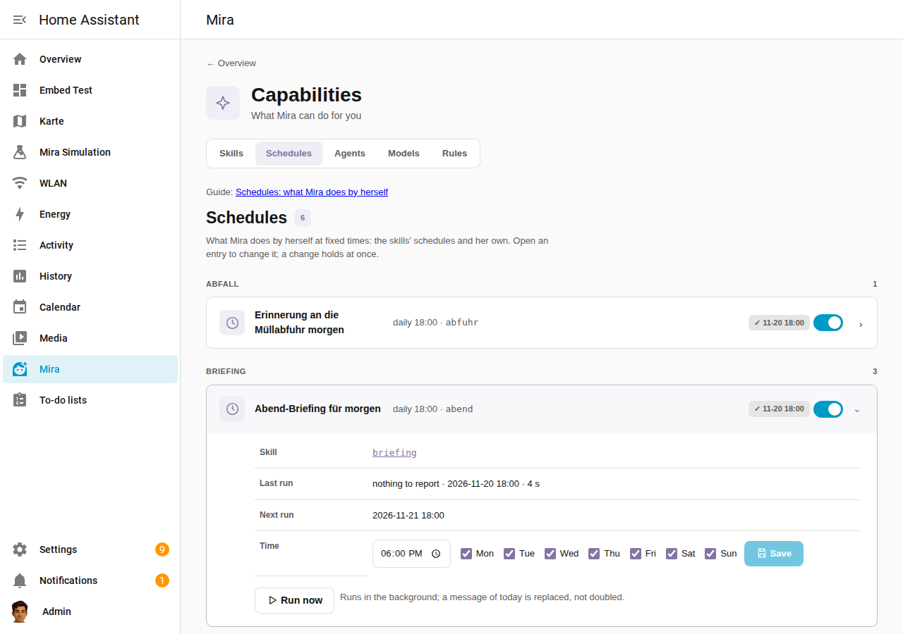

- **Each schedule is a card**, by skill, Mira's own last. Closed, it shows what it does, when ("Mon–Fri 06:45", "hourly"), how the last run went (✓ or ✗ with its time) and the switch for on and off.
- **Opened** it has the **last run** (done with what Mira will say, "nothing to report" or the error; for the personal briefing per person), the **next run**, the **time with the weekdays** to change, and **Run now** to try it at once. A second run on the same day replaces the first one's message instead of sending another. The skill's name leads to its card under **Skills**.
- **A change holds at once**, without a restart. It is in `mira.yaml` with the skill's scheduled job under `jobs`, such as `briefing: { jobs: { morgen: { template: morgen, cron: "45 6 * * 1-5" } } }`; a job switched off has `enabled: false` there and keeps its time. While a skill has no jobs in `mira.yaml`, the ones it brings hold. Entries under `schedules` from older versions keep working and move to `jobs` the next time the page saves.
- **You manage scheduled jobs on the skill**: under **Skills**, in the skill's section **Scheduled jobs**. There **New job** makes one (template, name, its values, time of day and weekdays); you change, switch off, delete or run one at once. A skill such as `youtube` can have several lists this way, in the morning on other topics than in the evening. New, changed and deleted jobs hold after Mira's restart; a time changed here under Schedules holds at once. When a skill is switched on, Mira writes its first jobs into `mira.yaml`; one that lacks a required value (the topics, say) is not made.
- **Mira's own schedules** can be moved, not switched off.
- A time such as "every hour" cannot be set here as a time of day; it is shown in words and changed in `mira.yaml` only. Switching it off works all the same.
- A skill under **Skills** lists its jobs in its section **Scheduled jobs**; **Change** there opens the job's form with its values, time of day and weekdays.

## Creating your own skill

A skill is a folder with a file `SKILL.md`. It holds instructions for Mira, optionally with settings, job templates for scheduled jobs and tools of its own in Starlark.

**1. Create the folder.** Skills live in the skills directory, `skills/` next to Mira by default. Create a folder there. Its name is the skill's name: lower-case words with hyphens, such as `plants`. If Mira runs in a container, put a skills folder of your own into the folder `config` (`/etc/mira` in the container) and add it under `skills.dirs` in `mira.yaml`. The skills that come with Mira stay available.

**2. Write `SKILL.md`.** The file begins with a header between two lines of `---`, followed by the instructions as text:

- `name`: exactly the folder's name.
- `description`: one sentence on when the skill is needed. That is all Mira sees until she opens the skill; a good sentence makes her open it at the right time.
- Optionally under `metadata:` → `mira:`:
  - `settings`: values every household fills in itself, each with a `description` (it also appears in error messages) and `required: true` if the skill cannot work without it.
  - `jobs`: job templates: what the skill can do at fixed times. Each template has a fixed name (`liste`), a `description` for the page, `parameters` (values each job gets for itself, built like settings), the `task` with `{{parameter}}` and the skill's settings, and under `first` the jobs the skill brings (`- { name: morning, cron: "0 7 * * *", parameters: { … } }`). `cron` is the time (five fields, for example `0 10 * * 0` for Sundays at 10). `{{since}}` in the `task` is when this job last ran, at its first run the template's `window` (default `24h`) before now: so a job that runs twice a day brings nothing twice. Which jobs run, the user decides on the skill (see "Schedules"). The older form `schedules` (a list with `name`, `cron`, `task`) keeps working: each entry is a template and a job of the same name. The result is either nothing (`importance: 0`, `spoken` empty) or a short message to the house. With `per_person: true` the job runs once for each person Mira can reach personally (a channel of their own, or "alone at home is me"). Filled in are `{{person}}` (the name), `{{person_login}}` (the Home Assistant login, "-" without one) `{{person_calendar}}` (the calendar named like the login or the person; "-" without one) and `{{person_list}}` (the to-do list, the same way; "-" without one). Mira adds what she knows about the person, and the message goes to that person instead of the house. With `to` the message goes to exactly one person, usually from a setting (`to: "{{empfaenger}}"`, the person's name, key or login): the job runs once, and the message comes at once and only over that person's channels (such as Telegram), so it is never read aloud; in quiet hours it waits until the morning. Good for a list with links. `to` and `per_person` exclude each other. A message from a schedule is at most "important" (2) and waits at night until the morning. With `urgent: true` the schedule may report "urgent" (3): that goes to everyone at once, in quiet hours too. Use it only where it really matters, as for official severe weather warnings.
  - `target`: turns the skill into a thread over several conversations, with questions back or as a run step by step (see below).
  - `takes`: the kind of message the skill takes up as a thread: `appointment`, `todo` (a to-do with a deadline), `voicemail` (a message on the answering machine), `device` (a newly found device). Mira's inbox looks in documents and mails only for kinds a switched-on skill takes. Each kind is taken by at most one switched-on skill; if two take the same, Mira's page shows a problem at both and neither takes it until you switch one off. Such a skill needs a section `## Ansage`: how Mira announces the message and leads over to the thread (examples: `termin`, `todo`).
  - `random`: axes Mira draws from at random, so that a quiz or a story does not come out the same every time: per axis a list of values (`schwierigkeit: [leicht, mittel, schwer]`), optionally with a list below each value (`thema: { Tiere: [Vögel, Insekten] }`). What the user fixes themselves ("questions about animals") stays fixed; Mira draws the rest. The skill's text says when Mira draws (the tool `random_pick`). Examples: `quiz`, `vokabeln`, `musikquiz`, `geschichte`.
  - `mail`: turns the skill into a mail application (see below).
  - `chapter`: the chapter of this guide about the skill, as its heading begins (`"## Cooking and baking"`, `###` for a section). Mira's page shows a link to it with the skill. A skill written in German names the German guide's chapter; its translation (`SKILL.en.md`) names the English one.
- The text below the header is the instruction for Mira. Where `{{name}}` stands, Mira puts in the setting `name`. Where the house is, Mira knows from Home Assistant (Settings → System → General): she puts in `{{ home.latitude }}`, `{{ home.longitude }}` and `{{ home.name }}` when the skill is used; no setting is needed for it.

**3. Switch it on.** A skill runs only when it is listed under `skills` in `mira.yaml`, with its settings below. If it has none, the name followed by `{}` is enough. `enabled: false` switches it off without losing its settings. The bundled skills for tasks (`aufgabe`, `aufgabe-aendern`, `ueberwachung-anbieten`), remembering, appointments (`termin`, `termin-absagen`), to-dos, alarms, cooking, rules, Mira's inbox, parcels and thinking it over (Nachdenken) are on without an entry; `enabled: false` switches them off too, say for a replacement of your own.

**Adapting a skill that comes with Mira.** The bundled skills sit in the container under `/app/skills` and are replaced by every update. To change one, copy it into your own skills folder:

1. Copy it, for example `kochen`: `docker cp mira:/app/skills/kochen ./config/my-skills/` (with your container's name instead of `mira`).
2. Put the folder `my-skills` (`/etc/mira/my-skills` in the container) **before** the bundled ones in `mira.yaml`. Of skills with the same name, Mira takes the one from the first folder:
   ```yaml
   skills:
     dirs: [/etc/mira/my-skills, skills]
   ```
3. Restart Mira. Your version holds now, and you can also edit it on Mira's page under **Skills**.

Your copy stays as it is through updates; improvements to the bundled version no longer reach you. Delete the copy, and after a restart the bundled one holds again.

**Example: watering plants.** The folder `skills/plants` holds the file `SKILL.md`:

```markdown
---
name: plants
description: Which plants need watering when; reminds on Sundays.
metadata:
  mira:
    settings:
      plants:
        description: The plants with their rhythm, for example "fern every Sunday, cactus on the first Sunday of the month".
        required: true
    jobs:
      watering:
        description: Reminds of watering on Sundays
        task: >-
          Today is Sunday. Which of these plants need watering today: {{plants}}?
          If none: importance 0 and spoken empty. Otherwise: importance 1, and spoken
          says briefly what needs watering.
        first:
          - { name: sundays, cron: "0 10 * * 0" }
---
# Watering plants

The household's plants and their rhythm: {{plants}}

If someone asks when something needs watering, answer from this list and do
not guess. If a plant is not in the list, say so honestly.
```

In `mira.yaml` you switch it on:

```yaml
skills:
  plants:
    plants: "fern every Sunday, cactus on the first Sunday of the month"
```

Then restart Mira. She answers "When does the cactus need water?" from the list, and on Sundays at 10 she speaks up by herself. You can try the job right away with **Run now** under **Schedules** or in the skill's **Scheduled jobs**, or with `mira skill plants`.

**When something is wrong:** Mira starts anyway; only the affected skill does not run. The log has `skill not started` with a sentence saying what is wrong, for example "The setting "plants" is missing in mira.yaml under skills.plants". Home Assistant shows the same message under Settings → System → **Repairs**. After fixing it, restart Mira; the message disappears once the skill runs.

### A thread with questions back

Some things need several details Mira has to ask for first, and end with an action in Home Assistant. That is what `target` with fields is for. Mira collects the fields over several turns, asks for what is missing, and at the end calls the action the skill names. The model only fills the fields; which action runs is up to the skill.

**Example: coffee.** You have a script `script.coffee` in Home Assistant that takes a variable `strength`. The skill `skills/coffee/SKILL.md`:

```markdown
---
name: coffee
description: Make coffee at the machine ("Make me a coffee", "a strong one, please").
metadata:
  mira:
    target:
      timeout: 5m
      fields:
        - name: strength
          description: How strong the coffee should be
          enum: [mild, normal, strong]
      finish:
        action: script.coffee
        data:
          strength: "{{ strength }}"
---
# Coffee

If the user does not say how strong, ask briefly: "Mild, normal or strong?" Then say
in one sentence that the coffee is on its way.
```

- **Fields** (`fields`): `name`, `description` (Mira asks along it), optionally `optional: true`, `enum` (only these values) and `check`, a built-in check: `entities` (devices in the house), `calendar_writable`, `calendar_event`, `todo_list`, `tasks.find` (an existing task), `hook.check` (a rule of your own).
- **Finish** (`finish`): a Home Assistant action with `data`. In `{{ … }}` Mira puts the fields, and the place: `{{ area }}`, `{{ area_name }}`, `{{ satellite }}`, `{{ satellite.device }}` (the satellite's ESPHome name) and `{{ person }}` when known. Empty values stay; with `omit_empty: true` they are left out. Instead of an action, a built-in finish works too: `memory.save`, `tasks.automation`, `tasks.edit` (change a task), `calendar.create` (enter an appointment), `calendar.delete`, `todo.create` (put a to-do on the person's list), `hook.save` (save a rule of your own), `message.send` (says the field `message` as the thread's message).
- `confirm: true` makes Mira ask before the action. `undo` names a second action that takes back what was done when you correct it ("No, mild"). `timeout` is how long Mira waits for an answer (15 minutes by default).
- An **agent** can fill a field too (see "Your own agents"): `agent: weather` and `input: { day: "{{ date }}" }`. Mira starts it as soon as the fields its input names are there (`{{ request }}` is what you asked for) and does not ask you for it. Several agents run at the same time; once all fields are there it goes on as usual. If an agent does not manage, Mira asks you for the field. At a satellite Mira waits up to 10 seconds for an agent she starts at the beginning; if it is quicker, it goes on in the same answer. Otherwise she comes back with the result at the satellite where you asked.
- What Home Assistant switches only with a yes (locks, alarm, the label "Mira: confirm first") asks here too.

The bundled skills `wecker`, `termin` and `todo` are further examples.

### A run step by step

Some things last longer than a conversation: a recipe, a workout, assembly instructions. That is what `target` with `plan: true` is for. At the start Mira writes a plan herself, a Markdown text with the steps as checkboxes, and then works through it with you.

**Example: workout.** `skills/workout/SKILL.md`:

```markdown
---
name: workout
description: Guide a short workout step by step ("Let's work out"); then "next", "again", "back".
metadata:
  mira:
    target:
      plan: true
      timeout: 30m
---
# Workout

Ask how much time the user has. Then write a plan with thread_plan (write): a
heading, below it the exercises as checkboxes, each with a duration or repetitions,
for example "- [ ] 30 seconds of jumping jacks". Read out only one exercise at a
time. On "next" tick it off (check) and read the next one; on "back" open the last
one again (uncheck). Offer a timer for exercises with a duration.
```

Mira does the rest by herself:
- The plan belongs to a thread. Without further settings the thread belongs to the person who started it and follows them to every satellite and into Telegram; if Mira recognizes nobody, it belongs to the room. With `bound: room` under `target` it always belongs to the room where it started, and anyone there can carry on (as with `kochen` and `quiz`); with `bound: house` it belongs to the whole house. The plan outlasts the conversation: minutes later, in a new conversation, Mira knows where you are.
- While it runs, Mira sees the step done last, the current and the next one, and the skill's instructions. She reads the whole plan when she needs it.
- Every step starts the time limit (`timeout`, 1 hour by default) anew. Once all steps are done, the run stays open for another 30 minutes in case something is left (`done_after`, say `done_after: 5m`); then it ends. "Stop" ends it at once.
- Everyone in the house sees the running plan in the **Plans** tab on Mira's page and can end it there with **End**.
- If the plan comes from the web (a recipe, say), Mira asks before she remembers or passes anything on while it runs.
- A plan without checkboxes works too (a menu, say); Mira then only sees that there is one and reads it when needed.

The bundled skill `kochen` is a detailed example; `quiz` and `vokabeln` are shorter ones.

### Sounds, cards and listening on

At a satellite a skill can do more than speak. Mira has four tools for it; the skill's instructions say when she uses them:

- **`sound_play`** plays one of Mira's sounds on the speaker of the satellite being spoken at: `fanfare_big` (a big success), `fanfare` (a success) and `too_bad` (it did not work out). Mira speaks on only when the sound is over. When music or the radio plays, the sound interrupts it only briefly, and it goes on after it. The quiz uses it at the end.
- **`display_card`** puts a card on the satellite's screen: a picture over the whole screen, with a title and one line over it. This works on an Echo Show with TECHO5. Mira still says what is on the card.
- **`clip_play`** plays a short clip from a web address after Mira's answer, under a title of its own instead of the piece's; that way the Echo Show gives nothing away in the music quiz. While it plays, the satellite does not listen by itself.
- **`keep_listening`** has the satellite listen again after Mira's answer, without the wake word, even when the answer is no question. Good when a short word comes next, such as "next".

At a satellite without a speaker or a screen, and on Telegram, nothing happens.

### A skill that brings automations and scripts

A skill can bring parts for Home Assistant: blueprints in the folder `blueprints/` next to `SKILL.md`. From them Mira makes automations and scripts in Home Assistant at her start, with values from the skill's settings.

```yaml
metadata:
  mira:
    automations:
      - id: gelandet
        blueprint: gelandet.yaml           # an automation blueprint (domain: automation)
        alias: "Mira: verfolgter Flug gelandet"
        inputs:                            # only if the blueprint has inputs
          empfaenger: "{{ empfaenger }}"   # from the skill's settings
    scripts:
      - id: abfrage
        blueprint: flug.yaml               # a script blueprint (domain: script)
        alias: "Mira Flug"
        description: Follows a flight, tells its state or stops following it.
```

- **Blueprints** are saved under `mira_skills/<skill>/` in Home Assistant. Their description holds `mira-version: N`; raise the number and Mira replaces the old blueprint at her next start. That works only while its inputs stay the same (none removed, none renamed, new ones with a default); otherwise the old one stays, and Repairs says which input does not fit. A real change of the inputs is a new file.
- **Automations** are named `mira_skill_<skill>_<id>` and carry the label "Mira". When the settings change, Mira makes them anew with the new values.
- **Scripts** Mira makes the same way, but does not expose them to Assist. Each becomes a tool of the skill, `<skill>__<id>` (here `flug__abfrage`), with the `description` and the blueprint's fields; it is in the conversation only once the skill is opened. When the model uses it, you write in the text of `SKILL.md`.
- **Nothing is deleted**: switch the skill off, and its blueprints, automations and scripts stay in Home Assistant until you remove them yourself.

### A skill with its own MCP server

A skill can bring an MCP server. Its tools are in no conversation until Mira opens the skill; then they stay for the rest of that conversation, and only those the skill names. With `conversation: false` they never enter the conversation: only the skill's agents and schedules use them. That way a server's 44 tools do not fill every prompt. Address and token come from the skill's settings; a secret token never reaches the model.

**Example: Paperless.** The shipped skill `paperless` searches your documents in Paperless-ngx ("Search my documents for the chimney sweep's invoice and tell me the amount"). It uses the MCP server [baruchiro/paperless-mcp](https://github.com/baruchiro/paperless-mcp), which runs as a container of its own:

```sh
docker run -d --name paperless-mcp --restart unless-stopped -p 3000:3000 \
  -e PAPERLESS_URL=http://paperless:8000 ghcr.io/baruchiro/paperless-mcp --http --port 3000
```

In `mira.yaml`:

```yaml
skills:
  paperless: { url: http://localhost:3000/mcp, token: ${PAPERLESS_TOKEN} }
```

The skill has the section `mcp` for it (the fields of `mcp_servers`, plus `tools`):

```yaml
metadata:
  mira:
    settings:
      url:   { description: Address of the MCP server, required: true }
      token: { description: API token, required: true, secret: true }
    mcp:
      url: "{{ url }}"
      token: "{{ token }}"
      web_content: true                              # what it returns is third-party text
      read_only: true                                # reading tools only
      conversation: false                            # not in the conversation, only for the agent
      tools: [query_documents, get_document_content]  # only these
    agents:
      paperless.recherche:                           # searches with these tools, returns only the result
        tools: [paperless__query_documents, paperless__get_document_content, calculate]
        conversation: true                           # the conversation can call it
        # … description, instructions and more fields as under "Your own agents"
```

For the agents the tools are called `<skill>__<tool>`. That way the documents never enter the conversation, only the agent's result. `read_only: true` says the server only reads; only then may Mira's tasks in the background use its tools too.

`tools` is the control: whoever writes the skill decides what Mira may do with the server. If the server cannot be reached, Mira starts all the same; the skill is there, only without its tools, and Home Assistant shows it under **Repairs**. With a local model, the first turn after opening the skill computes the prompt anew because tools come in; that one turn takes longer.

### A skill brings a program

A skill can bring the program for its MCP server itself, as a single executable file Mira downloads at her start. The skill names its address and its SHA-256 sum per architecture; Mira takes her own (`amd64` or `arm64`) and starts only a file whose sum matches. She never takes a newer version by herself: it comes only with a new version of the skill.

```yaml
metadata:
  mira:
    program:
      name: korb
      version: 0.9.0
      url: https://github.com/miraassist/rewe-cli/releases/download/v0.9.0/korb_linux_{{ arch }}
      sha256: { amd64: "…", arm64: "…" }
    mcp:
      transport: stdio
      command: "{{ programm }}"        # empty: the program above
      args: [mcp]
      env: ["KORB_CONFIG_DIR={{ data }}"]
      setup:
        - { tool: login_start, label: Bei REWE anmelden }
```

- **`{{ data }}`** is a folder of the skill's own beside `mira.yaml` (`skill-data/<skill>`) that survives restarts and updates; the program keeps its state there, such as a login. It is also the program's working folder.
- **`setup`** names tools of the server only an admin calls on the page, under **Set up** on the skill's entry: a button each, the fields from the tool's schema. A model never gets them, unless `tools` names one as well (such as `status`).
- With `command` empty Mira starts the downloaded program; a setting in it takes one's own.
- Programs are kept under `programs/` beside `mira.yaml`. When the download fails or the sum does not match, Home Assistant shows it under **Repairs**, and Mira tries again after 10 minutes.

### A skill with a sign-in at a service

Some services want you to sign in (OAuth) instead of using a fixed key; X is one of them. A skill describes the sign-in in its section `oauth`, and everyone who uses it creates their own app at the service and enters its client ID and secret on the page **Connections**. Home Assistant does the sign-in itself, over My Home Assistant; Mira gets the tokens and renews them. The model never sees them.

```yaml
metadata:
  mira:
    oauth:
      name: X                                    # what the page calls the service
      authorize_url: https://x.com/i/oauth2/authorize
      token_url: https://api.x.com/2/oauth2/token
      scopes: [tweet.read, users.read, offline.access]
      pkce: true                                 # if the service asks for it
      token_auth: basic                          # secret as HTTP Basic; else post
      api:                                       # optional: for the skill's tools
        - url: https://api.example.com/v1/
          methods: [GET, POST]
    mcp:
      url: https://api.x.com/mcp
      token: oauth                               # the connection's token
```

- With `mcp` and `token: oauth` the skill's MCP server gets the connection's token.
- With `api` the skill brings its tools in Starlark (next section). The token goes only to the addresses listed there.
- While the skill is not connected, Mira does not try the server at all and says when the skill is opened that the connection is missing.

### A skill brings tools in Starlark

Some skills need no code. Others bring scripts, blueprints or automations for Home Assistant, a program, or tools in Starlark, a small language that looks like Python. This way a skill with a sign-in gets fixed tools for its service's web API, as with an MCP server, without you writing a server: `strava` and `youtube` do it so.

The tools are in the file `tools.star` in the skill's folder. Every function whose name does not begin with `_` is a tool `<skill>__<function>`; functions with `_` are helpers. What the tool does and which values it needs is in the function's docstring:

```python
def suche(thema, tage = 7):
    """Searches videos on a topic. Costs 101 units.

    Args:
      thema (str): Search words, a few.
      tage (int): Only videos of the last so many days, 1 to 30.
    """
    if tage < 1 or tage > 30:
        fail("tage is 1 to 30, not %d" % tage)
    r = api.get("https://www.googleapis.com/youtube/v3/search", params = {
        "part": "snippet", "type": "video", "q": thema,
        "publishedAfter": time.now() - tage * 24 * time.hour,
    })
    if not r.ok:
        fail("YouTube answers %d" % r.status)
    return [i["id"]["videoId"] for i in r.json["items"]]
```

- **The docstring:** the text before `Args:` is the description the model reads. Under `Args:` each value with its type: `str`, `int`, `float`, `bool` or `list` (a list of texts). A value with a default is optional. Mira checks the model's values before the function runs.
- **What a function can do:** `api.get(address, params = {...})` fetches from the service, with the connection's token and only to the addresses under `api` in the section `oauth`; Mira puts the values into the address correctly, leaves out `None`, makes a time an ISO time. The answer has `status`, `ok`, `text` and `json`. Besides there are `json`, `time`, `math`, the skill's settings as `settings` (only those that are not secret), `fail("…")` for a message to the model and `print(…)` for the log. Nothing else: no files, no other network.
- **Writing:** `api.post`, `api.put`, `api.patch` and `api.delete` are only for tools the skill names under `tools:` → `writes:`; a writing tool asks first when third-party text came before, one under `confirm:` always asks.
- **Limits:** a tool may run at most 60 seconds, each request 20. A call that needs more than 256 MB of memory ends; a tool's answer above 1 MB is refused.
- **All the details** are in the "Reference: tools in Starlark" right after.
- **Finding mistakes:** if something in `tools.star` is wrong, the skill does not start; **Repairs** and its page say in which line what is wrong. Under Capabilities → Skills → your skill → **Try it** you call a tool yourself and see every request with its address, status and the start of the answer, every output of `print`, and the line of an error. The log has a line for every request.

### Reference: tools in Starlark

To look up what a `tools.star` may do and what Mira does with it. The introduction is in the section before.

**File and tools**

- The file is called `tools.star` and lives in the skill's folder. A skill with `tools.star` needs a section `api` under `oauth`, and a skill with `api` needs a `tools.star`; if one is missing, it does not start.
- Every top-level function whose name does not begin with `_` is a tool `<skill>__<function>`. Allowed are small letters, digits and `_`, a letter first. Functions with `_` are helpers.
- Mira offers the tools once a conversation opens the skill, and to its scheduled jobs and agents. Only while the skill is connected (page **Connections**); otherwise they are not there.
- What a tool returns is third-party text for Mira, like a web page.

**The docstring**

```python
def suche(thema, tage = 7, sprachen = ["de"]):
    """What the tool does, in one or two sentences. The model reads this.

    Args:
      thema (str): What the value means.
      tage (int): A longer explanation may
        go on in the next line, indented deeper.
      sprachen (list): A list of texts.
    """
```

- The text before `Args:` is the tool's description. Every parameter of the function needs a line `name (type): text` under `Args:`, and every line there a parameter of the function.
- Types: `str` (text), `int` (whole number), `float` (number), `bool` (yes/no), `list` (a list of texts).
- Without a default a parameter is required, with a default it is optional. `= None` means optional without a default.
- Before the function runs, Mira checks what the model sends: unknown parameters, missing required ones, wrong types. A whole number sent as `7.0` counts as `int`. What does not fit goes back to the model as an error, and the function does not run.
- Allowed values and limits the function checks itself with `fail("…")`, and the parameter's text names them.

**What the file has**

| Name | What it is |
|---|---|
| `api.get(address, params = {})` | a request to the service, with the connection's token |
| `api.delete(address, params = {})` | the same, deleting; only for tools under `writes` |
| `api.post`, `api.put`, `api.patch` `(address, params = {}, body = …)` | writing, `body` goes along as JSON; only for tools under `writes` |
| `json.encode`, `json.decode`, `json.indent` | JSON |
| `time.now()`, `time.parse_time(text, format, location)`, `time.parse_duration`, `time.hour`, `time.minute` … | times; a time has `.year` … `.unix` and `.format("2006-01-02")`, `.in_location("Europe/Berlin")` |
| `math.round`, `math.floor`, `math.ceil` … | arithmetic (Starlark itself has no `round`) |
| `settings` | the skill's settings that are not secret, as a dictionary of texts |
| `fail("…")` | ends the tool; the text goes to the model as an error |
| `print(…)` | a line in Mira's log |

Not there: `load()`, files, any network but the addresses under `api`. As usual in Starlark also no `while` (use `for … in range(…)`), no recursion and no `try`: an error ends the tool. The file's top level holds only functions and assignments.

**Requests**

- The address must begin with `https` and lie below an entry of `api` that allows the method; otherwise nothing goes out and the tool ends with an error naming the address.
- An address is refused the same way if its path has a part `.` or `..`, encoded dots or slashes (`%2e`, `%2f`, `%5c`) or a backslash: so a tool cannot leave the range under `api` through the path.
- `params` go into the address: texts and numbers as they are, `True`/`False` as `true`/`false`, a time as an ISO time in UTC, a list as a repeated parameter (`id=a&id=b`), `None` not at all. Mira encodes everything correctly.
- The answer has `status` (the number), `ok` (2xx), `text` (at most 2 MB) and `json` (the JSON read, `None` if it is none). A status of 400 or more is no error: the function decides what to make of it, with `fail` say.
- A request that does not come about (no answer within 20 seconds, no connection) ends the tool with an error.

**The tool's answer**

A text goes to the model as it is; anything else as JSON (a dictionary's keys must be texts). `None` is an empty answer. Return only what the model needs for its answer: short fields, numbers already rounded.

**Tools that write**

```yaml
metadata:
  mira:
    tools:
      writes: [posten]     # only these may use api.post, put, patch, delete
      confirm: [posten]    # these always ask first
```

A tool under `writes` asks first when the conversation read third-party text before; one under `confirm` always asks. A name there that `tools.star` does not have is a problem of the skill.

**Limits**

100,000 steps, 60 seconds and 256 MB of memory per call of a tool, 20 seconds per request, 2 MB per answer of the service, 1 MB per answer of the tool. A call that needs more memory ends; a larger answer of the tool does not go to the model. The model gets either as an error, and the log says `starlark tool: memory limit reached` or `starlark tool: answer too large`.

**When something is wrong**

- At loading, it is a problem of the skill (log and **Repairs**, with the line and the reason): the file does not parse, a tool without a docstring, a parameter without a line under `Args:` or a line without a parameter, an unknown type, `*args` or `**kwargs`, a default that does not fit its type, a call of `api` at the top level, a file without a tool, a tool named like a script of the skill.
- At a call, the model gets the text of `fail`, for any other error its first line; the log has the whole trace with line numbers.
- Every request writes a line in Mira's log (`starlark tool request` with address, status, time and size; without the token), every `print` one of its own.
- Under Capabilities → Skills → your skill → **Try it** you call a tool with values of your own and see every request with the start of the answer, every `print`, and the line of an error.

### Reading mails

A skill with `mail` reads mails that announce something with a date and puts them into a calendar, the way `pakete` does with shipping mails. The skill only says what to take from a mail; what may come out, and how entries are created, changed and cleaned up, Mira handles herself.

**Example: doctor's appointments.** `skills/doctor/SKILL.md`:

```markdown
---
name: doctor
description: Doctor's appointments from the practices' confirmation mails ("When is my next doctor's appointment?").
metadata:
  mira:
    mail:
      extract: >-
        Relevant are confirmations, changes and cancellations of appointments with
        doctors and practices. Title: "Appointment at <practice or doctor>". Keys: the
        appointment or booking number. Status: confirmed or moved: scheduled; cancelled:
        cancelled. Day and time of the appointment, as the place the practice's address.
        Details: the reason, if given. Never insurance numbers or links.
---
# Doctor's appointments

The appointments are in the calendar "Doctor" (for the house) and "Doctor <login>" (for a
person). When someone asks about doctor's appointments, read them with calendar_events
from today on.
```

To get it running:
1. Switch the skill on under `skills` (`doctor: {}`).
2. In Home Assistant, add the IMAP integration with a **search** for the senders, such as `FROM doctolib.de`.
3. Name the entry's **device** like the skill: "Doctor" (for the house) or "Doctor" and your login name (just for you). You create the calendar of the same name with the repair that then shows under Settings → Repairs.

With `done: "●"` in the `mail` section, Mira puts a sign before the title of entries that are done, as with parcels. Pick a sign your calendar display can show.

What Mira handles herself: every new mail is read by a model call of its own, without the house, tools or memory. Only a title, keys, status, day, time, place and details come out, and Mira checks them. A newer mail changes the entry, an older one is dropped, a cancellation removes it, and Mira clears what is done or past.

**Note:** Mails can contain private data. For reading mails, a local model is therefore the better choice; which model reads the mails goes under `agents` for `mail.read` and `mail.match` in `mira.yaml`.

### Your own agents

An agent is a helper for exactly one job: it gets an input, works it through with a model and returns a result. You describe it in `mira.yaml` under `agents` or in a skill under `metadata.mira.agents`, without any code. You call it from an automation with **Mira: Agent** (`mira.agent`), and other agents can use it as a tool.

**Example: taking a recipe apart.** In `mira.yaml`:

```yaml
agents:
  recipe:
    description: Turns a recipe page into a list of steps.
    context: background        # isolated (no house, no tools) or background
    tools: [web_page]          # none, read_only or a list of tools and agents
    rights: [read_house, web]  # without it, it may only read the house
    input:
      type: object
      properties: { url: { type: string } }
    instructions: >-
      You get the address of a recipe page. Read it and return the steps as a list.
    output:
      type: object
      properties: { steps: { type: array, items: { type: string } } }
```

Without `model` the agent takes the main model; with `model: smart` one from `models`. If `model` names one of Mira's own parts (see "Which part takes what" under "Several models"), such as `model: delegate`, the agent takes that part's model, whatever is set there; that is how the skills Nachdenken and Regel reach the strongest model. If an agent needs tools and a fixed form of answer (`output`) at once, take a model that can do both together; Gemini can. In a skill, Mira fills the skill's settings into `{{…}}`, as everywhere.

**In the conversation:** with `conversation: true` Mira herself can call the agent in a conversation, as a tool; without the line she cannot. An agent from `mira.yaml` is then there in every conversation, one from a skill once Mira has opened the skill. By voice Mira waits up to 5 seconds for it, on Telegram 30; if it takes longer, she says she will come back and announces the result later.

**How long it may search:** `max_rounds: 20` allows the agent 20 rounds with tools (1 to 50). Without the line the `max_tool_rounds` of its model applies, usually 8; for an agent that looks up a lot that is often too few.

**In a skill** an agent works with the tools of the skill's MCP server when it names them under `tools` (`paperless__query_documents`, say). If they return third-party text (`web_content`), it needs the right `web`.

If something in the description does not fit, a misspelt field for example, only this agent does not start. Home Assistant then shows under **Repairs** what to change.

### An agent on another device

▶ [Explainer video: Mira gets help (0:57)](https://mira-assist.com/videos/erklaer/hilfe-holen-en.mp4)

Some work is better done by another agent: one that researches the web at length, one that writes code, one on your own server. If it speaks **A2A** (the open protocol agents use to hand each other work), you bind it into a skill as a **remote agent**. Mira gives it work as she does to her own helpers: it fills a field of the thread the skill describes.

This is how it goes:
- "Ask Hermes which heat pump suits our house." Mira starts the skill's thread and passes the question on. If the result is there within a few seconds, she says it right away; otherwise "I'll come back to you", and the result comes later as a message.
- If the agent asks back ("Hermes asks: How large is the living space?"), that comes to you as a message, spoken at the satellite or over your channel. Mira passes your answer ("140 square metres") on to it.
- If it cannot do it, Mira says so in its words ("Hermes could not do it: …") and asks you herself.
- "Forget it" ends the thread, and Mira tells the agent it can stop.

**Example**, like the bundled skill `recherche` (see "Research"), shortened:

```yaml
---
name: recherche
description: Lets Hermes research the web at length when the user names him ("Ask Hermes …").
metadata:
  mira:
    settings:
      url:   { description: The agent's address, required: true }
      token: { description: The agent's token, secret: true }
    agents:
      recherche:
        remote:
          url: "{{ url }}"          # the agent's address
          token: "{{ token }}"      # its token, if it wants one
          a2a_skill: research       # optional: one particular skill of the agent
        name: Hermes                # optional: how Mira names it; else its own name
    target:
      fields:
        - name: message
          description: The overview.
          agent: recherche
          input: { input: "{{ request }}" }
      finish: message.send
---
Start the thread with the user's question. If Hermes asks back, pass the user's answer on with agent_answer.
```

`mira.yaml` holds the address and the token:

```yaml
skills:
  recherche: { url: http://192.168.1.20:9900, token: ${HERMES_TOKEN} }
```

What the agent can do and what it is called, Mira reads at the start from its agent card at `/.well-known/agent-card.json`. A remote agent has no model, tools or rights in Mira: it works with its own. It gets only what the skill gives it under `input`.

**Login:** if the agent wants a token, enter it as a setting of the skill; Mira sends it as its agent card asks, and only to the agent's address. If it asks for a login through OAuth, the skill gets an `oauth` section, and you connect it on the page **Connections**, as described above.

**Mira's address for remote agents:** most agents deliver their result directly while Mira waits for it. One that cannot reports back to Mira later on its own; for that it needs Mira's address as it reaches her in the network, for example `http://192.168.1.10:8787`. Enter it on the page **Connections** and restart Mira. If it is missing and the agent needs it, **Repairs** says so.

**http or https:** both work. Over `http` anyone in the same network can read along, the token too; for an agent outside your home network take `https`.

**From an automation:** with **Mira: Agent** and **Skill** instead of an agent (`skill: recherche`, the question as the input, a person or a room as the receiver) an automation starts the skill's thread as if the receiver had asked by voice. The thread's id comes back; the result comes as a message.

If the agent cannot be reached, Mira starts all the same and tries again later; what does not fit in its agent card shows under **Repairs**.

### When two skills can do similar things

If two skills describe similar tasks, Mira cannot always tell for sure which one is meant. For example, **Nachdenken** and the research skill **Recherche** can both look things up on the internet: "Find out which heat pump suits us" ends up with one or the other. If you call the agent by its name ("Ask Hermes, …"), Mira takes the research.

If you always want the same way, switch the other skill off in `mira.yaml` with `enabled: false`, for example `nachdenken: { enabled: false }` under `skills`.

## Cooking and baking

Mira cooks with you, step by step, even when a step takes half an hour.

- "Let's make pancakes." Mira searches chefkoch.de and offers you two recipes to choose from, with stars and time. Once you have chosen, she loads the recipe; that takes a few seconds. Then she asks how many it is for and reads out the first step.
- "Next", "again", "back": also minutes later, in a new conversation in the same room. Mira knows where you are. After a quick step ("add a pinch of salt") the satellite listens a little longer, so "next" needs no wake word.
- **On the screen** of an Echo Show with TECHO5 each step comes as a card with the recipe's picture, "Schritt 2 von 8" and the step in a few words. A tap closes it.
- "How much milk do I need?" Mira answers from the recipe.
- When something has to wait, she offers a timer: "Shall I set a timer for 30 minutes?"
- The **Plans** tab on Mira's page shows the recipe with all its steps; the ones done are ticked off.
- "Stop cooking" ends it. Otherwise it ends by itself half an hour after the last step, or after an hour without "next".

Mira needs her web search for this; it is built in and on unless you switch it off.

## Calendars and lists

▶ [Explainer video: To-dos with a due date (0:58)](https://mira-assist.com/videos/erklaer/todos-en.mp4)

Mira uses the calendars and to-do lists from Home Assistant that are exposed to Assist (Settings → Voice assistants → Expose entities). Several calendars are no problem.

- "What's on this week?" – "When is the parents' evening?" Mira reads the events briefly, by day; long descriptions only when you ask.
- "Put the dentist in for Friday at 3 pm." Mira enters it and says what she entered. With several calendars she asks once which one, and on request remembers it as your default. If that calendar already has something at the same time, Mira says so first and asks whether to enter it anyway: "Yes" enters it, "Then at 5 pm" takes the new time, "No" leaves it. All-day entries such as birthdays do not count.
- "Cancel my doctor's appointment tomorrow." Mira looks the event up and asks before she deletes it. Of a recurring event she cancels only this one, unless you want all.
- "Put milk on the shopping list." – "Add batteries, due Friday." – "What's on the list?"
- **To-dos with a due date:** "Put the tax return on my list, due Monday." Without a list named, Mira takes your own, the one named like you (as with the calendar), else your remembered default or the only one; she does not take other persons' lists. A list that cannot keep a due date (such as Home Assistant's shopping list) she does not take for it and names those that can; a local to-do list can. What is due today or overdue, the morning briefing tells you.

## Music with Music Assistant

"Play Queen in the kitchen." – "Take the music to the bathroom." – "Play this in the living room too." With Music Assistant, Mira becomes the music system for the whole house: the music goes with you from room to room, plays in several rooms at once and gets quieter while you talk to Mira.

**What you need:** the Music Assistant integration in Home Assistant, with its players exposed to Assist (Settings → Voice assistants → Expose entities). Music plays only on these players. A satellite's speaker that Music Assistant does not know as a player cannot play music from Music Assistant.

- **Playing:** "Play Queen in the kitchen." – "Play the album A Night at the Opera." If a room has several players, Mira takes one of them, or the one you name.
- **Taking it along:** "Take the music to the kitchen." – "Bring the music here." – "Let the music go on here." The music goes on in the new room at the same place in the song and stops in the old one. Each room keeps its volume. If different music plays in several rooms, Mira takes the one from your room or asks which one you mean.
- **In several rooms:** "Play this in the bathroom too." – "Put the music on everywhere." – "Take the bathroom out again." The rooms then play the same, each at its own volume. Fixed groups, such as two speakers that always play together, are set up in Music Assistant, not by voice.
- **What comes next:** "Play Bohemian Rhapsody after this." – "Put that on the list." Mira adds it right after the song playing or at the end. While a radio station plays, it comes only when you say "next": a station does not end by itself.
- **More of the same:** "Play more like this." – "Play something like Queen." After the song playing come similar songs that Music Assistant picks. This works with songs, not with a radio station.
- **Jumping:** "Skip ahead 30 seconds." – "Go to the beginning." – "Jump to minute three." Not with a radio station.
- Louder, quieter, pause and resume work like on any media player.

**Quieter while you talk:** when you talk to a satellite, the Music Assistant players playing in its room go down to a third of their volume until the conversation is over, follow-up questions included; then they come back. If you say "louder" or "quieter" meanwhile, the new volume stays. Mira never lowers Echos and Shows with TECHO5 or EchoLocal: they get quieter by themselves while they listen. A satellite without an area lowers nothing. There is nothing to set up for it.

## Listening to the radio

"Play SWR3." – "Turn on the radio in the living room."

**With Music Assistant** (its players exposed to Assist, see "Music with Music Assistant") a station plays like music through these players: you can take it along and hear it in several rooms.

**Without Music Assistant** Mira searches the station in Home Assistant's Radio Browser, which is always there, and plays it on the room's speaker. The speaker has to be exposed to Assist (Settings → Voice assistants → Expose entities). If several stations fit, she names a few and asks which one. A satellite with TECHO5 (version 1.6.16 or later) shows the station's name and logo and the song playing.

Louder, quieter and pause work either way like on any media player.

## Phone calls

▶ [Explainer video: Calling from your Echo (0:38)](https://mira-assist.com/videos/erklaer/telefon-en.mp4)

"Call Grandma." – "Call Ben on his mobile." – "Call the kitchen." – "Call 0721 123456." Mira calls from the satellite you are speaking at. This works on an Echo Show or Echo with TECHO5 signed in as an IP phone at your FRITZ!Box (see TECHO5's guide, "A SIP server at home").

- **Names** Mira finds in the FRITZ!Box's phone book, where your DECT phones look too. "Oma" finds "Oma Erika"; if several fit, Mira asks. If a contact has several numbers, she takes the main one, or the one you name ("on the mobile"). She never dials fax numbers.
- **Devices in the house** ("call the kitchen") Mira calls over the TECHO5 devices' intercom, without any phone line.
- Mira dials at once when it is clear whom you mean, and says whom she calls, never the number. Hang up on the device as usual.
- If the satellite's phone is not signed in at the FRITZ!Box, Mira does not dial and says why (no login yet, wrong password, FRITZ!Box not reachable).
- Calls go only by voice at a satellite, never from Telegram, tasks or schedules.
- The contacts stay in the FRITZ!Box; none end up on the devices.

**Setting it up:** Mira reads the phone book through the integration [Mira FRITZ!Box](https://github.com/miraassist/mira-fritz). Install it through the Marketplace like Mira itself (Settings → Marketplace → **Add from link**, `https://github.com/miraassist/mira-fritz`), add it under Settings → Devices & services and enter user and password of a FRITZ!Box user of its own; the form says which rights it needs. Then switch on the skill `telefon`, most easily on Mira's page under Capabilities → Skills → telefon → **Switch on**; **Test connection** shows how many contacts Mira reads. Which phone books are read is set in the integration's options. Or in `mira.yaml`:

```yaml
skills:
  telefon: {}
```

Without the skill Mira still calls devices in the house and numbers, she just does not know names. The Skills page shows with the skill which phone book Mira reads and when she last did, with a link to the FRITZ!Box; it never shows the contacts.

## Answering machine

▶ [Explainer video: Answering machine (0:50)](https://mira-assist.com/videos/erklaer/anrufbeantworter-en.mp4)

When someone left a message on the FRITZ!Box answering machine, Mira shows it in every room: the LED ring glows amber, red for a missed call (see "Mira speaks up on her own"), and an Echo Show shows "1 message on the answering machine".

- "Do I have new messages?" – Mira says whom the new messages are from and when, and who called without leaving one: "One on the answering machine, from Grandma, today at 14:12. And Ben called twice. Shall I play the message?" When there are many, she names the newest three and how many more there are.
- "Yes." – "Play the message from Grandma." – "Play them all." Mira says whom the message is from and when, and the satellite plays the recording. With several, she says before each further one whom it is from.
- While a recording plays, say the wake word; the recording turns quieter. "Next" skips it (it stays new), "again" plays it once more, "delete that one" deletes it, "stop" pauses, "that's enough" ends the listening.
- "What's on the answering machine?" – "Who called?" – "Delete the message."
- A message that was played counts as heard, on the FRITZ!Box too. Missed calls count as seen once Mira has named them. Mira deletes only when you say so.
- Mira plays the recording as it is; she does not write it down, and the recording stays in the house. Playing works only at a satellite, not in Telegram or the companion app.
- If you have several answering machines, Mira says which one a message is on.
- While something waits, Mira's page shows a line such as "2 new messages on the answering machine · 1 missed call", with a link to the FRITZ!Box.

**Setting it up:** Mira reads the answering machine through the integration Mira FRITZ!Box, set up as for phone calls (above). Then switch on the skill `anrufbeantworter` on Mira's page under Capabilities → Skills → anrufbeantworter → **Switch on**, or in `mira.yaml`:

```yaml
skills:
  anrufbeantworter: {}
```

## Reading posts on X

Mira reads X (formerly Twitter) for you: "What's new on X about the Premier League?", "What did NASA post?", "What's in my timeline?", "Did anyone mention me?". She tells two or three posts in a sentence each and asks whether she should say more about one. What is on X is information for her, never an instruction.

**What it costs:** X bills every post read, at the moment about half a cent. So Mira fetches only a few: ten for a search, five otherwise. You see the balance in X's developer console.

**Setting it up:**
1. In [X's developer console](https://developer.x.com) create an app, type "Web App", with OAuth 2.0. Enter `https://my.home-assistant.io/redirect/oauth` as its callback address. Home Assistant needs [My Home Assistant](https://my.home-assistant.io) with your instance's address for that.
2. Switch on the skill `x`: Mira → Capabilities → Skills → x → **Switch on**.
3. Mira → Setup → **Connections**: enter the app's client ID and client secret, **Apply**, then **Connect**. X's sign-in opens; once you agree, it says "connected" there.

From then on Mira keeps the sign-in fresh herself. If X refuses it once, say because you removed the app at X, a notice shows under **Repairs**, and Mira says so when you ask about X; **Connect again** fixes it. Connections need Home Assistant 2026.11 or newer.

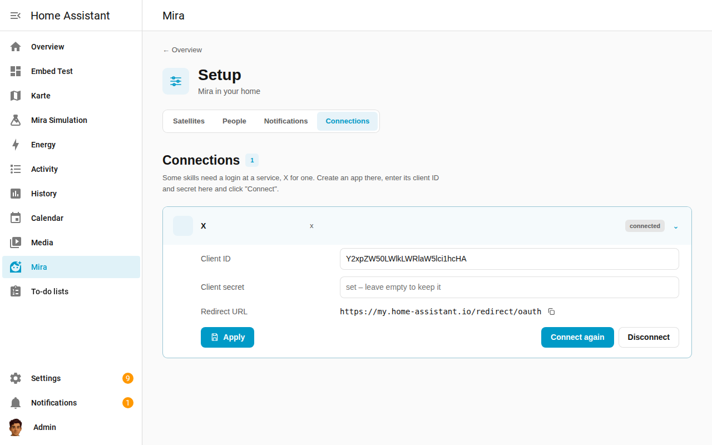

## Sport from Strava

Mira reads your activities from Strava: "How was my last ride?", "How far did I ride this week?", "How long is my streak?", "How many kilometres does my bike have?", "How many kilometres are on my running shoes?", "What are my best efforts?". She only reads, she enters nothing, and she remembers none of it; she looks again for every question. The streak counts the weeks in a row with at least one activity.

**Good to know:** since June 2026 Strava no longer allows data from its interface to be given to an AI (except to its own access for Claude and Gemini). Mira cannot use that access, Strava does not admit her there. The skill therefore goes through a Strava app of your own, and you use it at your own risk: Strava could block the app.

**Setting it up:**
1. On strava.com under Settings → **My API Application**, create an app (Strava needs a subscription for that). Under "Authorization Callback Domain" enter exactly `my.home-assistant.io`, without `https://` and without a slash. Home Assistant needs [My Home Assistant](https://my.home-assistant.io) with your instance's address for this.
2. Switch on the skill `strava`: Mira → Capabilities → Skills → strava → **Switch on**.
3. Mira → Setup → **Connections**: enter the app's client ID and client secret, **Apply**, then **Connect**. Sign in at Strava and **Authorize**; leave every box ticked, including the one for activities.

A new Strava app can read only your own account. The kilometres per bike or shoe count only activities that have the bike or the shoe set as gear in Strava.

## What's on YouTube

"What's trending on YouTube?", "What's new about Home Assistant on YouTube?", "What did @heise upload?" Mira looks on YouTube and tells two or three videos in a sentence each: by whom, what it is about going by the title, how long ago. What is said in a video she does not know; YouTube does not give it out. Since 2025 YouTube has no general trends any more, only charts for music, films and gaming.

**A list on your topics:** in the skill's **Scheduled jobs**, **New job** makes a list: a name (such as "morning"), your topics under `themen`, say "Home Assistant Voice, local AI", who gets the list under `empfaenger`, and the time. Mira then puts together the new videos since the last run on these topics and leaves out what does not fit. The list comes with the links to the recipient's phone (Telegram, say); without a recipient a short sentence goes to the house. For other topics in the evening, make a second job.

**What it costs:** nothing. YouTube allows a Google project about a hundred searches a day; charts and channels cost almost nothing. When the quota is used up, Mira says so.

**Setting it up:**
1. In the [Google Cloud Console](https://console.cloud.google.com/) create a project and enable the **YouTube Data API v3**.
2. Under **Google Auth Platform**: under **Branding** enter a name and your e-mail; under **Audience** choose the type "External" and **Publish app**; under **Data access** add the scope `…/auth/youtube.readonly`. If the app stays in testing, you have to add yourself as a test user under **Audience**, and the sign-in runs out after seven days.
3. Under **Clients** create a client of the type **Web application**, with the redirect URI `https://my.home-assistant.io/redirect/oauth`. Home Assistant needs [My Home Assistant](https://my.home-assistant.io) with your instance's address for that.
4. Switch on the skill `youtube`: Mira → Capabilities → Skills → youtube → **Switch on**.
5. Mira → Setup → **Connections**: enter the client ID and client secret, **Apply**, then **Connect**. Google warns that the app is not verified; **Advanced** goes on. Mira may only read.

## Shopping at REWE

"Bestell den Einkaufszettel bei REWE." – "Pack noch Butter zur REWE-Bestellung." – "Wann kommt die REWE-Lieferung?" Mira fills a basket at REWE's delivery service (or your market for pickup) from your shopping list in Home Assistant, picks a delivery slot and orders after you said yes. She can add to an open order while REWE allows it. REWE is a German supermarket chain; the skill speaks German.

**How an order goes:**
- For each entry Mira first takes your matching **favorite** at REWE, else the product you bought most often, else a clear hit of the search. With "Milch" on the list, your favorite milk goes into the basket. When something is unclear she asks briefly; what she does not find she names at the end.
- Below the minimum order value she says how much is missing and does not order.
- When the house remembers a delivery day ("REWE soll donnerstags liefern"), she takes the next slot on that day.
- Then she asks once, with the total, the slot and the payment method. Only after your yes she orders. Afterwards she checks off on the list what was ordered; the rest stays.

**Who may order:** everyone who talks to Mira, after a yes. Mira does not check who speaks. Whoever logs korb in at REWE trusts Mira with the account. The order is guarded all the same: korb never orders above your **limit**, never with another total than the one Mira said, and only with a payment method that needs no confirmation in a browser. You can cancel an order at REWE until shortly before delivery.

**Good to know:** Mira uses [korb](https://github.com/miraassist/rewe-cli), an open program for the REWE app's interface. REWE offers no official access for it; the interface may change, and REWE may block such programs. You use the skill at your own risk.

**Setting it up:**
1. In the REWE app, set a **delivery address** and a **payment method without confirmation**; today that is PayPal direct debit ("PayPal-Einzugsverfahren").
2. Switch the skill `rewe` on: Mira → Capabilities → Skills → rewe → **Switch on**, with the **limit** in euros (e.g. 150). When your shopping list is not the list "Einkaufsliste", enter its name under **liste**. At the next start Mira downloads korb herself and checks it.
3. On the skill's entry under **Set up**:
   - **Bei REWE anmelden** shows a link. Open it in **Chrome** and sign in with your REWE account. At the end Chrome cannot open the address `de.rewe.app://redirect?…`. Open the developer tools (F12, tab **Console**) and copy the address from the line "Failed to launch …".
   - **Anmeldung abschließen**: paste the copied address, within 30 minutes.
   - **Lieferdienst suchen** with your postcode, then **Lieferdienst wählen** with its id and the same postcode (or the id of a market for pickup).
   - **Stand prüfen** says whether everything is ready and what is missing.

The login normally lasts. When it is missing, Mira says so when you want to order, and you log korb in again under **Set up**. Whoever prefers to build korb or to log it in on a computer enters the path of their own korb under **programm**; korb's login is then still in the skill's folder the entry shows.

## Keeping an eye on a flight

"When does LH 123 land?" – "Keep an eye on Grandma's flight LH 123." – "Is the flight delayed?" Mira tracks a flight, tells you the expected arrival and a delay, and once it has landed the house gets a message by itself ("Der Flug LH 123 aus Rom ist gelandet in München."). After that she no longer tracks it. A flight number has no date: it means the flight in the air now, or the next one by plan. Mira knows no gate, only the terminal. The skill speaks German.

The data comes from Flightradar24 through an integration from HACS. It needs no account, but it uses no official access: Flightradar24 may slow it down or change it.

**Setting it up:**
1. In HACS install the integration **Flightradar24**, restart Home Assistant and add it under Settings → Devices & services → Add integration (place and radius do not matter for Mira).
2. Switch on the skill `flug`: Mira → Capabilities → Skills → flug → **Switch on**. At her next start Mira creates the script "Mira Flug" and the automation "Mira: verfolgter Flug gelandet". If any of it fails, Settings → Repairs shows "The skill flug is not running" with the reason. The script is meant for Mira only: she uses it when a question is about a flight. If you expose it to Assist yourself, Mira and Assist have it at every question, also without the skill and its instructions.

## Adding new devices

▶ [Explainer video: Adding new devices (0:41)](https://mira-assist.com/videos/erklaer/geraete-einbinden-en.mp4)

▶ [A temperature sensor joins the house by voice: pairing, room, name](https://youtu.be/K1LEZiy7XTM)

▶ [A Shelly joins the Wi-Fi by voice: hand-over, room, name](https://youtu.be/SyKFBLzfPkY)

▶ [A Matter plug by voice: the QR code scanned, plugged in, room, name](https://youtu.be/xO_4xwkGXZo)

Mira adds new devices by voice: she brings them into the network, asks for the room, proposes a name and exposes their values to voice, so you can control them or ask about them right away. The name goes for the entities in Home Assistant too: `switch.shelly1pmmini_348518e056a8` becomes `switch.fridge`. There are four ways.

**While Mira waits** for a device to be there, her satellite shows it: on an Echo Show a turquoise ring runs down in a minute, with "Waiting for your device …" under it; on an Echo the light ring runs down in turquoise, without a sound. When the minute is over and Mira still waits, it starts again. It stops as soon as Mira speaks up or you say "cancel". When Mira speaks or you say the wake word, the ring pauses and goes on afterwards.

### Zigbee devices

"I have a new Zigbee device." Mira asks whether to start adding it and then tells you to hold the button on the device for a few seconds until it blinks quickly, or to plug it in again. When the device joins, she says briefly that she is getting to know it; with battery devices that can take up to two minutes, and pressing its button now and then helps. As soon as the device is there, she speaks up at the same satellite by herself: "Got it: a plug with power metering from IKEA. Which room does it go in?" – "Living room." Then she proposes a name ("Plug living room"), and on your yes the device is done.

- It works with [Zigbee2MQTT](https://www.zigbee2mqtt.io) (with its Home Assistant integration) and with ZHA, Home Assistant's own Zigbee. With both, Mira asks which network the device goes into.
- One device at a time; for the next one you say again that you have a new one.
- If nothing comes up for three minutes, Mira asks whether to try again. A device that is already added she recognizes, and names its name and room.
- "Cancel" ends adding at any time. Pairing works only at a satellite, where Mira speaks up once the device is there.

### Matter devices

"I have a new Matter device." A Matter device brings its setup code with it: the QR code on the device or its sticker, and eleven digits beside it. At an Echo Show Mira reads the QR code with its camera ("hold the code up to the camera"). At a device without a camera you read the eleven digits out; she checks them at once and tells you when a digit does not fit.

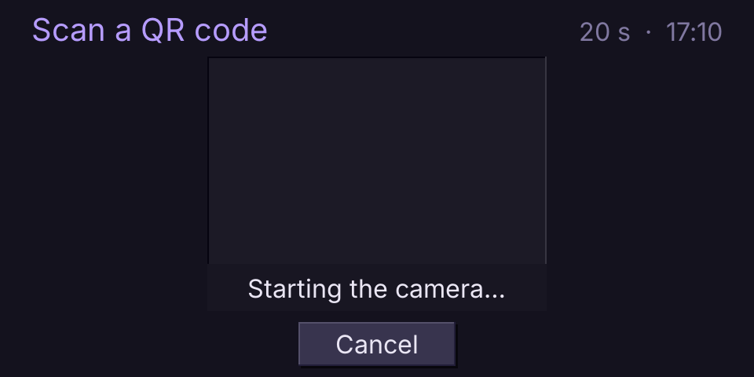

With a code that fits Mira says: "Put the device into pairing mode now, as its instructions say." Mostly that means plugging it in or putting the battery in. She looks for it over Bluetooth for three minutes, gives it your Wi-Fi or your Thread network – she works out herself which one the device speaks – and speaks up as soon as it is there — then it goes on with room and name as every device does.

- **What works:** Matter devices over Wi-Fi and over Thread.
- **The device must be ready to be added:** factory new or reset. If Mira finds nothing, she says so and what helps: hold its button until it blinks, then tell her.
- **Close enough:** the machine Mira runs on talks to the device over Bluetooth. Too far away and she does not find it.
- Home Assistant needs its **Matter integration** with its Matter server for this; your Wi-Fi goes to the skill's settings (below).
- **For Thread devices** Home Assistant also needs a border router and with it a Thread network, for example through the [OpenThread Border Router](https://www.home-assistant.io/integrations/otbr/) integration; how is told under [Thread](https://www.home-assistant.io/integrations/thread/). With several Thread networks Mira takes the preferred one.

### Devices Home Assistant found

Home Assistant finds a lot by itself: a Hue Bridge or a Shelly in the network, a Bluetooth sensor, a lamp you paired in its maker's app. Mira puts each new device into her message, as she does with mail and recordings on the answering machine: the ring lights up, the screen shows that a message waits. Then ask "Do I have new messages?", or Mira mentions it in passing. She names what she found and offers to add it: "I found a Hue Bridge. Shall I add it?" With several devices she asks whether to add all or which ones; if something else waits too, say mail, she first asks what to start with. If you say yes, she leads you through what Home Assistant needs ("Press the button on the bridge"), and then the room and the name follow.

- **No, ignore it, that's the neighbour's:** Mira never names it again. In Home Assistant a discovered device is then under "Ignored", a device without a room has the label "Mira: ignoriert"; that is where you undo it.
- **Not taken up:** the device waits in the message for a day; after that Mira no longer names it by herself. "Any new devices?" names everything still waiting.
- Several at once (a bridge with twenty lamps) are in the same message, each device on its own.
- Bluetooth beacons the iBeacon integration only sees passing by (such as a speed camera warner in a car on the street), Mira does not name.
- If a device needs details such as a key or a password, Mira tells you it is done in Home Assistant under Settings → Devices & services → Discovered. Only your Wi-Fi she fills in herself, once you gave it to her (below).

### Wi-Fi devices

"I have a new Shelly." A new Wi-Fi device opens a Wi-Fi of its own for its setup. Mira looks for it with the Wi-Fi of her machine, gives the device your Wi-Fi and speaks up once it is in your network: "Shelly Plus 1 is in the Wi-Fi now. Shall I add it?" Then the room and the name follow as for every device.

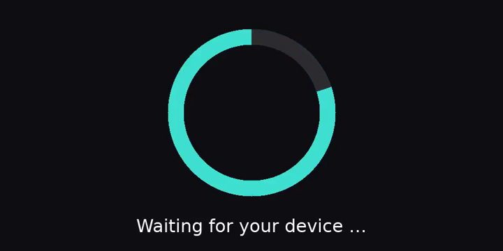

- **Works with:** Shelly (all generations), Tasmota, WLED and ESPHome devices with an open setup Wi-Fi. Tried are Shelly and Tasmota.
- **Not with:** devices set up only through their maker's app (Tuya, Smart Life, Meross and the like). A device already in your Wi-Fi is found by Home Assistant itself, and Mira tells you as above.
- **Not in setup mode?** Mira tells you how to start it: a new Shelly is in it already, else hold its button for 10 seconds; a fresh Tasmota for three minutes after plugging it in.
- Mira's machine needs **Wi-Fi and a cable** for it: it is in the network by cable, and its Wi-Fi may be free or connected. Mira borrows the Wi-Fi for the minute of the hand-over; afterwards the machine connects again as before. When the machine is in the network by Wi-Fi only, it does not work.
- Mira never says your Wi-Fi password and gives it only to the device you are adding.
- Home Assistant finds Tasmota over MQTT; for it Mira needs the MQTT broker too.

### Setting up

Switch on the skill `geraet-einbinden`: Mira → Capabilities → Skills → geraet-einbinden → **Switch on**. There you also enter your Wi-Fi (name and password) and, for Tasmota, the MQTT broker. Or in `mira.yaml`:

```yaml
skills:
  geraet-einbinden:
    wlan_ssid: MyWiFi
    wlan_password: ${WLAN_PASSWORD}
    # Tasmota only:
    mqtt_host: 192.168.1.10
    mqtt_user: mqtt
    mqtt_password: ${MQTT_PASSWORD}
```

On an Echo Show Mira switches video playback on for the ring when it is off ("Video" at the device in Home Assistant).

**As the HA app** Mira needs nothing more: she uses the Wi-Fi of the machine Home Assistant runs on, through the Supervisor.

**As a container** Mira needs the machine's network and access to its NetworkManager for Wi-Fi devices:

- `network_mode: host` (already in the `compose.yaml` under "Setup"),
- the volume `/run/dbus/system_bus_socket:/run/dbus/system_bus_socket`,
- the right to manage networks. There are two ways: Mira runs as `root` (the container's default, as in the `compose.yaml` under "Setup"), then she has it. Or she runs as another user, such as with `user: nonroot`; then that user must be allowed to manage Wi-Fi, through a polkit rule that allows the actions `org.freedesktop.NetworkManager.*` to it or to one of its groups. The group `netdev` alone is not enough on Ubuntu.

Without Wi-Fi access the other three ways still work.

Z-Wave does not work with it yet.

## Looking things up and hard questions

▶ [Explainer video: News and web search (0:39)](https://mira-assist.com/videos/erklaer/nachrichten-websuche-en.mp4)

Mira looks up on the web what she cannot know: opening hours, results, news. She sums it up briefly and says so when she found nothing reliable. She treats what is on the web as information, never as instructions.

The search is built in and needs no setup. You can switch it off under Settings → Devices & services → Mira → **Configure** → **General** → **Web search**, for instance if you use another search (see "More tools over MCP").

Elaborate questions – explanations, comparisons, weighing options ("Explain to me how a heat pump works") – Mira hands to the strongest model of your setup with the bundled skill **Nachdenken** ("think it over") and sums up the result for you. Which model that is, `mira.yaml` says under `agents` for `delegate` (see "Several models"); without an entry it is `main`. The model can look things up but change nothing in the house. If it takes longer than a few seconds, Mira comes back with the answer as a message. The skill is on without an entry; `nachdenken: { enabled: false }` under `skills` switches it off.

## Reminders, timers and alarms

- "Remind me tomorrow at 7 pm to take out the trash."
- "Set a timer for 10 minutes." – "Remind me about the laundry in half an hour."
- "Which reminders do I have?" – "Delete the laundry reminder."

At the time you chose, Mira speaks the reminder in the room where you asked for it – even during quiet hours, since you picked the time. Reminders set on Telegram or in the companion app come to you privately over your channels.

**Alarm clock**: "Wake me tomorrow at 6" – "Wake me on weekdays at half past six" – "Wake me at the usual time", if Mira knows it. The alarm rings on the satellite where you asked, on the device itself: snooze and stop work there as usual, and it rings even when Home Assistant is down. Mira does not ask back but says what she set; if she misheard, just say "No, half past six". This works on satellites that have alarms, such as an Echo Show with TECHO5; on others Mira says it cannot.

## Messages to others

- "Tell Anna I'll be late." – Anna hears: "Ben asks me to tell you: I'll be late."
- "Leave a note for the house: the chimney sweep comes at 10." – whoever next comes into a room hears it (or the indicator shows it).
- "Remind Ben tomorrow at 7 to take out the trash." – a message that is only delivered then.
- "Send that to my phone." – it comes over your channels.

A message to a person goes over their channels (Telegram, companion app), at a satellite only when they are recognised there. Each person sets whose messages they take: everyone, only persons Mira recognises, or nobody; Mira's own messages (tasks, reminders, warnings) always arrive. Someone who leaves a message in the living room without being recognised appears as "someone in Living room". The sender never learns whether a message was heard.

A message for the house that you leave at a satellite is not announced or shown in that same room for ten minutes: you are standing there. All other rooms get it at once. You set the time in Home Assistant under "Configure → General"; 0 means no waiting. Urgent messages and reminders are not affected.

A **broadcast** ("Tell everyone dinner is ready") is something else: it goes out on all satellites at once and is not kept.

## And of course: controlling the house

- "Turn on the light in the living room." – "Dim the floor lamp to 30 percent."
- "How warm is the bathroom?" – "Which windows are open?" – "What's the weather tomorrow?"

Mira always fetches values fresh instead of guessing. If she cannot check something, she says so honestly.

**Confirming important actions**: locks, the alarm system and everything that carries the label "Mira: confirm first" in Home Assistant (such as the garage door) Mira only operates after you explicitly say "Yes" to her question.


## What happened? Questions about the past

- "When was the bathroom window open today?" – "When was the front door last unlocked?"
- "How long did the washing machine run yesterday?" – "How warm was it outside last week?"

For this Mira reads the history from Home Assistant and works out the times herself. You can ask about the last 31 days. For readings such as temperature or power, older values are coarser, by the hour say; Mira then says so. A washing machine that only has a power meter, Mira recognises by when it draws more than a few watts.

**Older on/off states:** Home Assistant keeps the history of switches, doors, windows and lights for 10 days only. If you want to ask further back, set Home Assistant to keep it longer (in `configuration.yaml`: `recorder:` with `purge_keep_days: 31`). Home Assistant's database then grows accordingly.

## Timer

"Set a timer for 10 minutes for the pasta." – "How long is left?" – "Five more minutes." – "Pause the timer." – "Cancel the timer."

These are Home Assistant's own timers, and they run on the satellite you speak to: it counts down, shows what is left (the Show on its screen), rings, and you stop it with "stop". Mira builds no timer of her own, she uses the tools Home Assistant gives its voice assistants for it. Several timers are told apart by name ("the pasta timer"). On a device without timers, such as Telegram, Mira says so honestly.

A **reminder** ("Remind me in an hour about the laundry") is something else: Mira then tells you the text.

## Sleep timer

"Sleep timer 30 minutes." – "Turn the music off in half an hour, and the light too." – "Ten more minutes." – "Never mind, cancel." – "Which timers do I have?"

After the time the playback in the room stops (audiobook, radio, music), and on request the light goes off too. A second sleep timer in the same room replaces the first. You can have at most ten open timers per person and room.

The timer runs in **Home Assistant**, not in Mira: it is created there as a one-time automation with the label "Mira: once" and removes itself after it ran. If Home Assistant is off at the time, it catches up at start, so the light does not burn all night. The speaker and the light have to be exposed to Assist. A timer never switches locks, the alarm system or the garage door.

## Scenes and scripts from Home Assistant

Scenes ("Good night", "Home cinema") and scripts that you made in Home Assistant and exposed to Assist can be started by Mira:

- "Good night." – "Turn on the Home cinema scene." – "I want to fall asleep to rain."

How Mira picks the right routine depends on two things in Home Assistant:

- **The name** should say what happens: "Good night", "Home cinema", "Sleep with rain".
- **For scripts, the description** (`description` in the script): one sentence on what it does, for example "Plays soft rain sounds for falling asleep on the Show in the living room." Mira reads that sentence. Without it she only has the name, and for a request such as "Play rain sounds" she may guess wrong and look for a radio station instead.

For scenes the name is enough. Important actions (locks, alarm system, garage door) inside a routine still ask for confirmation, as everywhere.

## Mira in Home Assistant

Mira is in Home Assistant's sidebar. You are signed in there already, she looks like your HA theme (light or dark) and speaks your HA language; this works from away in the companion app too.

The **Overview** shows four cards. Each says briefly what is going on and leads to its pages:

- **Day to day**: **Messages** (see open and delivered ones and mark them done), **Tasks** (on/off, dry run, log, delete, "Edit in Home Assistant"), **Plans** (running step-by-step runs such as a recipe) and **Memory** (the house's and your own; edit, forget, export and import as a file).
- **Setup**: **Satellites** and **People** (all of them from Home Assistant, with what Mira needs on top; see below), **Notifications** (quiet hours, pauses, escalation, confidential and urgent messages) and **Connections** (sign-ins at services that skills need, X for one).
- **Capabilities**: **Skills** (which run, with settings, scheduled jobs and instructions; under **Try it** admins call one of the skill's tools themselves), **Schedules** (what Mira does by herself and when, with the last run; see "Schedules"), **Agents** (Mira's own and yours, with model and who calls them, the latest runs below) and **Models** (which ones Mira uses; **Check now** sends a real small request and shows whether and how fast the model answers) and **Rules** (your own rules; see "Rules of your own").
- **Guide**: this page, with jumps to the main chapters.

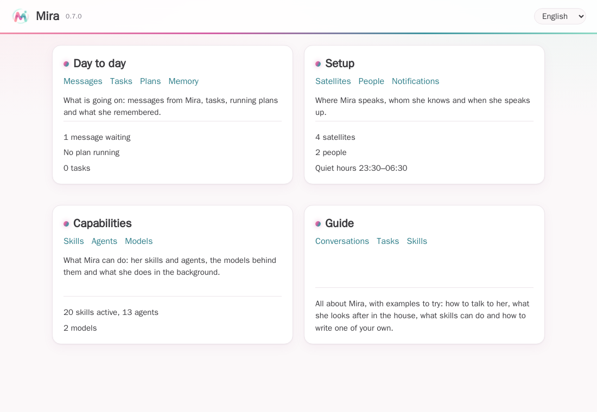

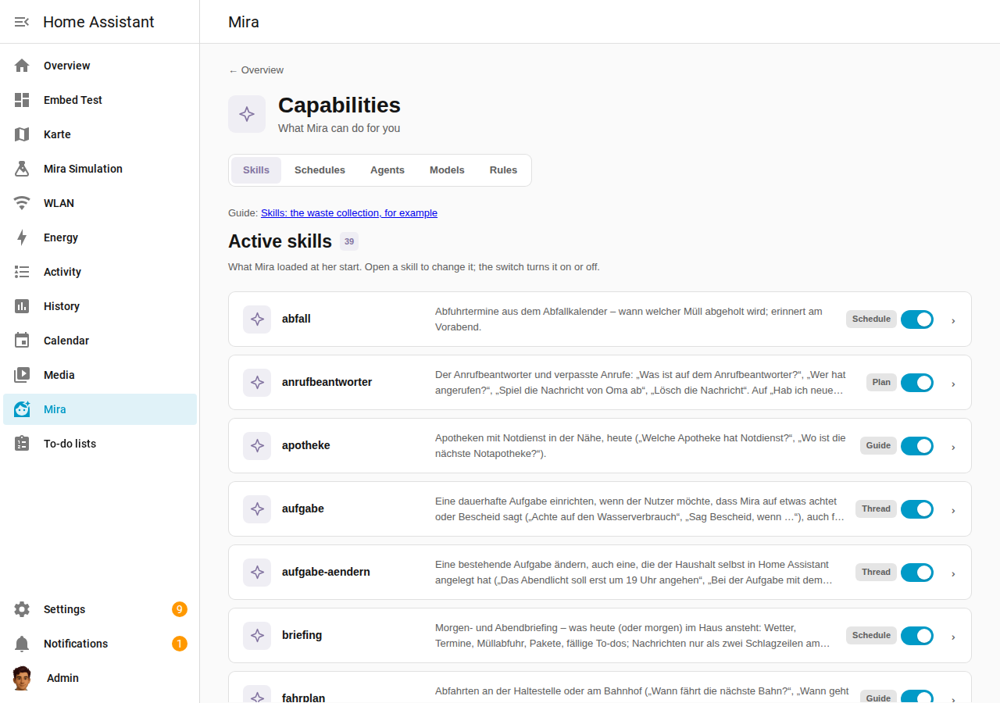

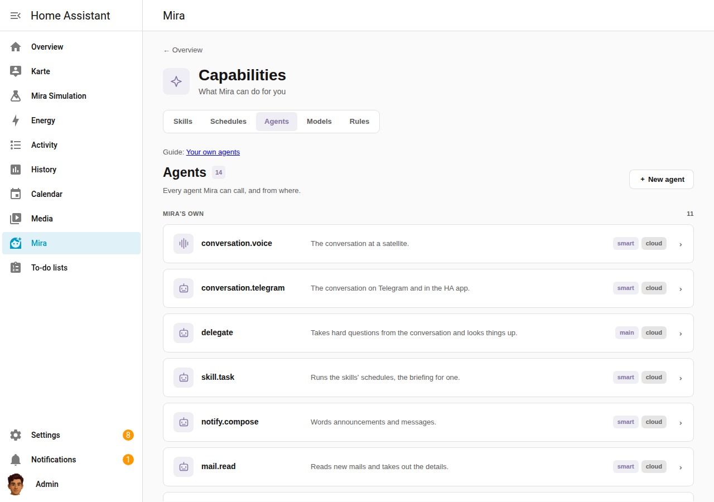

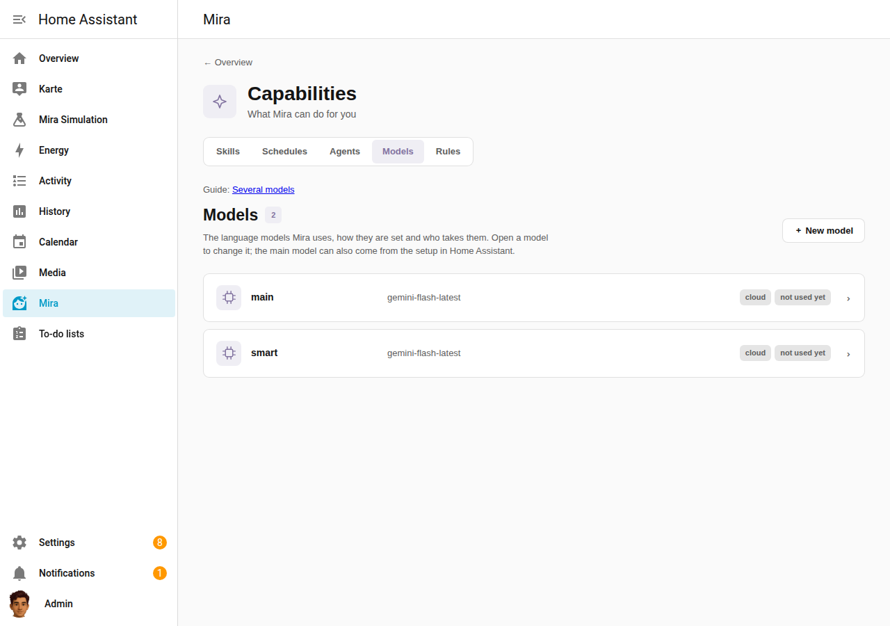

**The lists**: every page shows its entries as cards that start closed. A click opens a card, and what can be changed is right there to change; **Apply** saves it. Skills and tasks have a switch on the right for on and off, without opening the card. A fact in the memory opens as a text field; satellites and people save only the one entry.

**Changing things on the page** (admins only): under **Capabilities** you open a model, an agent or a skill and change it right there; **New model** and **New agent** add one.
- For a model you pick the **Provider** (OpenAI, Google Gemini, OpenRouter, Mistral, Anthropic); Mira knows the address. For a local model or another server, pick **Own server** and enter the address. With the token Mira fetches the list of models and you pick one. Mira tries it at once and fills in the context size; a wrong key is shown right below it.
- The page writes straight into `mira.yaml` and changes only the entry in question; comments stay. What is in the file holds, whether written by hand or by the page.
- Keys (tokens) do not go into `mira.yaml` but into a file of their own in the data folder that only Mira can read; `mira.yaml` has only a reference such as `${MIRA_MODEL_SMART_TOKEN}`. If you set `MIRA_SECRET_KEY` (in the compose file, say), Mira encrypts that file.
- A model an agent still takes and an agent someone still calls cannot be deleted; `main` can be neither renamed nor deleted.
- Skills: switch on, switch off and set them up, with **Test connection** for a skill with an MCP server. For your own skills also the instructions, agents, thread and MCP server; an update replaces the bundled skills, so for those only the settings.
- Changes to models, agents and skills hold after a restart; the page offers **Restart Mira** for it.
- **Notifications**, and without the integration also **Satellites** and **People**, the page writes into `mira.yaml` too, only what differs from the defaults. That holds at once, without a restart. What the integration manages stays in Home Assistant and does not go into the file.

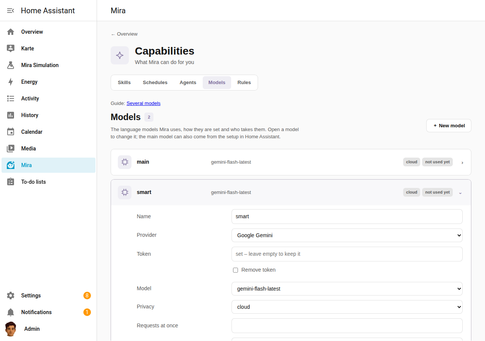

**Your card.** First on the overview is a card with your name, for everything that is yours: **Settings**, **Voice**, **Messages** to you and your **Memory**. Below it stands how many messages wait for you, how many memories Mira keeps for you and whether she knows your voice. On the card you set yourself whose messages you take and whether it is you when you are alone at home, and you enroll your voice (see "Who is speaking"). What belongs to the house is under **Day to day**: the messages to the house and the house's memory. Under Setup → **People** admins see all persons; opened, they set channels, "Alone = me" and the voice threshold there, and **Whole card and voice** opens the same card the person sees.

Someone who is no admin sees only their card, **Messages** (to the house), **Plans**, **Memory** (the house's) and **Guide**; they can mark done only messages to themselves. For Mira to know which card and memory are yours, your person must be linked to your HA user (in Home Assistant under Settings → People).

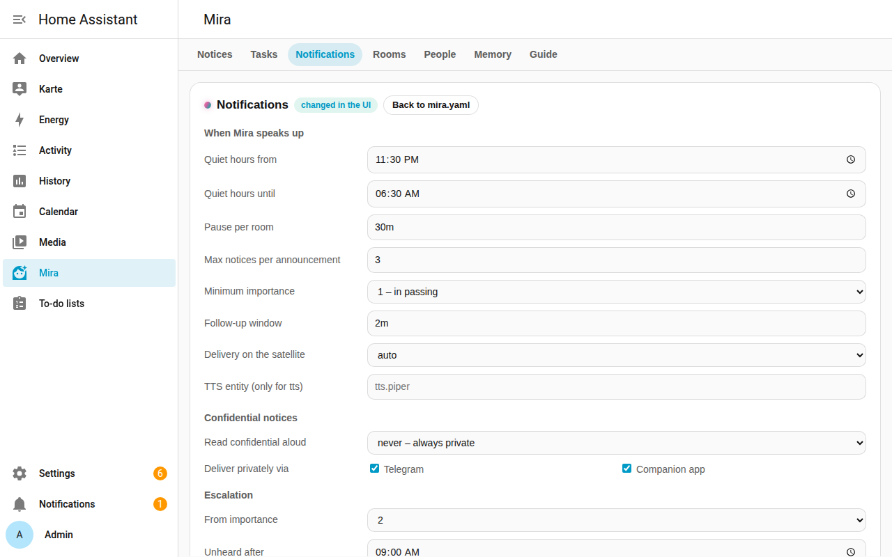

Before Mira deletes something, she asks:

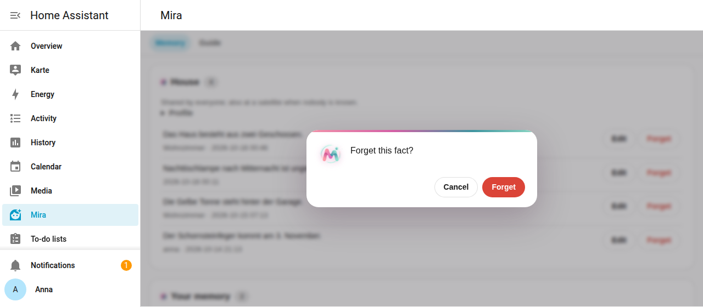

**Mira on her own**: the same interface is also at Mira herself, at `http://<mira>:8787/ui`, meant for whoever runs Mira. It does a few things differently: it comes in Mira's own colors, asks for the access token on the first visit, shows the memories of all persons, and lets you edit satellites and people there as long as the integration does not manage them.

## In Home Assistant

- **Device "Mira"** with the **Quiet mode** switch, the **Pending messages** sensor and the **Compact profile** button; the versions of the integration and of Mira are in the device info.
- Mira is a conversation agent: choose her for your satellites under Settings → Voice assistants.
- Automations can give Mira messages: with HA's own action `notify.send_message` to **Mira House** or **Mira ‹person›** (one notify entity for the house and one per person), or with `mira.send_message` when they need more (importance, confidential, expiry).
- **Mira in the sidebar** (see above). Switch it off in the integration's options; anyone can also hide it in just their own sidebar.

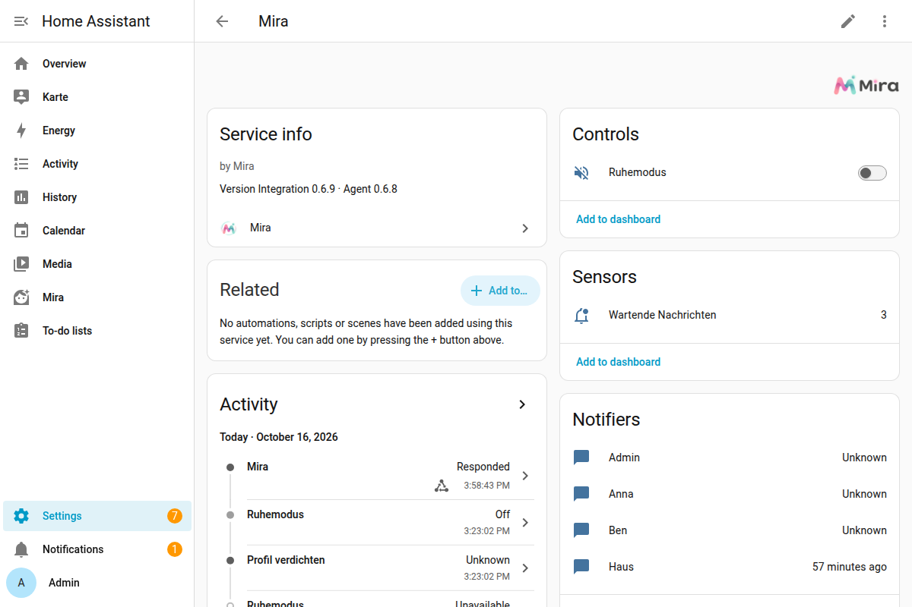

Mira knows your persons and satellites by herself; you create nothing: every person in Home Assistant is a person for Mira too, and every Assist satellite speaks in its area.

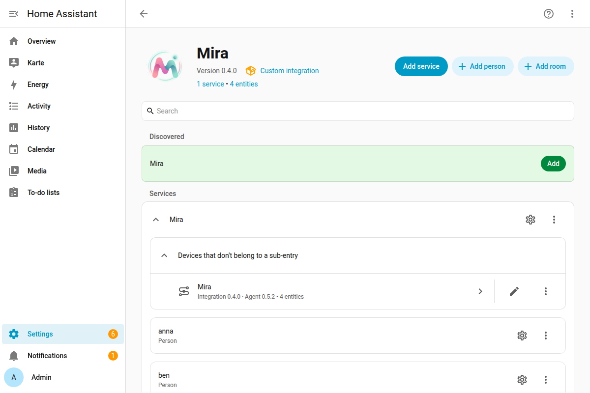

What Mira needs beyond that is easiest to set in Mira's panel under **Satellites** and **People**; the same works in Home Assistant under Settings → Devices & services → Mira → **Configure**, with a collapsible section per person or satellite. It is stored right on the person or satellite and goes away with them.

- **Settings for a satellite**: motion sensors (several too, such as hallway and living room), announce on entry, indicator (LED ring). The room is the satellite's area.
- **Several satellites in one room** (two in a large living room, say): each has its own settings. What you asked for at a satellite, such as a reminder, Mira says there; the announcement on entry comes at the satellite whose motion sensor fired; everything else, such as a message for the room, at the **main satellite**. That is the one that was in the room first; the switch **Main satellite** makes another one it. Every ring and screen in the room shows what waits.
- **A satellite without an area** has no room: you can talk to it, but Mira does not speak there on her own, its ring shows nothing, and Mira lowers no music while you talk to it. Home Assistant shows a message for it under Settings → **Repairs**, with a link to the device; give it an area there and the message goes.
- **Settings for a person**: **channels** (notify targets, e.g. the Telegram chat of HA's Telegram integration and the companion app; personal messages go to the first that works), **take messages from** (everyone, persons only, nobody) and "Alone at home, the satellites are me".

**Two kinds of notify entities:** **Mira House** and **Mira ‹person›** (`notify.mira_…`) are Mira's mailboxes. What arrives there becomes a message, and Mira decides how it gets delivered: spoken, shown or private, with quiet hours and importance. A person's **channels**, on the other hand, deliver directly, such as the Telegram chat or the companion app. Automations send to the mailboxes; as channels you enter such direct notify entities, and the choice there does not even offer Mira's own mailboxes.

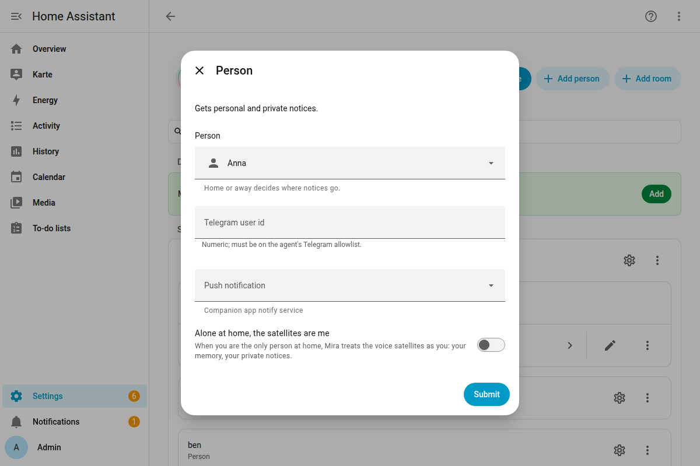

- **Personality** (under **General**): how Mira sounds, as free text: tone, humour, how short she answers device commands, a few examples of her tone. She appends it to her fixed rules; it applies to voice, Telegram and her announcements. What holds per channel (short sentences at a satellite, lists on Telegram) and which language she handles herself; that does not belong in it.
- **Confirm first**: put the label **"Mira: confirm first"** on an entity in Home Assistant, such as the garage door, and Mira switches it only after your "yes", and tasks never switch it. That holds also when you do not name it, as in "Open all blinds" or "Turn everything off downstairs". Locks and alarm panels are like that anyway.
- **Private area**: when Mira knows who is speaking (she recognizes your voice, you are alone at home, or write on Telegram or in the companion app), a conversation goes with you from room to room, plans included. Put the label **"Mira: private area"** on an area, such as the guest room, and what starts there stays in that room, and nothing from outside comes in.

In the companion app's Assist chat and in the sidebar Mira recognises you by your HA user, through the person Home Assistant links it to.

## More tools over MCP

Mira can use extra tools that an MCP server offers, such as a web search other than the built-in one. You list them in `mira.yaml` under `mcp_servers` (Home Assistant's own MCP server is always there); Mira connects at start and hands the tools to the model, prefixed with the server name (`search__…`). This works with any language model.

A server either runs on its own and is reached over HTTP, or Mira starts it as a program (stdio):

```yaml
mcp_servers:
  - name: search                   # Mira starts the server itself
    transport: stdio
    command: /usr/bin/node
    args: ["/opt/web-search-mcp/dist/index.js"]
    env: ["MAX_RESULTS=5"]         # optional
    read_only: true
    web_content: true
  - name: notes                    # runs on its own, over HTTP
    transport: http
    url: "http://localhost:9100/mcp"
    token: ${NOTES_TOKEN}          # optional
    disabled: true                 # switched off for now
```

With `tools: [name, …]` Mira takes only these tools of a server; that keeps the prompt small. Two switches decide how careful Mira is with a server:

- **`read_only: true`**: the server only reads and changes nothing. Only such tools are also available to background work (judging tasks, delegated hard questions). Without the switch the tools exist only in conversation.
- **`web_content: true`**: what the server returns is third-party text, from web pages for example, and may hide instructions. Once Mira has used such a tool, critical actions are locked for the rest of the request: everything Mira otherwise asks a yes for, such as locks, the alarm and what carries the label "Mira: confirm first".

A program Mira starts herself (stdio) gets only the bare minimum of her environment: search path, home folder, language and proxy settings. It does not get her credentials (Home Assistant token, model keys). What the server needs goes under `env`, for instance `env: ["API_KEY=${BRAVE_KEY}"]`.

New or changed servers take effect when Mira restarts. `mira check` tells whether all of them are reachable.

## Several models

▶ [Explainer video: Local or cloud? (0:54)](https://mira-assist.com/videos/erklaer/lokal-oder-cloud-en.mp4)

The integration sets up one model: in Mira it is called **`main`**, and every part of Mira takes it. If you want more, a local model for mails and a cloud model for hard questions say, add the models to `mira.yaml` under `models` and say under `agents` which part takes which:

```yaml
models:
  main:
    endpoint: http://localhost:1234/v1   # LM Studio on this machine
    model: qwen/qwen3-30b-a3b-2507
    privacy: local                       # the data stays in the house
  smart:
    endpoint: https://generativelanguage.googleapis.com/v1beta/openai
    model: gemini-flash-latest
    token: ${GEMINI_API_TOKEN}           # the key comes from the environment
    privacy: cloud                       # the data goes to the provider
    fallback: main                       # if smart fails, Mira takes main

agents:
  conversation.telegram: { model: smart }
  delegate: { model: smart }
  mail.read: { model: main, privacy: local }
  mail.match: { model: main, privacy: local }
```

- **`privacy`** must be there for every model: `local` (your own server) or `cloud` (a provider).
- **`parallel`** is how many requests a model gets at once; without it 1 for `local`, 4 for `cloud`.
- **`fallback`** names another model Mira takes when this one does not answer. If it is only busy, Mira waits.
- **If a model refuses its key or cannot be reached**, Mira says so in the conversation ("My AI model refuses my key …"), and **Repairs** names the model and the server's answer until it answers again.
- **Which part takes what:** without an entry under `agents` every part takes `main`. The parts are: `conversation.voice` (voice), `conversation.telegram` (Telegram), `delegate` (the strongest model: hard questions in the skill Nachdenken, writing rules of your own), `skill.task` (skill schedules, briefing), `notify.compose` (announcements), `tasks.assess`, `tasks.decide`, `tasks.plan` (tasks), `mail.read`, `mail.match` (mails), `inbox.read` (Mira's inbox), `profile.compact` (memory profile).
- **`privacy: local`** on a part means: it runs only on a local model, with no fallback to the cloud either. A skill can ask the same (`privacy: local` under `metadata.mira`); then Mira checks every part it uses when it starts. If something does not fit, it does not start, and Home Assistant shows under **Repairs** what to change.

What the integration sets up as the model applies to `main` before what `mira.yaml` says.

### Answers that start early

Mira hands on a spoken answer while she writes it: a long answer, a story say, starts seconds earlier. For that, the speech output and the satellite must be able to play early too (Phonon can; on a TECHO5 set the reply delivery to **Early**). Before a longer task, a search on the internet say, Mira sometimes first says what she is doing ("Let me check."). If your satellite cannot play early, everything is as before: you hear the answer in one go.

### A local model without waiting: always a warm slot

Before Mira answers, the model reads her instructions: who she is, what there is in the house, which tools she has. That is many pages. A local model remembers what it read, so every further question goes fast. But when something in the house changes (a new device, a renamed light, a restart of Home Assistant), it has to read everything again. With a local model such as Qwen 30B that takes about half a minute, and whoever asks in that time waits.

With **Warm up** (under **Models**, at the model) Mira has the model read at the start and after every change, before anyone asks. Whoever asks within exactly that half minute still waits. This works with every local model, LM Studio too.

With **Always keep a warm slot** (under **Models**, at the model; in `mira.yaml` `warm_slots: true`) the model has two places to remember. On one the previous version lies ready, and Mira answers from there. On the other the model reads the new version while it has nothing else to do. Once it is done, the two places swap. So nobody waits half a minute. Warming up happens by itself here, at the start too.

What you accept for it:

- **Twice the memory:** the model needs room for two versions, with Qwen 30B about 3 GB more.
- **Briefly the old state:** until the new version is read, about half a minute, Mira does not know a device just added or renamed yet.
- **Sometimes a few seconds:** if you ask exactly while the new version is being read, Mira interrupts the reading. That takes up to about 4 seconds.

This works only with a **llama.cpp** server of your own, not with LM Studio and not with a cloud model (there the problem does not exist). The server needs two places with a memory of their own each. Start it with:

- `--parallel 2` (two places),
- `--ctx-size` twice as large as before, for Qwen 30B about `60000`,
- **without** `--kv-unified` (otherwise the places share the memory and push each other out).

## Rules of your own

▶ [Explainer video: Ask first (1:00)](https://mira-assist.com/videos/erklaer/sicherheit-en.mp4)

Before Mira uses a tool, small rules decide whether she may: run it, ask first or refuse. Mira brings her own, such as "locks only with a yes" and "nothing critical after a web search". You see them on Mira's page under **Capabilities → Rules**, with their code.

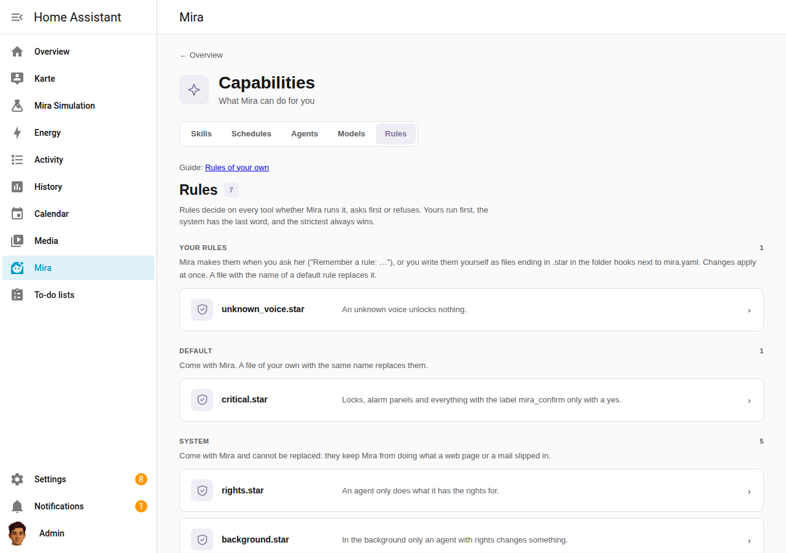

**A rule on request.** Just tell Mira what should hold: "Remember a rule: when you don't know who is speaking, you unlock nothing." A helper writes the rule, Mira tells you in one sentence what it does and asks whether to switch it on. After your yes it applies at once. Mira has not tested it, so try it once. Likewise "Which rules are there?", "Switch the music rule off for tonight" and on again, or "Delete the rule …". Anyone Mira knows can change rules, always with a yes, and never right after she read something from the web or a mail. Mira's own rules cannot be changed this way.

**Rules as files** are for the technically minded: a file ending in `.star` in the folder `hooks` next to `mira.yaml`, written in Starlark, which looks like Python (technically such rules are called hooks). Mira keeps hers there too. A change applies at once, without a restart; with the line `ACTIVE = False` a rule is off without being deleted. An example:

```python
DESCRIPTION = "An unknown voice unlocks nothing."

def pre_tool(call, verdict):
    if call.who.person:
        return None
    for e in call.targets + call.candidates:
        if e.domain == "lock" and call.tool.name == "HassTurnOff":
            return deny("Unlocking only when I know who is speaking.")
```

- Your rules run first, Mira's after them, and the strictest always wins. The only one you can loosen is Mira's default rule `critical.star` (what asks for a yes), by creating a file of your own with that name. The system rules, which guard against slipped-in instructions, always stay.
- A rule sees labels by their **id**, not by their name: the label "Mira: confirm first" is `mira_confirm`, whatever language it is named in and even if you rename it. A rule that compares the name breaks with the next rename.
- If a file does not load, Home Assistant reports it under **Repairs**, and Mira works on without it.
- What a rule sees is in the [specification](https://github.com/miraassist/mira/blob/main/docs/spec/hooks.md).

## Commands

The `mira` program has a few commands. In the container you call them with `docker exec mira /app/mira …`.

| Command | What it does |
|---|---|
| `mira run` | starts Mira (that runs in the container anyway) |
| `mira check` | checks the settings and whether the models, Home Assistant and the MCP servers can be reached |
| `mira reset` | deletes Mira's data (memory, messages, settings from Home Assistant, the AI model) at the next start; `mira.yaml` stays. Then Mira pairs like a new one, without a code |
| `mira skill NAME` | runs one of the skill's scheduled jobs right away and shows what Mira would say; if the skill has several, a number after it picks one (from 0) |
| `mira chat "…"` | one conversation turn in the terminal, without Home Assistant as the interface; `-channel voice` or `telegram`, `-session` for another turn in the same conversation |
| `mira profile` | rebuilds the memory profile from the remembered facts |
| `mira memory export [-o FILE]`, `mira memory import FILE [-yes]` | the memory as a file, as on the page; the command line sees every memory |

## Setup

You need two things:
- **A machine with Docker** in your home network. It can be the one Home Assistant runs on. With Home Assistant OS you need none: Mira comes as an app then (step 2).
- **An AI model (LLM)** Mira thinks with. Simplest is a cloud provider such as Google Gemini or OpenAI. During setup you pick the provider and enter its key. A server of your own (LM Studio, Ollama, llama.cpp) works too, but needs a strong graphics card.

You need no config file. Three steps:

**1. Install the integration.** In Home Assistant: Settings → Marketplace → **Add from link**, enter `https://github.com/miraassist/mira` as the GitHub link, **Add**. The first time, the Marketplace asks to connect GitHub: follow the link, enter the code shown, approve. Then open **Mira**, **Install**, restart Home Assistant. (Before Home Assistant 2026.11 through HACS: Custom repositories → the same address, type Integration.)

**2. Start Mira.** With Home Assistant OS as an app: Settings → Apps → App store → Repositories → add `https://github.com/miraassist/mira`, then install and start **Mira**. In step 3 Mira is then not under **Discovered**: **Add integration** → **Mira**, with the address `http://localhost:8787`.

Otherwise on the Docker machine: in an empty folder create the file `compose.yaml` and run `docker compose up -d`:

```yaml
services:
  mira:
    image: ghcr.io/miraassist/mira
    container_name: mira
    restart: unless-stopped
    network_mode: host
    environment:
      TZ: Europe/Berlin
    volumes:
      - ./config:/etc/mira     # mira.yaml, your own skills, what skills bring along
      - ./data:/var/lib/mira   # memory, messages, database
```

Docker creates the folders `config` and `data` next to `compose.yaml`. In `config` Mira's page writes `mira.yaml`; your own skills are kept there too, and what a skill brings along, such as the program for REWE.

**3. Add Mira.** Settings → Devices & services. Mira shows up under **Discovered** → **Add**. The dialog shows an overview: what is chosen and what is still missing. From there you choose, and every step leads back to the overview:
- **AI model (LLM)** Mira thinks with:
  - **OpenAI, Google Gemini, OpenRouter, Mistral, Anthropic**: your API key from the provider.
  - **Own server**: its address as Mira sees it (`localhost` is the machine Mira runs on).

  Then the model from the list. Mira tries it at once and asks the provider how much context the model has; it shows on her page under Models afterwards. If the provider does not say (OpenAI), you enter it there.
- **Use Mira in**: the assistants Mira answers in; the preferred one is already ticked.
- **Start using Mira**: shows once nothing is missing, and asks for an **access for Mira**. Mira creates your tasks and timers as automations, and in Home Assistant only an administrator may do that. You give her the access yourself: in your profile under **Security → Long-lived access tokens**, click **Create token**, name it for example "Mira", copy it and paste it into the dialog. It must belong to an administrator. Done.

If you close the dialog in between, opening it again goes on at the overview.

If Mira is not under "Discovered": **Add integration** → Mira, and enter its address, such as `http://192.168.1.20:8787`.

Then the integration sets up the rest in Home Assistant by itself:
- Home Assistant's **MCP server**, if it is missing;
- **Mira as the conversation agent** of the assistants you ticked.

Nothing happens before that. If you break the dialog off, nothing is left half set up.

What Mira may see and switch you decide under Settings → Voice assistants → **Expose entities**.

### If something goes wrong

The dialog says what is wrong, and you can correct it right there:
- **"The provider refused the key"**: check the key and enter it again.
- **"Mira cannot reach this address"** (own server):
  - Check the address as Mira sees it.
  - If LM Studio runs on another machine, switch on "Serve on Local Network" there.
  - Ollama only listens on its own machine by default (`OLLAMA_HOST=0.0.0.0` changes that).
- **"The model does not use tools"**: choose another model. Mira needs tools to switch and look things up.
- **"Home Assistant does not know this token"**: the token was not copied completely, or it is revoked already. Create a new one and paste it.
- **"This is not a long-lived access token"**: the token must be created under **Long-lived access tokens**.
- **"This token does not belong to an administrator"**: create the token in an administrator's profile.

Otherwise:
- **Mira not under "Discovered"?** Usually `--network host` is missing, or Mira is in another network. Then enter the address by hand (see step 3).
- **The dialog asks for a pairing code?** This Mira was paired with another Home Assistant. Mira writes the code into its log as soon as the integration is removed there: `docker logs mira`, for the Home Assistant app under **Settings → Apps → Mira → Log**. It looks like this: `ABCD-EFGH-JKMN`.
  - Removing the integration and adding it again in the same Home Assistant needs no code.
  - No code, because the old Home Assistant is gone: reset Mira's data, with `docker exec mira /app/mira reset` and a restart (`docker restart mira`); for the HA app with the option **Reset data** on the **Configuration** tab and a restart of the app. Memory and messages are gone then, `mira.yaml` stays.
- **Another model?** Settings → Devices & services → Mira → **Configure** → **AI model (LLM)**.
- **Repair "Mira has no access any more"?** Mira's token was revoked, or its user is no longer an administrator. Until you give her a new one, what Home Assistant refuses fails, such as new tasks and timers. Open the repair under **Settings → System → Repairs** and paste a new token, as when setting up.

**Security while setting up:** A new Mira pairs with the first Home Assistant that completes pairing, without a code. So set it up in your own home network, not in a guest or shared network. Had someone beaten you to it, you would notice at once: your dialog would ask for a code. Reset Mira's data then (see above) and set it up anew.

For advanced setups (several models, more MCP servers, skills with settings) there is the file `mira.yaml`; see [mira.example.yaml](https://github.com/miraassist/mira/blob/main/mira.example.yaml). What you set in the integration wins over the file.

### Updating Mira

Mira has two parts, both from the same release: the **integration** in Home Assistant and the **Mira service** (the HA app or your container). Both carry the same version.

- **Integration and HA app:** Settings → Updates shows both. Update the integration first, then the HA app (it restarts itself), then restart Home Assistant once. If one of the two is not offered yet, Mira makes Home Assistant look again at once; after a release the HA app often comes a few minutes after the integration. Otherwise a restart of Home Assistant helps.
- **Your own container:** in the folder of `compose.yaml`, `docker compose pull && docker compose up -d`. Your data is in the folders `config` and `data` and stays.
- **Until both match**, Settings → Repairs says which part is older. Mira keeps working meanwhile.

**Seeing the container's updates in Home Assistant:** [What's Up Docker (WUD)](https://getwud.github.io/wud/) watches your containers and reports new versions. With its MQTT trigger an update for Mira shows under Settings → Updates like the app's. Next to Mira, on the same machine:

```yaml
services:
  wud:
    image: getwud/wud
    container_name: wud
    restart: unless-stopped
    ports:
      - "3000:3000"
    volumes:
      - /var/run/docker.sock:/var/run/docker.sock
    environment:
      - WUD_TRIGGER_MQTT_HA_URL=mqtt://<your-broker>:1883
      - WUD_TRIGGER_MQTT_HA_USER=<user>
      - WUD_TRIGGER_MQTT_HA_PASSWORD=<password>
      - WUD_TRIGGER_MQTT_HA_HASS_ENABLED=true
```

Mira herself gets the label `wud.watch.digest=true` (in `compose.yaml` under `labels`: `- wud.watch.digest=true`), as her image runs without a version number. WUD then compares the image and reports when there is a new one. Everything else, updating from WUD too, is in WUD's documentation.

### Backup and restore

Mira's data goes into Home Assistant's backups (Settings → System → Backups): what she remembers, her messages and threads, `mira.yaml`, her keys (tokens) and your own skills. There is nothing to set up; it works for the app as well as for Mira in a container of her own.

- **Every backup** fetches Mira's data first. If Mira cannot be reached then, the backup is made all the same, only without Mira; Settings → Repairs then shows **Mira was not in the last backup** with the reason. It disappears with the next backup that has Mira.
- **Restore:** when you restore Home Assistant from a backup, Repairs shows **Restore Mira's data** with the backup's date. Open it and choose **Restore**: Mira takes the data and restarts for a moment. **Keep Mira as she is** leaves everything as it is. This also works with a freshly set up Mira, on a new machine say.
- **A backup of a newer Mira** is not taken: update Mira first, then it works.
- **The keys** are in the backup without encryption of their own. Home Assistant's backup encryption protects them, as it protects Home Assistant's own keys; so leave it on (it is the default). So keep Home Assistant's **backup key** safe, in a password manager say; without it no backup can be opened. You do not need `MIRA_SECRET_KEY` to restore.
- If `mira.yaml` is read only (mounted so in a container), Mira leaves it as it is at a restore and puts the backup's as `mira.yaml.restored` into her data folder, to compare.

### More access tokens

With a token of its own, another program can use Mira the way Mira's page does, one a company uses to look after Mira for you, say.

- **Create:** Mira → Setup → **Connections** → **Access tokens**: enter a name and **Create a new token**. Mira shows the token only once, in a window; **Copy and close**. Only admins can create and delete one.
- **What it can do:** everything Mira's page can, as an admin, with the house's memory, not each person's. Through Mira's interface it can also read any state in Home Assistant and call any action, with Mira's administrator rights and without asking; "Expose to Assist" and "Mira: confirm first" do not apply there. Setting Mira up anew, separating her from Home Assistant, fetching or restoring a backup and managing tokens it cannot.
- **What was done with it:** open the token. Every call is listed there with its time, user and what, except the regular status query. Mira keeps this for 90 days.
- **Take it back:** **Delete** at the token. From then on nobody reaches Mira with it.

## Security: how Mira and Home Assistant talk

- **Two keys:**
  - Home Assistant reaches Mira with an **access token**. The integration fetches it when adding Mira; you never see it. Other programs get one of their own (see "More access tokens").
  - Mira reaches Home Assistant with **the token you gave her when setting up**, so with the rights of the administrator it belongs to. The integration never makes a token itself. You can revoke it at any time under Security in the profile you created it in; Mira then asks for a new one under Repairs. If you remove the integration, the token stays until you delete it there.
  - Whoever knows an access token can do all that Mira can, including calling any action in Home Assistant through her interface. Treat it like a password.
- **What Mira does in HA:** only what her tools offer: switch devices and save your tasks and timers as automations, the way the automation editor does; she deletes only her own. She manages no users, integrations or settings. Skills may bring blueprints; from them Mira makes automations and scripts in Home Assistant. If Mira runs with a token from her `mira.yaml` (`ha.token`), it must be an admin's for tasks and timers. What she sees in a conversation, you decide with "Expose to Assist". Locks, the alarm panel and everything labelled "Mira: confirm first" she switches in a conversation only after your yes. A program with an access token goes past this (see above).
- **If Mira runs on the same machine as Home Assistant** (the usual case), everything stays on that machine.
- **If Mira runs on another machine** in your network, the connection goes through your home network unencrypted: the access token, what you say and what Mira answers. That is common in your own home network, as with many other devices in Home Assistant. A guest network, a shared network or the way over the internet without HTTPS is not the place for it.
- **If Mira gets a new address**, the integration follows her by itself, but only once Mira shows there that she knows the access token. Another device posing as Mira does not get it. So keep Mira and the integration at the same version.

## Good to know

- Mira does not make up values: if something is missing, she says so or asks.
- After a web search Mira performs no critical actions until you give the command again directly. Remembering something, sending a message or creating a task then only happens after your yes. So a web page cannot slip her anything she keeps or passes on.
- If speech recognition gets you wrong, speak clearly and in one sentence.
- A Telegram conversation goes on as long as you keep writing. Mira sees its last exchanges (about 30 to 50) and everything about the matter you are working on; older parts drop out, what she remembered stays. What Mira sends into the chat by herself (a reminder, a message) belongs to the conversation too: "What did you just send me?" works. `/new` starts over.
