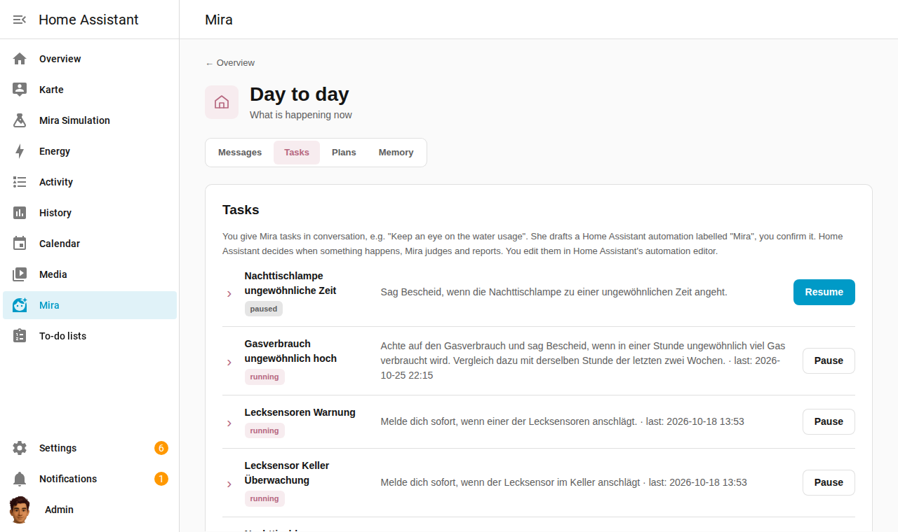
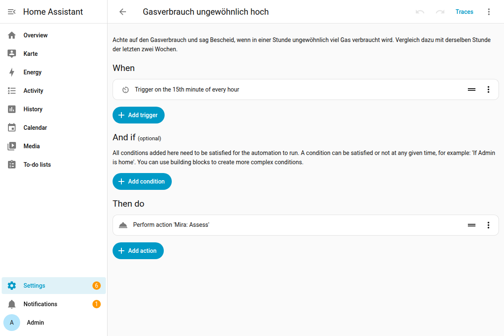
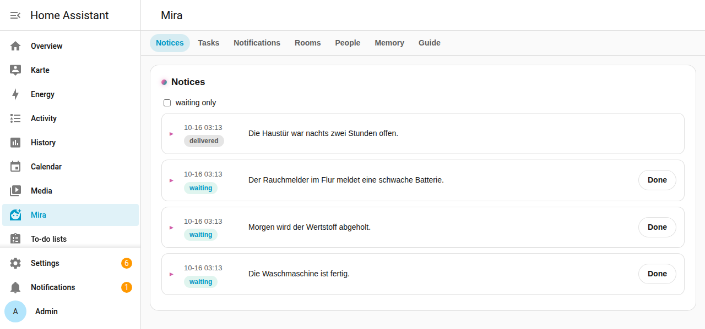
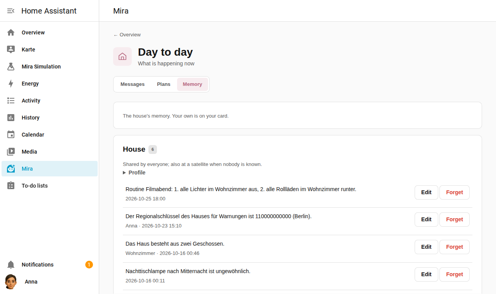
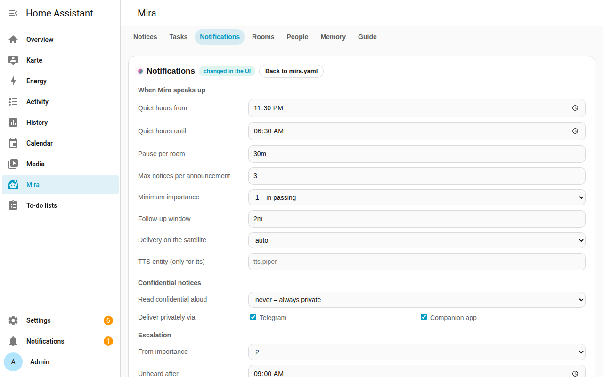
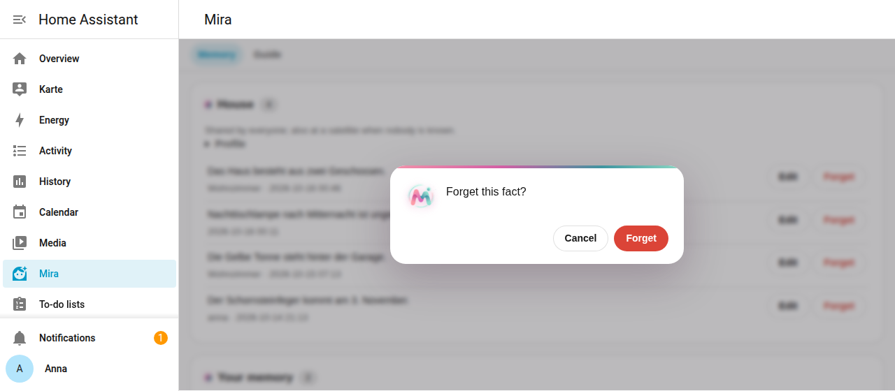
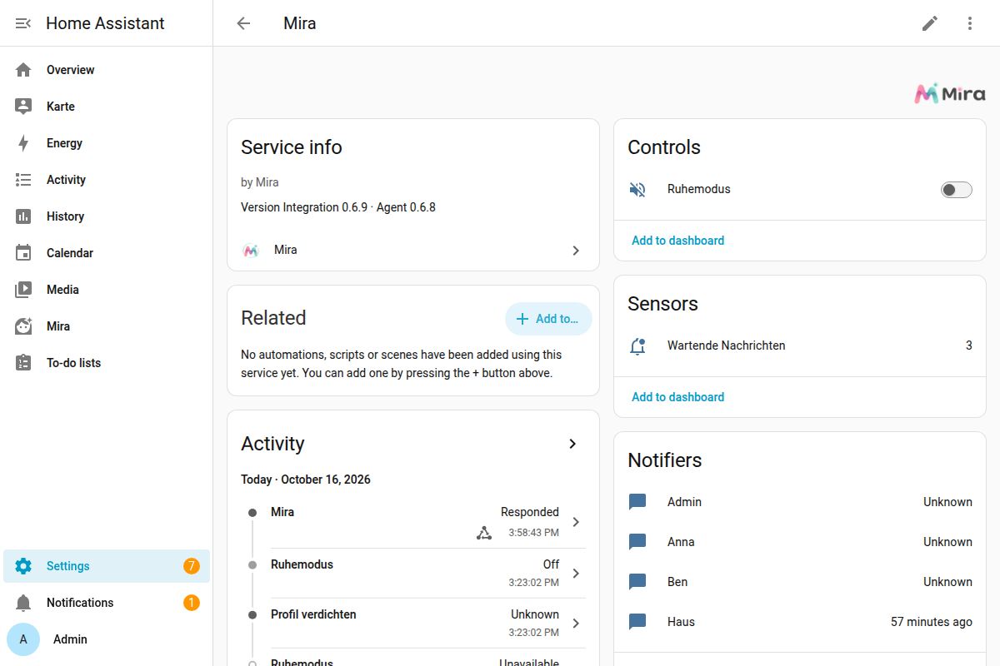
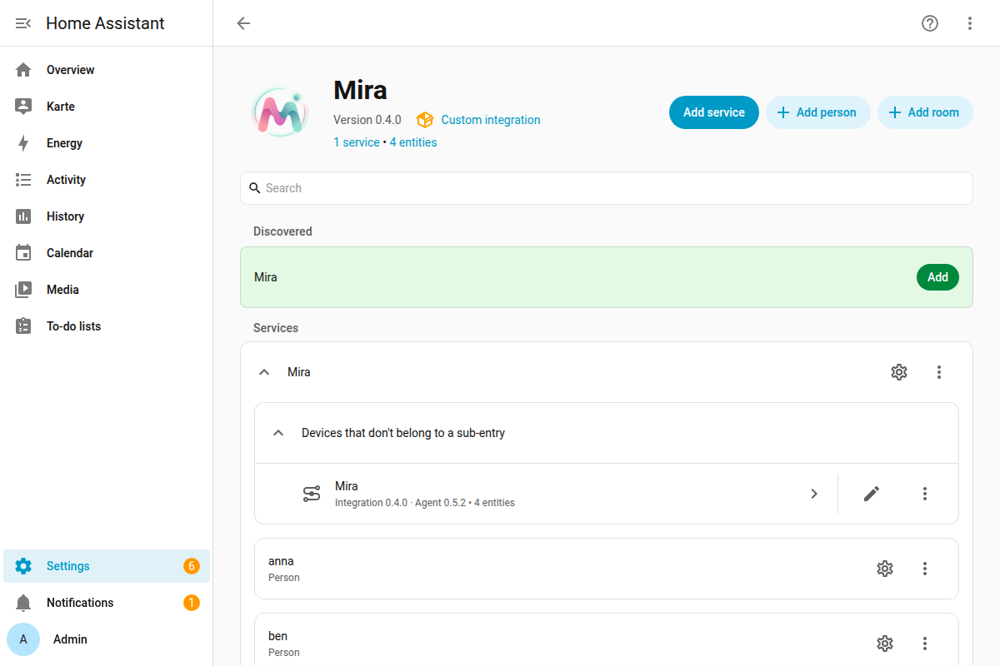
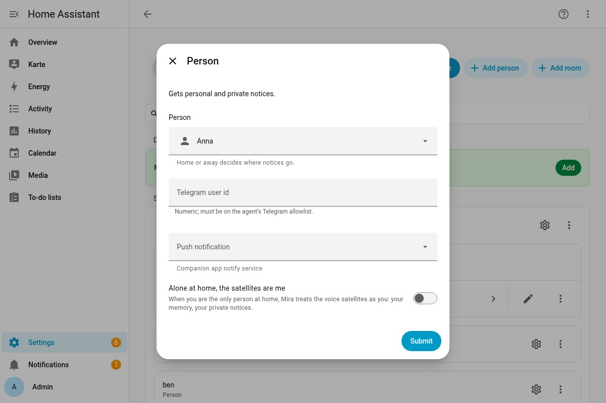

# Mira – Guide

Mira is the voice assistant as it always should have been. You talk to her like to a person: she understands what you mean, asks when something is missing, and stays on the subject, over several sentences too. She remembers what matters to you, looks things up on the internet, knows your waste collection calendar – and she looks after your home on her own and speaks up when something is up.

Home Assistant is her toolbox: lights, sensors, voice satellites. That Mira can switch on the light goes without saying. What makes her different comes first here.

## What makes Mira different

- **Real conversations.** No fixed commands. Mira asks instead of guessing and still knows in the next sentence what it was about.
- **She keeps watch.** Tell her once "Keep an eye on the water usage" – from then on she watches it and speaks up when something is unusual.
- **She speaks up at the right moment.** In the room you are in, not in the middle of the night, and urgent things at once.
- **She remembers things** – for the whole house and for everyone personally.
- **She can do more than the house.** Skills like the waste calendar, a web search, hard questions for a stronger model.

## A conversation with Mira

> 🎬 **Recording to follow:** a voice dialog at a satellite – a question Mira looks up on the internet, a follow-up, and at the end a task for the house.

This is how it sounds, for example when setting up a task:

> **You:** Let me know when the bedside lamp turns on at an unusual time.
>
> **Mira:** Which time is unusual for you, say between midnight and 6 am?
>
> **You:** Between one and four.
>
> **Mira:** My proposal: when the bedside lamp turns on between 1 and 4 am, I'll let you know. Shall I set it up like that?
>
> **You:** Yes.
>
> **Mira:** All right, the task is set up.

And with a question that has nothing to do with lights and switches:

> **You:** What gets collected next week?
>
> **Mira:** Next week the recycling is collected on Monday, the residual waste on Tuesday and the organic waste on Thursday.

## How to talk to Mira

- **By voice**: through a voice satellite (e.g. the Echo in the living room). Say the wake word and then what you want. Mira knows which room the satellite is in: "Turn on the light" means the light in that room. If her answer is a question, the satellite keeps listening.
- **On Telegram**: write to the bot you set up in Home Assistant (integration "Telegram bot"). For Mira to answer, your chat must be one of your person's channels (see below). Answers can be longer here, with lists and links. `/new` starts a new conversation.
- **In the Home Assistant app**: the Assist chat of the companion app talks to Mira too, typed or spoken.

Mira answers in the language you speak to her in.

## Mira looks after the house: tasks

Give Mira a standing task and she keeps an eye on something for you:

- "Keep an eye on the gas usage and tell me if an unusually large amount is used in an hour."
- "Tell me if a lot of electricity is used at night."
- "Speak up at once when one of the leak sensors goes off."

This is how setting one up goes:

1. If something is missing, Mira asks instead of guessing – "Which time is unusual for you?". Just answer; the conversation stays on the subject, over several sentences too.
2. Then she plans. If that is quick, she tells you the proposal right away; otherwise she says "I'll plan that" and comes back once she has finished speaking – in the same room or on Telegram.
3. The proposal says what she watches and names the condition: "When the bedside lamp turns on, I'll let you know. Condition: only between 1 and 4 am. Shall I go ahead?"
4. Say **"Yes"** and she sets up the task. "No, leave it" cancels. If nobody answers, the proposal lapses after a quarter of an hour.

When judging, Mira compares, for example, the last hour's usage with the same hour over the past two weeks, knows who is at home and what you asked her to remember, and recalls what she already said about this task. She does not report the same thing again and again, only when it gets worse.

- "Which tasks do you have?" – "Pause the gas task." – "Delete the electricity task." – "Do a dry run of the gas task."
- In Home Assistant under Mira → **Tasks** you see all tasks with on/off, dry run and the log of their judgements, plus proposals still waiting for your yes.



Under the hood every task is an ordinary **automation in Home Assistant** labelled "Mira": Home Assistant decides *when* something happens (hourly, when a sensor fires, only at night …), Mira decides *what* of it interests you. "Edit in Home Assistant" opens it in the editor; you can change it there yourself too.



Your own automations can use Mira the same way: the actions **Mira: Assess** (`mira.assess`), **Mira: Decide** (`mira.decide`, a yes/no answer for conditions) and **Mira: Send message** (`mira.send_message`). For now tasks belong to the whole house and use the house's memory when judging.

## Mira speaks up on her own

Mira speaks up when something happens: a leak sensor goes off, the washing machine is done, the bins are collected tomorrow, a task finds something unusual. How she tells you depends on the room and the importance.

> 🎬 **Recording to follow:** the LED ring pulses, you ask "Do you have a notification?", Mira reads it out.

Per satellite you set:

- **Indicator**: an LED ring (e.g. the Echo's) pulses teal while something is waiting – no motion sensor needed. A satellite with a screen like the Echo Show shows "Mira · 1 message waiting" instead as soon as something new arrives, and takes it away when everything was heard; Mira finds that out by herself. Then ask: **"Do you have a notification?"** or "Anything new?".
- **Announce on entry**: when a motion sensor notices someone entering the room, Mira says by herself what is pending; the first motion after quiet hours starts with "Good morning". Without a motion sensor, or switched off, she does not speak up on her own.

Several messages become one announcement, the most important first and with times where they help ("tonight at three …").

**By the way**: when you talk to the satellite anyway, Mira adds what is waiting to her answer – "The light is on. By the way: the recycling is collected tomorrow." After that the message counts as heard and the indicator goes off. If you ask ("What exactly?"), you get the details.

**Importance**:

| Level | Meaning | What happens |
|---|---|---|
| 1 | in passing | waits for the next opportunity |
| 2 | important today | goes out privately after 9 am if nobody has heard it by then |
| 3 | urgent | at once, even at night: announced on all satellites and privately to everyone |

When Mira speaks up on her own, the room's LED ring glows steadily while she speaks.

**Quiet hours**: during quiet hours (e.g. 23:30–6:30) Mira announces nothing – except urgent things and your reminders. LED rings still glow; what came in at night you see in the morning.

**Quiet mode**: the "Quiet mode" switch in Home Assistant turns off all announcements until you turn it off again.

**Confidential and personal**: messages can be meant for one person or be confidential. Mira reads confidential messages out only when the setting allows it (e.g. only when that person is alone at home); otherwise they go privately over that person's channels (Telegram, companion app).



## Mira remembers things

- "Remember that the chimney sweep comes in March."
- "Remember something." – Mira asks "What is it?", and you tell her in the next sentence.
- "What do you know about the chimney sweep?" – "Forget the thing about the chimney sweep."

What Mira knows she also uses when keeping watch: tell her "Remember, the bedside lamp after midnight is unusual", and her tasks judge by it.

There is one memory for the **house** and one for **each person**:

- When Mira knows who is speaking, she remembers it for that person. It goes into the house's memory only when you say so ("remember for the house …").
- Mira knows who is speaking on Telegram, in the HA app's chat (through your HA user), and at a satellite only when you are alone at home and switched that on for your person ("Alone at home, the satellites are me"). Otherwise a satellite is the house.
- Your personal memory is only seen by Mira when talking to you. The house's memory is for everyone.
- Nobody writes into someone else's memory.

At night Mira condenses each memory into a short profile. In Home Assistant, under Mira → **Memory**, you see the house's memory and your own, with who said it and when, and can edit or forget facts. Nobody sees the others' memories there, not even an admin.



## Skills: the waste collection, for example

Skills are extra abilities the setup switches on. Mira opens a skill only when a question needs it.

**Waste**: Mira knows your waste collector's calendar. It is a calendar in Home Assistant (for example through the "Remote Calendar" integration with your collector's iCal link); in `mira.yaml` the skill `abfall` names it.

- "When is the residual waste collected?" – "What gets collected next week?"
- On the evening before, Mira reminds you on her own: "The recycling is collected tomorrow."
- If the collection is today, she says so in case the bin still has to go out.

> 🎬 **Recording to follow:** "What gets collected next week?" at a satellite.

## Creating your own skill

A skill is a folder with a file `SKILL.md`. It holds instructions for Mira, optionally with settings and schedules. A skill runs no program code; it only tells Mira what to do, when and with what, using the tools she already has (reading calendars, messages, controlling the house and so on).

**1. Create the folder.** Skills live in the skills directory, `skills/` next to Mira by default. Create a folder there. Its name is the skill's name: lower-case words with hyphens, such as `plants`. If Mira runs in a container, mount a folder of your own as a volume and add it under `skills.dirs` in `mira.yaml`. The skills that come with Mira stay available.

**2. Write `SKILL.md`.** The file begins with a header between two lines of `---`, followed by the instructions as text:

- `name`: exactly the folder's name.
- `description`: one sentence on when the skill is needed. That is all Mira sees until she opens the skill; a good sentence makes her open it at the right time.
- Optionally under `metadata:` → `mira:`:
  - `settings`: values every household fills in itself, each with a `description` (it also appears in error messages) and `required: true` if the skill cannot work without it.
  - `schedules`: jobs on a schedule. `cron` is the time (five fields, for example `0 10 * * 0` for Sundays at 10), `task` is what Mira should do then. The result is either nothing (`importance: 0`, `spoken` empty) or a short message to the house.
- The text below the header is the instruction for Mira. Where `{{name}}` stands, Mira puts in the setting `name`.

**3. Switch it on.** A skill runs only when it is listed under `skills.enabled` in `mira.yaml`, with its settings below. If it has none, the name with a colon is enough. Only the bundled conversation skills for tasks, remembering, appointments, to-dos and alarms switch themselves on.

**Example: watering plants.** The folder `skills/plants` holds the file `SKILL.md`:

```markdown
---
name: plants
description: Which plants need watering when; reminds on Sundays.
metadata:
  mira:
    settings:
      plants:
        description: The plants with their rhythm, for example "fern every Sunday, cactus on the first Sunday of the month".
        required: true
    schedules:
      - cron: "0 10 * * 0"
        task: >-
          Today is Sunday. Which of these plants need watering today: {{plants}}?
          If none: importance 0 and spoken empty. Otherwise: importance 1, and spoken
          says briefly what needs watering.
---
# Watering plants

The household's plants and their rhythm: {{plants}}

If someone asks when something needs watering, answer from this list and do
not guess. If a plant is not in the list, say so honestly.
```

In `mira.yaml` you switch it on:

```yaml
skills:
  enabled:
    plants:
      plants: "fern every Sunday, cactus on the first Sunday of the month"
```

Then restart Mira. She answers "When does the cactus need water?" from the list, and on Sundays at 10 she speaks up by herself. You can try the schedule right away with `mira skill plants`.

**When something is wrong:** Mira starts anyway; only the affected skill does not run. The log has `skill not started` with a sentence saying what is wrong, for example "The setting "plants" is missing in mira.yaml under skills.enabled". Home Assistant shows the same message under Settings → System → **Repairs**. After fixing it, restart Mira; the message disappears once the skill runs.

## Calendars and lists

Mira uses the calendars and to-do lists from Home Assistant that are exposed to Assist (Settings → Voice assistants → Expose entities). Several calendars are no problem.

- "What's on this week?" – "When is the parents' evening?" Mira reads the events briefly, by day; long descriptions only when you ask.
- "Put the dentist in for Friday at 3 pm." Mira enters it and says what she entered. With several calendars she asks once which one, and on request remembers it as your default.
- "Cancel my doctor's appointment tomorrow." Mira looks the event up and asks before she deletes it. Of a recurring event she cancels only this one, unless you want all.
- "Put milk on the shopping list." – "Add batteries, due Friday." – "What's on the list?"

## Listening to the radio

"Play SWR3." – "Turn on the radio in the living room." Mira searches the station in Home Assistant's Radio Browser, which is always there, and plays it on the room's speaker. The speaker has to be exposed to Assist (Settings → Voice assistants → Expose entities). If several stations fit, she names a few and asks which one. Louder, quieter and pause work like on any media player.

## Looking things up and hard questions

Mira looks up on the web what she cannot know: opening hours, results, news. She sums it up briefly and says so when she found nothing reliable. She treats what is on the web as information, never as instructions.

The search is built in and needs no setup. You can switch it off under Settings → Devices & services → Mira → **Configure** → **General** → **Web search**, for instance if you use another search (see "More tools over MCP").

If the setup is connected to a stronger language model, Mira hands elaborate questions over to it – explanations, planning, recipes, comparisons – and sums up the result for you. The stronger model can look things up but change nothing in the house.

## Reminders, timers and alarms

- "Remind me tomorrow at 7 pm to take out the trash."
- "Set a timer for 10 minutes." – "Remind me about the laundry in half an hour."
- "Which reminders do I have?" – "Delete the laundry reminder."

At the time you chose, Mira speaks the reminder in the room where you asked for it – even during quiet hours, since you picked the time. Reminders set on Telegram or in the HA app come to you privately over your channels.

**Alarm clock**: "Wake me tomorrow at 6" – "Wake me on weekdays at half past six" – "Wake me at the usual time", if Mira knows it. The alarm rings on the satellite where you asked, on the device itself: snooze and stop work there as usual, and it rings even when Home Assistant is down. Mira does not ask back but says what she set; if she misheard, just say "No, half past six". This works on satellites that have alarms, such as an Echo Show with TECHO5; on others Mira says it cannot.

## Messages to others

- "Tell Anna I'll be late." – Anna hears: "Ben asks me to tell you: I'll be late."
- "Leave a note for the house: the chimney sweep comes at 10." – whoever next comes into a room hears it (or the indicator shows it).
- "Remind Ben tomorrow at 7 to take out the trash." – a message that is only delivered then.
- "Send that to my phone." – it comes over your channels.

A message to a person goes over their channels (Telegram, companion app), at a satellite only when they are recognised there. Each person sets whose messages they take: everyone, only persons Mira recognises, or nobody; Mira's own messages (tasks, reminders, warnings) always arrive. Someone who leaves a message in the living room without being recognised appears as "someone in Living room". The sender never learns whether a message was heard.

A message for the house that you leave at a satellite is not announced or shown in that same room for ten minutes: you are standing there. All other rooms get it at once. You set the time in Home Assistant under "Configure → General"; 0 means no waiting. Urgent messages and reminders are not affected.

A **broadcast** ("Tell everyone dinner is ready") is something else: it goes out on all satellites at once and is not kept.

## And of course: controlling the house

- "Turn on the light in the living room." – "Dim the floor lamp to 30 percent."
- "How warm is the bathroom?" – "Which windows are open?" – "What's the weather tomorrow?"

Mira always fetches values fresh instead of guessing. If she cannot check something, she says so honestly.

**Confirming important actions**: locks, the alarm system, the garage door and the like Mira only operates after you explicitly say "Yes" to her question.

## Timer

"Set a timer for 10 minutes for the pasta." – "How long is left?" – "Five more minutes." – "Pause the timer." – "Cancel the timer."

These are Home Assistant's own timers, and they run on the satellite you speak to: it counts down, shows what is left (the Show on its screen), rings, and you stop it with "stop". Mira builds no timer of her own, she uses the tools Home Assistant gives its voice assistants for it. Several timers are told apart by name ("the pasta timer"). On a device without timers, such as Telegram, Mira says so honestly.

A **reminder** ("Remind me in an hour about the laundry") is something else: Mira then tells you the text.

## Sleep timer

"Sleep timer 30 minutes." – "Turn the music off in half an hour, and the light too." – "Ten more minutes." – "Never mind, cancel." – "Which timers do I have?"

After the time the playback in the room stops (audiobook, radio, music), and on request the light goes off too. A second sleep timer in the same room replaces the first. You can have at most ten open timers per person and room.

The timer runs in **Home Assistant**, not in Mira: it is created there as a one-time automation with the label "Mira: once" and removes itself after it ran. If Home Assistant is off at the time, it catches up at start, so the light does not burn all night. The speaker and the light have to be exposed to Assist. A timer never switches locks, the alarm system or the garage door.

## Scenes and scripts from Home Assistant

Scenes ("Good night", "Home cinema") and scripts that you made in Home Assistant and exposed to Assist can be started by Mira:

- "Good night." – "Turn on the Home cinema scene." – "I want to fall asleep to rain."

How Mira picks the right routine depends on two things in Home Assistant:

- **The name** should say what happens: "Good night", "Home cinema", "Sleep with rain".
- **For scripts, the description** (`description` in the script): one sentence on what it does, for example "Plays soft rain sounds for falling asleep on the Show in the living room." Mira reads that sentence. Without it she only has the name, and for a request such as "Play rain sounds" she may guess wrong and look for a radio station instead.

For scenes the name is enough. Important actions (locks, alarm system, garage door) inside a routine still ask for confirmation, as everywhere.

## Mira in Home Assistant

Mira is in Home Assistant's sidebar. You are signed in there already, she looks like your HA theme (light or dark) and speaks your HA language; this works from away in the app too.

- **Messages**: see open and delivered messages and mark them done.
- **Tasks**: what Mira keeps an eye on for you; on/off, dry run, log, delete, "Edit in Home Assistant".
- **Notifications**: quiet hours, pauses, escalation, confidential and urgent messages.
- **Satellites** and **People**: all of them from Home Assistant, with what Mira needs on top; as an admin you set it right here (see below).
- **Memory**: the house's and your own; edit and forget.
- **Guide**: this page.

Someone who is no admin sees only **Memory** and **Guide**. For Mira to know whose memory is yours, your person must be linked to your HA user (Settings → People).



Before Mira deletes something, she asks:



**Mira on her own**: the same interface is also at Mira herself, at `http://<mira>:8787/ui`, meant for whoever runs Mira. It does a few things differently: it comes in Mira's own colors, asks for the access token on the first visit, shows the memories of all persons, and lets you edit satellites and people there as long as the integration does not manage them.

## In Home Assistant

- **Device "Mira"** with the **Quiet mode** switch, the **Pending messages** sensor and the **Compact profile** button; the versions of integration and agent are in the device info.
- Mira is a conversation agent: choose her for your satellites under Settings → Voice assistants.
- Automations can give Mira messages: with HA's own action `notify.send_message` to **Mira House** or **Mira ‹person›** (one notify entity for the house and one per person), or with `mira.send_message` when they need more (importance, confidential, expiry).
- **Mira in the sidebar** (see above). Switch it off in the integration's options; anyone can also hide it in just their own sidebar.



Mira knows your persons and satellites by herself; you create nothing: every person in Home Assistant is a person for Mira too, and every Assist satellite speaks in its area.



What Mira needs beyond that is easiest to set in Mira's panel under **Satellites** and **People**; the same works in Home Assistant under Settings → Devices & services → Mira → **Configure**, with a collapsible section per person or satellite. It is stored right on the person or satellite and goes away with them.

- **Settings for a satellite**: motion sensors (several too, such as hallway and living room), announce on entry, indicator (LED ring). The room is the satellite's area.
- **Settings for a person**: **channels** (notify targets, e.g. the Telegram chat of HA's Telegram integration and the companion app; personal messages go to the first that works), **take messages from** (everyone, persons only, nobody) and "Alone at home, the satellites are me".

**Two kinds of notify entities:** **Mira House** and **Mira ‹person›** (`notify.mira_…`) are Mira's mailboxes. What arrives there becomes a message, and Mira decides how it gets delivered: spoken, shown or private, with quiet hours and importance. A person's **channels**, on the other hand, are transports that deliver directly, such as the Telegram chat or the companion app. Automations send to the mailboxes; as channels you enter transports, and the choice there does not even offer Mira's own mailboxes.



- **Personality** (under **General**): how Mira sounds, as free text: tone, humour, how short she answers device commands, a few examples of her tone. She appends it to her fixed rules; it applies to voice, Telegram and her announcements. What holds per channel (short sentences at a satellite, lists on Telegram) and which language she handles herself; that does not belong in it.
- **Confirm first**: put the label **"Mira: confirm first"** on an entity in Home Assistant, such as the garage door, and Mira switches it only after your "yes", and tasks never switch it. Locks and alarm panels are like that anyway.

In the HA app's Assist chat and in the sidebar Mira recognises you by your HA user, through the person Home Assistant links it to.

## More tools over MCP

Mira can use extra tools that an MCP server offers, such as a web search other than the built-in one. You list them in `mira.yaml` under `mcp_servers` (Home Assistant's own MCP server is always there); Mira connects at start and hands the tools to the model, prefixed with the server name (`search__…`). This works with any language model.

A server either runs on its own and is reached over HTTP, or Mira starts it as a program (stdio):

```yaml
mcp_servers:
  - name: search                   # Mira starts the server itself
    transport: stdio
    command: /usr/bin/node
    args: ["/opt/web-search-mcp/dist/index.js"]
    env: ["MAX_RESULTS=5"]         # optional
    read_only: true
    web_content: true
  - name: notes                    # runs on its own, over HTTP
    transport: http
    url: "http://localhost:9100/mcp"
    token: ${NOTES_TOKEN}          # optional
    disabled: true                 # switched off for now
```

Two switches decide how careful Mira is with a server:

- **`read_only: true`**: the server only reads and changes nothing. Only such tools are also available to background work (judging tasks, delegated hard questions). Without the switch the tools exist only in conversation.
- **`web_content: true`**: what the server returns is third-party text, from web pages for example, and may hide instructions. Once Mira has used such a tool, critical actions are locked for the rest of the request: everything listed under `security` as needing confirmation, such as locks, alarm, garage.

A program Mira starts herself (stdio) gets only the bare minimum of her environment: search path, home folder, language and proxy settings. It does not get her credentials (Home Assistant token, model keys). What the server needs goes under `env`, for instance `env: ["API_KEY=${BRAVE_KEY}"]`.

New or changed servers take effect when Mira restarts. `mira check` tells whether all of them are reachable.

## Setup

You need two things:
- **A machine with Docker** in your home network. It can be the one Home Assistant runs on. With Home Assistant OS, use another machine for now; an add-on comes later.
- **An AI model (LLM)** Mira thinks with. Simplest is a cloud provider such as Google Gemini or OpenAI. If you already set up an AI integration in Home Assistant, Mira takes it over, key included. A server of your own (LM Studio, Ollama, llama.cpp) works too, but needs a strong graphics card.

You need no config file. Three steps:

**1. Install the integration.** In Home Assistant through HACS: Custom repositories → `https://github.com/miraassist/mira`, type Integration. Install **Mira**, restart Home Assistant.

**2. Start Mira.** On the Docker machine, one line:

```sh
docker run -d --name mira --restart unless-stopped --network host \
  -e TZ=Europe/Berlin -v mira-data:/var/lib/mira ghcr.io/miraassist/mira
```

**3. Add Mira.** Settings → Devices & services. Mira shows up under **Discovered** → **Add**. The dialog shows an overview: what is chosen and what is still missing. From there you choose, and every step leads back to the overview:
- **AI model (LLM)** Mira thinks with:
  - **From Home Assistant**: an AI integration you already have; nothing more to enter.
  - **OpenAI, Google Gemini, OpenRouter, Mistral**: your API key from the provider.
  - **Own server**: its address as Mira sees it (`localhost` is the machine Mira runs on).

  Then the model from the list. Mira tries it at once.
- **Use Mira in**: the assistants Mira answers in; the preferred one is already ticked.
- **Start using Mira**: shows once nothing is missing. Done.

If you close the dialog in between, opening it again goes on at the overview.

If Mira is not under "Discovered": **Add integration** → Mira, and enter its address, such as `http://192.168.1.20:8787`.

Then the integration sets up the rest in Home Assistant by itself:
- a user **"Mira"** without admin rights, which Mira uses to talk to Home Assistant;
- Home Assistant's **MCP server**, if it is missing;
- **Mira as the conversation agent** of the assistants you ticked.

Nothing happens before that. If you break the dialog off, nothing is left half set up.

What Mira may see and switch you decide under Settings → Voice assistants → **Expose entities**.

### If something goes wrong

The dialog says what is wrong, and you can correct it right there:
- **"The provider refused the key"**: check the key and enter it again.
- **"Mira cannot reach this address"** (own server):
  - Check the address as Mira sees it.
  - If LM Studio runs on another machine, switch on "Serve on Local Network" there.
  - Ollama only listens on its own machine by default (`OLLAMA_HOST=0.0.0.0` changes that).
- **"The model does not use tools"**: choose another model. Mira needs tools to switch and look things up.

Otherwise:
- **Mira not under "Discovered"?** Usually `--network host` is missing, or Mira is in another network. Then enter the address by hand (see step 3).
- **The dialog asks for a pairing code?** This Mira is already paired with a Home Assistant. Removing the integration there lets Mira go, and it works without a code again. Otherwise get a code with `docker exec mira /app/mira pair`.
- **Another model?** Settings → Devices & services → Mira → **Configure** → **AI model (LLM)**.

**Security while setting up:** A new Mira pairs with the first Home Assistant that completes pairing, without a code. So set it up in your own home network, not in a guest or shared network. Had someone beaten you to it, you would notice at once: your dialog would ask for a code.

For advanced setups (several models, more MCP servers, skills with settings) there is the file `mira.yaml`; see [mira.example.yaml](https://github.com/miraassist/mira/blob/main/mira.example.yaml). What you set in the integration wins over the file.

## Security: how Mira and Home Assistant talk

- **Two keys:**
  - Home Assistant reaches Mira with an **access token**. The integration fetches it when adding Mira; you never see it.
  - Mira reaches Home Assistant as **a user of her own without admin rights**.
  - Whoever knows the access token can do all that Mira can. Treat it like a password.
- **What Mira may do in HA:** manage nothing (no users, no integrations), but switch devices. What she sees, you decide with "Expose to Assist". Locks, the alarm panel and everything labelled "Mira: confirm first" she switches only after your yes.
- **If Mira runs on the same machine as Home Assistant** (the usual case), everything stays on that machine.
- **If Mira runs on another machine** in your network, the connection goes through your home network unencrypted: the access token, what you say and what Mira answers. That is common in your own home network; a guest network or a shared network is not the place for it.

## Good to know

- Mira does not make up values: if something is missing, she says so or asks.
- After a web search Mira performs no critical actions until you give the command again directly. Remembering something, sending a message or creating a task then only happens after your yes. So a web page cannot slip her anything she keeps or passes on.
- If speech recognition gets you wrong, speak clearly and in one sentence.
- A Telegram conversation goes on as long as you keep writing. Mira sees its last exchanges (about 30 to 50) and everything about the matter you are working on; older parts drop out, what she remembered stays. `/new` starts over.
