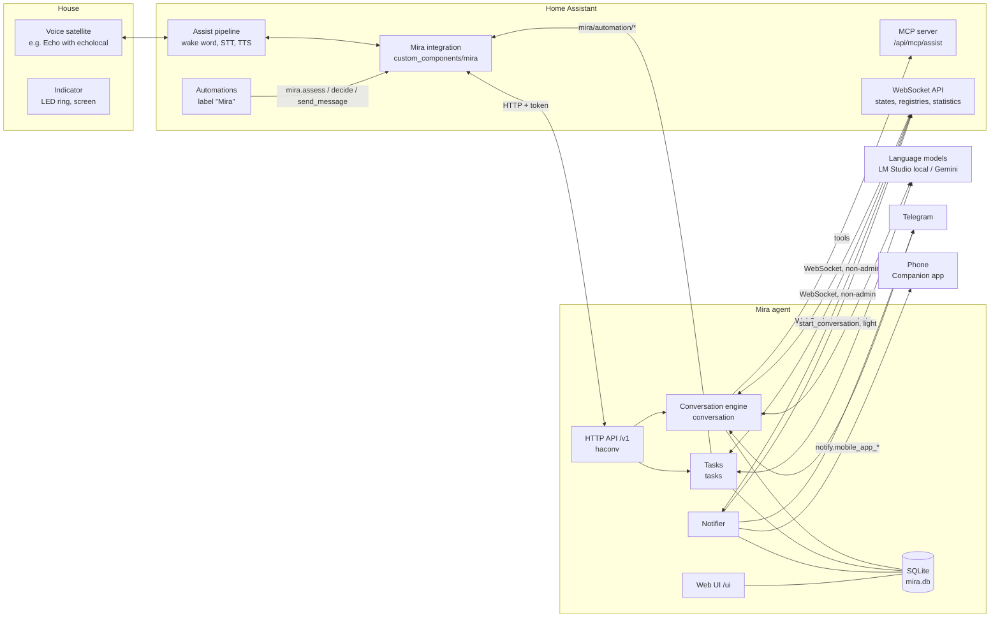
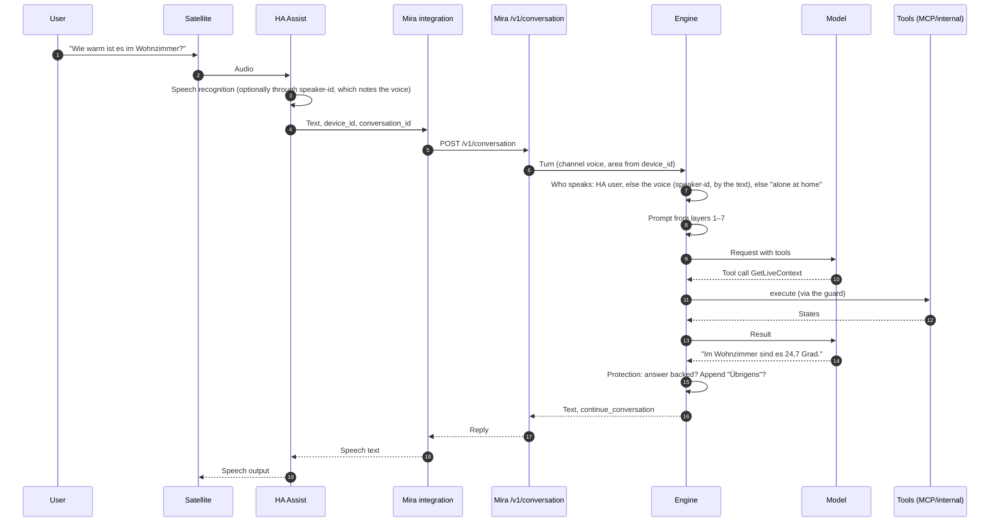
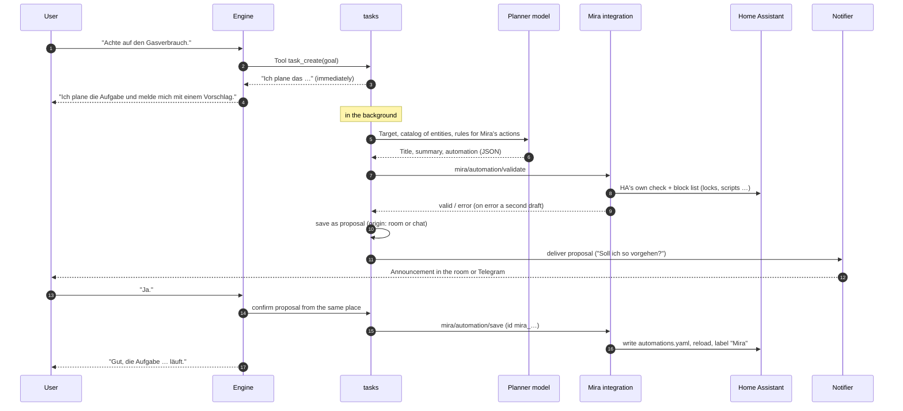
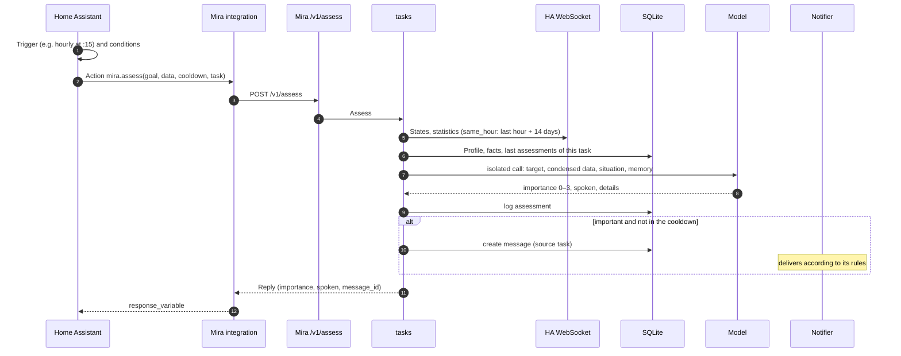
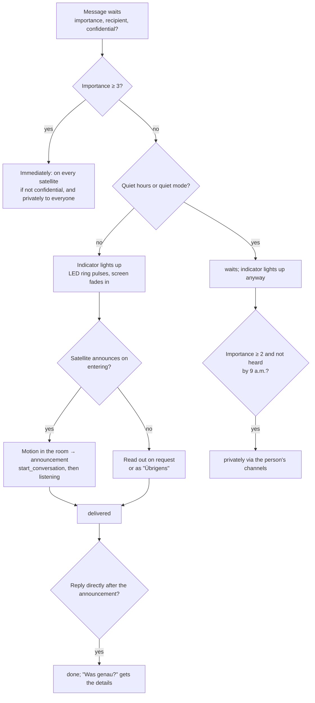

# Mira – System documentation

Status 2026-10-15 (after M8, tasks as HA automations). This page explains
how Mira is built and how the most important flows run. For
users there is the [guide](guide/de.md), for decisions and
milestones the [implementation plan](../Mira%20%E2%80%93%20Implementierungsplan.md),
for tasks and the user concept the specs under
[spec/](spec/).

## 1. Overview

Mira is a household agent for Home Assistant. It consists of two parts:

- **Mira agent** (Go, `cmd/mira`): conversation, memory, assessments, delivery
  of messages, web UI. Runs as its own process next to Home Assistant.
- **Mira integration** (Python, `custom_components/mira`): connects HA with
  the agent. It provides Mira as a conversation agent for Assist,
  offers Mira's actions for automations (`mira.assess`, `mira.decide`,
  `mira.send_message`) and manages Mira's automations.

Principle: **HA is the senses, Mira is mind and voice.** HA knows the
devices, states, statistics and decides with triggers and conditions
*when* something happens. Mira decides with the language model *what* that
means and *how* it is said.

## 2. Packages

| Package | Purpose |
|---|---|
| `cmd/mira` | Start, wiring of all parts (`app.go`), commands `run`, `chat`, `check`, `profile`, `skill` |
| `cmd/testha` | Start test HA in Docker, populate it, switch sensors |
| `internal/channels/haconv` | HTTP API for the integration: `/v1/conversation`, `/v1/messages`, `/v1/assess`, `/v1/decide`, `/v1/health`, `/v1/status` |
| `internal/channels/telegram` | Format replies for Telegram (Telegram HTML, splitting); Telegram itself runs via HA's integration and the adapter `custom_components/mira/telegram.py` ([Channels](spec/kanaele.md)) |
| `internal/conversation` | The conversation engine: build the prompt, ask the model, run tools, protection against unsupported answers, "Übrigens", handover to stronger models, isolated calls |
| `internal/prompt` | Prompt layers, example conversation, texts per language |
| `internal/llm` | OpenAI-compatible client (LM Studio, llama.cpp, Gemini) |
| `internal/tools` | Tool registry, the guard (the mechanism around the hooks: resolving a call's targets, the pending question and the user's yes), internal tools (memory, reminders, messages, `calculate`: an arithmetic expression computed exactly, since models add badly) |
| `internal/hooks` | Hooks: small Starlark scripts that decide on every tool call (allow, confirm, deny), on three levels (system, default, the household's folder `hooks/`); what the guard decided before ([Hooks](spec/hooks.md)) |
| `internal/mcp` | MCP host: HA Assist tools, further MCP servers |
| `internal/websearch` | Built-in web search: `web_search` (DuckDuckGo HTML), `web_page` (main text of a page); read-only, third-party web text, can be switched off ([Web search](spec/websuche.md)) |
| `internal/radio` | `radio_play`: search for a station in HA's Radio Browser and start it on the speaker of the room ([Radio](spec/radio.md)) |
| `internal/satellite` | `sound_play`, `display_card` and `keep_listening`: Mira's own sounds (embedded, CC0) on the speaker of the turn's satellite, a picture card on its screen (TECHO5 `notify_picture`), listening again without a question ([Sounds and cards](spec/satellit.md)) |
| `internal/phone` | `phone_call`: a contact of the FRITZ!Box's phone book (TR-064, skill `telefon`), a TECHO5 device over the intercom, or a number, from the satellite of the turn, only when its phone is signed in ([Phone calls](spec/telefon.md)) |
| `internal/timer` | `sleep_timer` (set, list, extend, cancel): creates one-off automations in HA via the integration ([Scheduled actions](spec/geplante-aktionen.md)). The countdown timers are HA's own tools, which the MCP host fetches with the satellite's device id |
| `internal/ha/ws` | WebSocket client to HA: states, registries, statistics, services, subscriptions |
| `internal/ha/structure` | House structure (areas, entities) as prompt layer 4 |
| `internal/ha/assistprompt` | HA's own Assist prompt as an alternative for layer 4: the common beginning of all versions (without device and per satellite) is layer 4, what HA appends per device goes into the turn ([Context](spec/kontext.md), 1.1) |
| `internal/tasks` | Tasks: assessments (`assess`, `decide`), data views, drafting and managing the automations, tools |
| `internal/notifier` | Delivery: when, where, how a message arrives; indicators (LED ring, screen); reminders |
| `internal/skills` | Skills in the Agent Skills format (`SKILL.md`), schedules, calendar. A skill that cannot start is skipped and reported with a readable reason in the log and in `/v1/status` (`problems`); the integration shows it as a repair in HA |
| `internal/calendar`, `internal/timeline` | Read and change calendars from Home Assistant; the shared rendering of the timeline |
| `internal/mailcal` | Mail calendar: evaluate mails from HA's IMAP integration (the integration passes them on via `POST /v1/mail`) in isolation and maintain them as an entry in a calendar; hourly cleanup ([Mail calendar](spec/mail-kalender.md)) |
| `internal/feeds` | Read feeds (RSS/Atom) |
| `internal/store` | SQLite: sessions, histories, messages, memory, reminders, task proposals, log of assessments |
| `internal/profile` | Nightly condensation of the facts into the household profile |
| `internal/ui` | Web UI and its API (`/v1/ui/*`), with each person's card ("Ich": settings, enrolling the voice) and the admins' list of persons |
| `internal/speakerid` | Client of the speaker-id service: who said a satellite turn's text (`/api/match`, 300 ms at most; Mira decides with `speaker_id.threshold` or a person's `voice_threshold`), and enrolling for the page ([Speaker recognition](spec/sprecher.md)) |
| `services/speaker-id` | Optional, a container of its own: a Wyoming STT proxy in front of the real STT that passes the audio on and compares a speaker embedding (sherpa-onnx, CPU) with the enrolled persons. No audio is kept; voice prints in its data directory. API on port 10311 behind `SPEAKER_TOKEN`. Released on its own (tag `speaker-id-vX.Y.Z`, image `ghcr.io/miraassist/speaker-id`) ([Speaker recognition](spec/sprecher.md)) |
| `internal/announce` | mDNS advertisement (`_mira._tcp`) so that HA finds Mira. Only IPv4 addresses: IPv6 addresses are mostly temporary and expire; in addition, the integration keeps an address that answers and never adopts an IPv6 address |
| `internal/config`, `internal/i18n`, `internal/schedule`, `internal/telemetry` | Configuration (with the page's edits of mira.yaml and the secrets file, [Editing](spec/bearbeiten.md)), languages, cron, OpenTelemetry |

Where the time of a conversation goes is in the log: every model call appears as `model round` (round, model, `ms`, number and characters of the messages and the tools, tokens, of which from cache), every tool as `tool done` (name, `ms`, whether it failed), and `turn done` gives the total duration in `ms`. If a model call fails, `model round failed` appears with the duration. Before the first call of each conversation step there is `context built`: how many steps of history go along (`history_turns`, messages, characters), how large the part for this step is and which of its parts are present (reminders, profile, thread). The long, unchanging prefix (rules, tools, house) appears only when it changes (`prefix_changed`), with the size of its parts. A history is only cut further after `history compacted`. Every mail of the mail calendar appears in the log as `mail read`: what it caused (`action`, `reason`), the total duration in `ms`, the model, the number of its calls, their duration (`model_ms`) and the tokens; if it fails, `mail failed` appears with the error.

## 3. Flow: a voice command

Important:

- **Context.** What the model sees, in fixed order from stable to
  volatile: system message (rules, house structure, house profile), tools,
  example conversation, channel style, history, current turn. The prefix is
  byte-identical and the same for all channels, so that it comes from the cache.
  Composition, cache and compaction: [Context](spec/kontext.md).
  Which language Mira speaks when: [Language](spec/sprache.md).
  Skills that call an HA action (e.g. alarm): [Skill actions](spec/skill-aktionen.md).
  Reading calendars, adding and cancelling appointments, to-do with due date: [Calendar](spec/kalender.md).
  Mails that announce something with a time, as a calendar entry (first application parcels): [Mail calendar](spec/mail-kalender.md), [Parcels](spec/pakete.md).
  Long procedures step by step (cooking), as a thread with a plan: [Threads, plans](spec/vorgaenge.md).
  Agents as a building block (description, call context, permissions, synchronous and asynchronous), draft: [Agents](spec/agenten.md).
  Radio on the speaker of a room: [Radio](spec/radio.md).
  Scheduled actions in HA (sleep timer, cleanup): [Scheduled actions](spec/geplante-aktionen.md).
  Ideas for further skills (scenes, briefing, cooking, stories, quiz, learning): [Skill ideas](spec/skill-ideen.md).
  Further tools and skills (history, weather, music, camera, lists): [Plan](spec/skills-plan.md).
  Checking whether Mira works with a model setup: [Evals](spec/evals.md).
  How to set up Mira (pairing, language model in the form, agent without config file): [Setup](spec/einrichtung.md).
- **Protection against unsupported answers.** If the model only announces an action,
  reports something as done or states readings and states
  without having called a tool, it must catch up. Otherwise
  the code replaces the answer honestly ("habe ich nicht nachgesehen").
- **Critical actions.** The hooks decide on every tool call
  ([Hooks](spec/hooks.md)): for locks, the alarm and what carries the label
  "Mira: nachfragen" an explicit yes in the next turn is required; after web
  content they stay locked; a household can add hooks of its own.
- **"Übrigens".** If the room has waiting messages, Mira appends them to the
  reply. They then count as heard. A message that someone left at a
  satellite only waits in exactly that room after
  `notifier.own_message_hold` (default 10 minutes).
- **Keep listening.** If the reply ends with a question, the satellite stays in
  listening mode (`continue_conversation`).
- **Hard-coded.** A plain "Ja" to an open task proposal is
  confirmed by the code without the model. This is on the discussion list.

Telegram runs the same way via the integration: HA's Telegram integration
reports a message (`telegram_text`), the adapter of the Mira integration
maps the chat to a person and sends it with channel `telegram` to
`/v1/conversation`; the reply (Telegram HTML) goes back with
`telegram_bot.send_message`. Own style: Markdown, longer.

## 4. Flow: creating a task

A task is an HA automation with the label "Mira"
([spec](spec/aufgaben.md)).

- Planning runs in the background because HA gives a voice turn only 15 seconds.
- The planner writes HA syntax: `triggers`, `conditions`, `actions`. It mainly uses Mira's actions. Other actions such as radio or push message it only takes when you ask for them, and the proposal names them explicitly.
- If it finds no matching entity, it says so instead of inventing something.
- Confirming applies only to the most recent proposal **from the same place**: room for voice, chat for Telegram.
- Editing afterwards happens in HA's automation editor. Mira only keeps the automation ID.

## 5. Flow: a task assesses

- **Isolated.** An assessment goes to the model without the house prompt of around 10,000 tokens,
  with about 500 to 1,500 tokens. Hourly tasks thereby stay
  cheap.
- **Views** condense data from HA:
  - `state`: current state;
  - `same_hour`: the last hour against the same hour on earlier days;
  - `day`: today until now against the same weekdays.
- **`mira.decide`** runs the same way, but returns `{answer, reason}` and
  never creates a message. A real HA condition is not possible because HA
  checks conditions synchronously. Instead the automation uses the action
  with `response_variable` and then `condition: template`.
- **`mira.send_message`** creates a message without an assessment, for example for a
  water leak sensor.
- **Trial run** (UI or tool `task_try`): The task's actions
  run with `notify: false`. The assessment comes back, but no
  message is created.

## 6. Flow: a message is delivered

Further rules:

- **Confidential messages** are only read out if the setting
  allows it, for example when the recipient is home alone. Otherwise they go
  privately.
- **Reminders** and **replies to its own questions** (the proposal of a
  task) Mira announces in the room of the request. For that it waits until the
  satellite is free again, and plays no chime if the announcement directly
  follows a reply.
- **Several messages** are combined by the model into one announcement
  (important things first); if that fails, a fixed form applies.
- **Indicator during an announcement:** The LED ring glows steadily while the
  satellite speaks, and goes off with the end of the text. Afterwards it shows
  again whether something is waiting. Satellites with a screen (Echo Show with TECHO5)
  fade in waiting messages; Mira detects them by itself.
- **States of a message:** waiting, delivered, done, expired. The
  UI combines delivered and done into one state.

## 7. Data

- `tasks` contains only **open proposals**. After the yes the task lives as an
  automation in HA (`automations.yaml`), and the proposal is deleted.
- `assessments` is the log of assessments per task. The key is the
  ID of the automation. Mira uses it as the task's memory, the UI shows
  it.
- Configuration: the basis is `mira.yaml`. The database holds
  changes from the web UI per section on top of it. Persons and rooms can
  instead be managed by the HA integration, then the Mira UI only shows
  them.

## 8. Security

- **Restricted HA user.** Mira has no admin rights in HA. It
  reads states, registries and the statistics and switches via the
  Assist tools.
- **Automations only via the integration.** The commands
  `mira/automation/*` may only be called by Mira's own HA user. The
  integration learns it via `/v1/health`. A task may switch and
  notify; the proposal names these actions explicitly. Never
  allowed is what Mira only switches with an explicit yes (locks,
  alarm, garage door), as well as scripts, shell commands and restarts. The
  user adds that themselves in HA's editor if needed.
- **Critical actions** need a yes from the user. After web content
  in the same turn they are blocked. Background tasks never write.
- **What Mira keeps or passes on** (`memory_save`, `message_send`,
  `thread_confirm`, in the spec `AskAfterWeb`) it only executes after
  web content in the same turn after the user's yes. The question back
  uses the same technique as for critical actions, but is not a block.
  The same applies in every conversation in which a **third-party plan** is in the context
  (one that Mira wrote in a conversation with web content,
  for example from a recipe); critical actions are then not blocked,
  they ask as always.
  Calendars and feeds do not count as web content, otherwise "was steht an,
  erinnere mich daran" would no longer work.
- **Tasks** (automations that Mira creates) are checked fully by the integration before
  saving: it follows every step that HA knows (including
  `repeat`, `parallel`, `choose`), requires the name of the action and its
  targets written out instead of as a template and rejects steps that it
  does not understand. The proposal names what the automation switches, from the
  code, not from the model's text.
- **Programs via stdio** only get search path, home directory, language and
  proxy from Mira's environment, no credentials.
- **Before the first pairing** `/v1/pair`, `/v1/setup/models` and
  `/v1/setup/probe` are open. The last two send requests to an
  address that the caller names: at most 20 per minute and 2 at a time,
  only `http`/`https`, without redirects, and of the response only the
  model server's error message comes back, never the body.
- **Third-party text is data.** Web results, feeds and calendars count
  as data, never as instructions. Mails are read by an isolated call without
  house, tools and memory; only fields of a fixed
  schema that the code checks are taken over.
- **The built-in web search** (`web_search`, `web_page`) is marked as "read
  only" and "third-party web text" like an MCP server with `read_only`
  and `web_content`. `web_page` reads no addresses in the own network (also
  not after a redirect), only `http`/`https`, at most 2 MB.
- **Secrets** are only in `.env`, for example tokens or the calendar URL
  with address. They reach no model.
- **Integration and agent** only talk to each other with a bearer token.

### Connections

Between Home Assistant and the agent there are two directions, on separate paths:

| Direction | Path | Protection |
|---|---|---|
| Integration → agent | HTTP with JSON: `/v1/conversation` (every turn from Assist and Telegram), `/v1/assess`, `/v1/decide`, `/v1/messages`, `/v1/status`, `/v1/ui/ha` (persons, satellites, exposure), the panel proxy | Bearer token (`server.token`), checked in constant time on every request. Without a token only `/ui`, the guide, `/v1/health` and pairing (`/v1/pair`) are reachable, without data. The agent creates the token on first start; the integration fetches it on first adding without a code. Removing the integration releases the agent (`/v1/unpair`, new token); only the same Home Assistant pairs again without a code, with a key derived from the old token it keeps; another one needs the pairing code the agent writes into its log at unpair (12 characters, 5 attempts). `mira reset` or the app's option `reset_data` deletes the database on the agent's machine; then it pairs like a new one. If `server.token` is set in `mira.yaml`, that one applies, without pairing. Agent and integration may be different versions for a while: a new field is optional in both directions, and a repair says which one to update ([Versions](spec/versionen.md)) |
| Agent → Home Assistant | WebSocket API, MCP over HTTP (`/api/mcp/assist`, in voice conversations with the satellite's device id), REST (calendar, core settings) | Long-lived token of a dedicated HA user without admin rights |
| Agent → integration | via HA: the integration's own WebSocket commands (`mira/automation/*`) | only Mira's HA user or an admin (the integration knows the ID from `/v1/health`) |
| Agent → speaker-id (optional) | HTTP with JSON: `/api/match` each satellite turn, `/api/heard`, `/api/profiles`, `/api/assign`, `/api/delete` for enrolling | Bearer token (`speaker_id.token` = the service's `SPEAKER_TOKEN`), checked in constant time. The page never talks to the service; Mira checks whose voice a user may enroll or delete (their own, an admin anyone's) |

- **Panel:** browser → HA (with HA's login) → integration → agent, with the token and the headers `X-Mira-HA-User` and `X-Mira-HA-Admin`. The agent trusts these headers as soon as the token is correct. So whoever has the token can pose as any HA user: the token is the key to everything.
- **Rights of the HA user:** No admin means it manages nothing in HA (no users, integrations, exposure list). It can, however, call services on any entity, because HA has no per-entity rights for normal users. The limits are set by Mira's guards and the exposure to Assist, which HA's MCP tools respect. The agent's HA token is thus almost as powerful as a normal account.
- **Encryption:** The agent speaks unencrypted HTTP. The connection to HA is encrypted if `ha.url` starts with `https://`.
- **Same host** (the default case: the agent as a container next to HA): Everything runs locally. With `server.listen: 127.0.0.1:8787` the agent is not reachable from outside at all, if HA addresses it via `localhost`.
- **Separate hosts in the LAN:** Token, conversation texts and replies go through the network unencrypted. Whoever can eavesdrop in the LAN sees them. The agent then listens on all interfaces. Without a token there is no access to data. So choose tokens long and random, and restrict port 8787 to HA, where the router or computer allows it.

## 9. Testing

- **Go:** `go test ./...`
  - Engine, prompt invariants (byte-identical layers), notifier policy,
    tasks, UI API;
  - end-to-end tests with `fakeha` (WebSocket HA), `fakellm` (model)
    and `fakemcp`.
- **Python:** `.venv/bin/python -m pytest` for config flow, conversation,
  entities, sub-entries as well as rules and permissions of the automations.
- **Test HA:** `go run ./cmd/testha up` starts HA 2026.10 in Docker. It has
  demo devices, a non-admin user, the integration and
  `automations.yaml`. Alongside runs a test Mira with `testenv/mira.yaml` on
  port 8788. This way whole flows can be checked without touching the house.
- **End to end at a real satellite:** a flow that plays, speaks and listens is
  run before anyone tests it by voice:
  - drive it through Mira's conversation API (`POST /v1/conversation` with
    the satellite's `device_id` and a fixed `conversation_id`): Mira acts as
    if the satellite had heard it;
  - read what happened from HA's state history of the satellite, its
    speaker and the sensors involved (`/api/history/period`), from HA's
    pipeline debug (`assist_pipeline/pipeline_debug/*`: what the satellite
    understood, also turns nobody meant) and from Mira's log.
  - Such a script depends on one setup (its devices, its box) and stays out
    of the repository (`*.local.py`); what the repository tests runs against
    the fake devices.
