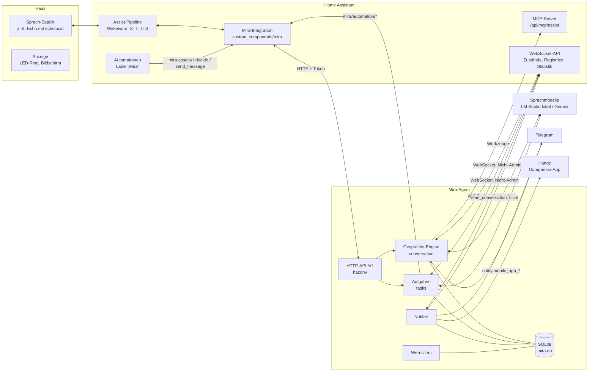
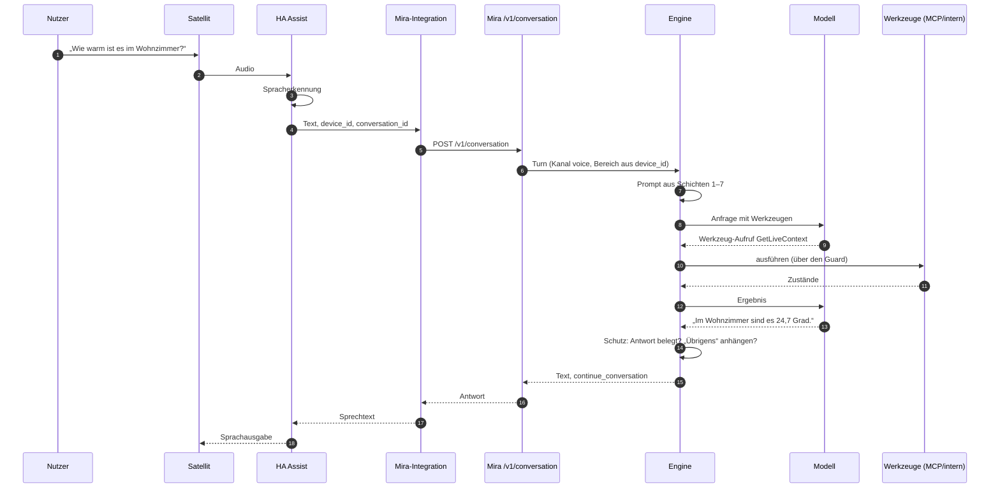
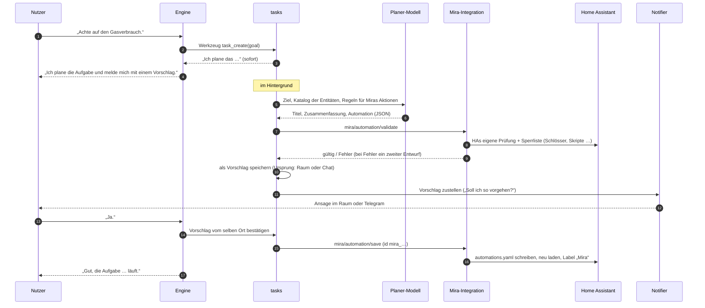
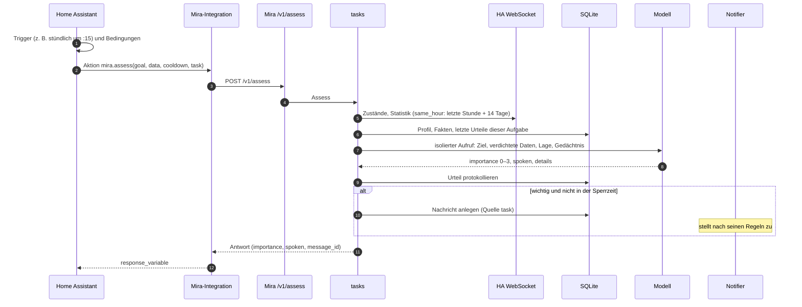
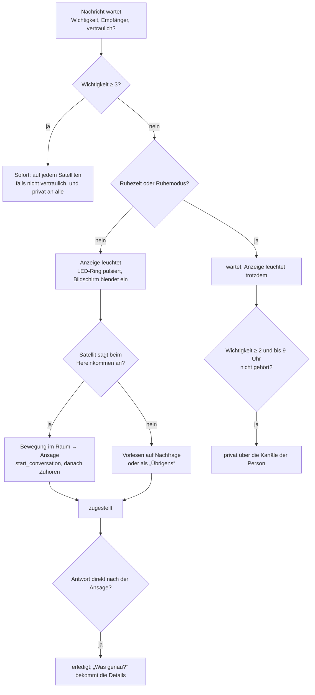
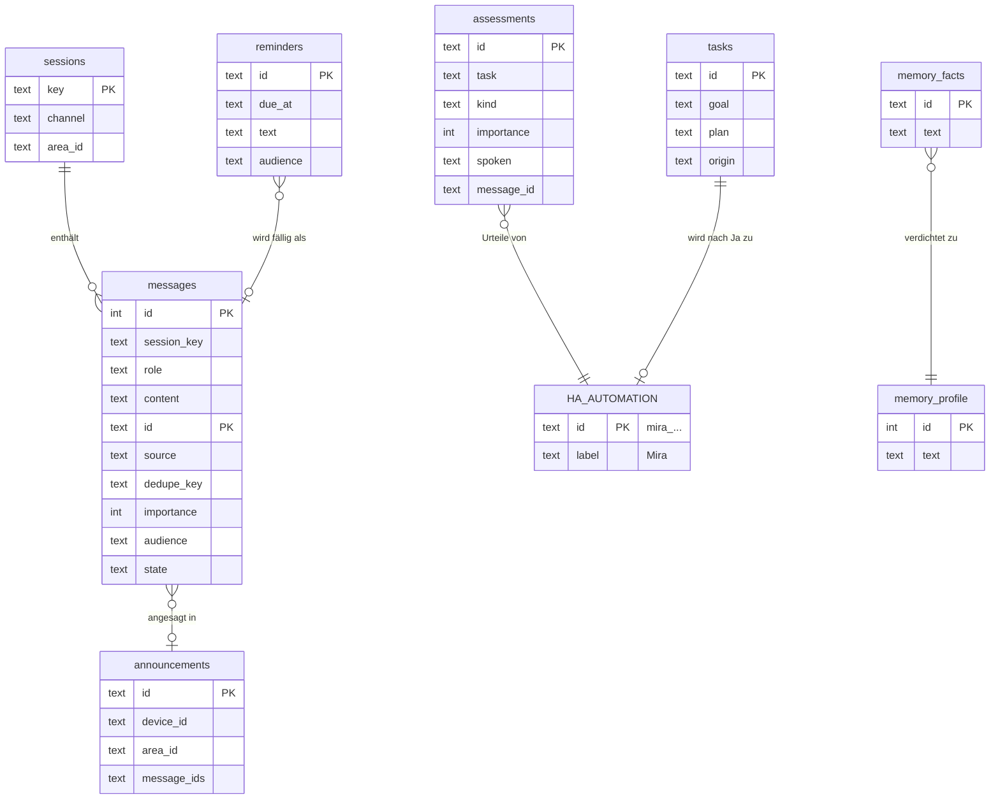

# Mira – Systemdokumentation

Stand 2026-10-15 (nach M8, Aufgaben als HA-Automationen). Diese Seite erklärt,
wie Mira aufgebaut ist und wie die wichtigsten Abläufe laufen. Für
Anwender gibt es die [Anleitung](guide/de.md), für Entscheidungen und
Meilensteine den [Implementierungsplan](../Mira%20%E2%80%93%20Implementierungsplan.md),
für die Aufgaben und das Benutzer-Konzept die Spezifikationen unter
[spec/](spec/).

## 1. Überblick

Mira ist ein Haushalts-Agent für Home Assistant. Sie besteht aus zwei Teilen:

- **Mira-Agent** (Go, `cmd/mira`): Gespräch, Gedächtnis, Urteile, Zustellung
  von Nachrichten, Web-UI. Läuft als eigener Prozess neben Home Assistant.
- **Mira-Integration** (Python, `custom_components/mira`): verbindet HA mit
  dem Agenten. Sie stellt Mira als Konversations-Agent für Assist bereit,
  bietet Miras Aktionen für Automationen an (`mira.assess`, `mira.decide`,
  `mira.send_message`) und verwaltet Miras Automationen.

Grundsatz: **HA sind die Sinne, Mira ist Verstand und Stimme.** HA kennt die
Geräte, Zustände, Statistiken und entscheidet mit Triggern und Bedingungen,
*wann* etwas passiert. Mira entscheidet mit dem Sprachmodell, *was* das
bedeutet und *wie* es gesagt wird.

## 2. Pakete

| Paket | Aufgabe |
|---|---|
| `cmd/mira` | Start, Verdrahtung aller Teile (`app.go`), Befehle `run`, `chat`, `check`, `profile`, `skill` |
| `cmd/testha` | Test-HA in Docker starten, befüllen, Sensoren schalten |
| `internal/channels/haconv` | HTTP-API für die Integration: `/v1/conversation`, `/v1/messages`, `/v1/assess`, `/v1/decide`, `/v1/health`, `/v1/status` |
| `internal/channels/telegram` | Antworten für Telegram formatieren (Telegram-HTML, Aufteilen); Telegram selbst läuft über HAs Integration und den Adapter `custom_components/mira/telegram.py` ([Kanäle](spec/kanaele.md)) |
| `internal/conversation` | Die Gesprächs-Engine: Prompt bauen, Modell fragen, Werkzeuge ausführen, Schutz gegen unbelegte Antworten, „Übrigens“, Abgabe an stärkere Modelle, isolierte Aufrufe |
| `internal/prompt` | Prompt-Schichten, Beispielunterhaltung, Texte je Sprache |
| `internal/llm` | OpenAI-kompatibler Client (LM Studio, llama.cpp, Gemini) |
| `internal/tools` | Werkzeug-Register, Schutz (Guard) für kritische Aktionen, interne Werkzeuge (Gedächtnis, Erinnerungen, Nachrichten) |
| `internal/mcp` | MCP-Host: HA-Assist-Werkzeuge, weitere MCP-Server |
| `internal/websearch` | Eingebaute Websuche: `web_search` (DuckDuckGo-HTML), `web_page` (Haupttext einer Seite); liest nur, fremder Webtext, abschaltbar ([Websuche](spec/websuche.md)) |
| `internal/ha/ws` | WebSocket-Client zu HA: Zustände, Registries, Statistik, Dienste, Abos |
| `internal/ha/structure` | Hausstruktur (Bereiche, Entitäten) als Prompt-Schicht 4 |
| `internal/ha/assistprompt` | HAs eigener Assist-Prompt als Alternative für Schicht 4 |
| `internal/tasks` | Aufgaben: Urteile (`assess`, `decide`), Datenansichten, Entwurf und Verwaltung der Automationen, Werkzeuge |
| `internal/notifier` | Zustellung: wann, wo, wie eine Nachricht ankommt; Anzeigen (LED-Ring, Bildschirm); Erinnerungen |
| `internal/skills` | Skills im Agent-Skills-Format (`SKILL.md`), Zeitpläne, Kalender |
| `internal/calendar`, `internal/timeline` | Kalender aus Home Assistant lesen und ändern; die gemeinsame Darstellung der Zeitachse |
| `internal/feeds` | Feeds (RSS/Atom) lesen |
| `internal/store` | SQLite: Sitzungen, Verläufe, Nachrichten, Gedächtnis, Erinnerungen, Aufgaben-Vorschläge, Protokoll der Urteile |
| `internal/profile` | Nächtliche Verdichtung der Fakten zum Haushaltsprofil |
| `internal/ui` | Web-UI und ihre API (`/v1/ui/*`) |
| `internal/announce` | mDNS-Ankündigung (`_mira._tcp`), damit HA Mira findet |
| `internal/config`, `internal/i18n`, `internal/schedule`, `internal/telemetry` | Konfiguration, Sprachen, Cron, OpenTelemetry |

## 3. Ablauf: ein Sprachbefehl

Wichtig:

- **Kontext.** Was das Modell sieht, in fester Reihenfolge von stabil nach
  volatil: Systemnachricht (Regeln, Haus-Struktur, Haus-Profil), Werkzeuge,
  Beispielunterhaltung, Kanalstil, Verlauf, aktueller Turn. Der Anfang ist
  byte-identisch und für alle Kanäle gleich, damit er aus dem Cache kommt.
  Komposition, Cache und Kompaktierung: [Kontext](spec/kontext.md).
  Welche Sprache Mira wann spricht: [Sprache](spec/sprache.md).
  Skills, die eine HA-Aktion aufrufen (z. B. Wecker): [Skill-Aktionen](spec/skill-aktionen.md).
  Kalender lesen, Termine eintragen und absagen, To-do mit Fälligkeit: [Kalender](spec/kalender.md).
  Weitere Werkzeuge und Skills (Verlauf, Wetter, Musik, Kamera, Listen): [Plan](spec/skills-plan.md).
  Prüfen, ob Mira mit einem Modell-Setup funktioniert: [Evals](spec/evals.md).
  Wie man Mira einrichtet (Koppeln, Sprachmodell im Formular, Agent ohne Config-Datei): [Einrichtung](spec/einrichtung.md).
- **Schutz gegen unbelegte Antworten.** Kündigt das Modell eine Aktion nur
  an, meldet es etwas als erledigt oder nennt es Messwerte und Zustände,
  ohne ein Werkzeug aufgerufen zu haben, muss es nachholen. Sonst ersetzt
  der Code die Antwort ehrlich („habe ich nicht nachgesehen“).
- **Kritische Aktionen.** Bei Schlössern, Alarm und Garagentor verlangt der
  Guard ein ausdrückliches Ja im nächsten Turn.
- **„Übrigens“.** Hat der Raum wartende Nachrichten, hängt Mira sie an die
  Antwort an. Sie gelten dann als gehört.
- **Weiterhören.** Endet die Antwort mit einer Frage, bleibt der Satellit im
  Zuhörmodus (`continue_conversation`).
- **Fest im Code.** Ein schlichtes „Ja“ auf einen offenen Aufgabenvorschlag
  bestätigt der Code ohne Modell. Das steht auf der Besprechungsliste.

Telegram läuft genauso über die Integration: HAs Telegram-Integration
meldet eine Nachricht (`telegram_text`), der Adapter der Mira-Integration
ordnet den Chat einer Person zu und schickt sie mit Kanal `telegram` an
`/v1/conversation`; die Antwort (Telegram-HTML) geht mit
`telegram_bot.send_message` zurück. Eigener Stil: Markdown, länger.

## 4. Ablauf: eine Aufgabe anlegen

Eine Aufgabe ist eine HA-Automation mit dem Label „Mira“
([Spezifikation](spec/aufgaben.md)).

- Das Planen läuft im Hintergrund, weil HA einem Sprach-Turn nur 15 Sekunden gibt.
- Der Planer schreibt HA-Syntax: `triggers`, `conditions`, `actions`. Er nutzt vor allem Miras Aktionen. Andere Aktionen wie Radio oder Push-Nachricht nimmt er nur, wenn du darum bittest, und der Vorschlag nennt sie ausdrücklich.
- Findet er keine passende Entität, sagt er das, statt etwas zu erfinden.
- Bestätigen gilt nur für den jüngsten Vorschlag **vom selben Ort**: Raum bei Sprache, Chat bei Telegram.
- Bearbeitet wird danach im Automations-Editor von HA. Mira hält nur die Automations-ID.

## 5. Ablauf: eine Aufgabe urteilt

- **Isoliert.** Ein Urteil geht ohne den Haus-Prompt von rund 10.000 Tokens
  an das Modell, mit etwa 500 bis 1.500 Tokens. Stündliche Aufgaben bleiben
  dadurch billig.
- **Ansichten** verdichten Daten aus HA:
  - `state`: aktueller Zustand;
  - `same_hour`: die letzte Stunde gegen dieselbe Stunde an früheren Tagen;
  - `day`: heute bis jetzt gegen dieselben Wochentage.
- **`mira.decide`** läuft genauso, liefert aber `{answer, reason}` und legt
  nie eine Nachricht an. Eine echte HA-Bedingung ist nicht möglich, weil HA
  Bedingungen synchron prüft. Stattdessen nutzt die Automation die Aktion
  mit `response_variable` und danach `condition: template`.
- **`mira.send_message`** legt ohne Urteil eine Nachricht an, etwa für einen
  Wassermelder.
- **Probelauf** (UI oder Werkzeug `task_try`): Die Aktionen der Aufgabe
  laufen mit `notify: false`. Das Urteil kommt zurück, aber es entsteht keine
  Nachricht.

## 6. Ablauf: eine Nachricht wird zugestellt

Weitere Regeln:

- **Vertrauliche Nachrichten** werden nur vorgelesen, wenn die Einstellung es
  erlaubt, etwa wenn der Empfänger allein zu Hause ist. Sonst gehen sie
  privat.
- **Erinnerungen** und **Antworten auf eigene Fragen** (der Vorschlag einer
  Aufgabe) sagt Mira im Raum der Anfrage an. Sie wartet dafür, bis der
  Satellit wieder frei ist, und spielt keinen Gong, wenn die Ansage direkt
  auf eine Antwort folgt.
- **Mehrere Nachrichten** fasst das Modell zu einer Ansage zusammen
  (Wichtiges zuerst); klappt das nicht, gilt eine feste Form.
- **Anzeige während einer Ansage:** Der LED-Ring leuchtet ruhig, solange der
  Satellit spricht, und geht mit dem Ende des Textes aus. Danach zeigt er
  wieder, ob etwas wartet. Satelliten mit Bildschirm (Echo Show mit TECHO5)
  blenden wartende Nachrichten ein; Mira erkennt sie von selbst.
- **Zustände einer Nachricht:** wartet, zugestellt, erledigt, abgelaufen. Die
  UI fasst zugestellt und erledigt zu einem Zustand zusammen.

## 7. Daten

- `tasks` enthält nur **offene Vorschläge**. Nach dem Ja lebt die Aufgabe als
  Automation in HA (`automations.yaml`), und der Vorschlag wird gelöscht.
- `assessments` ist das Protokoll der Urteile pro Aufgabe. Schlüssel ist die
  ID der Automation. Mira nutzt es als Gedächtnis der Aufgabe, die UI zeigt
  es an.
- Konfiguration: Grundlage ist `mira.yaml`. In der Datenbank liegen
  Änderungen aus der Web-UI pro Abschnitt darüber. Personen und Räume kann
  stattdessen die HA-Integration verwalten, dann zeigt die Mira-UI sie nur
  an.

## 8. Sicherheit

- **Eingeschränkter HA-Benutzer.** Mira hat keine Admin-Rechte in HA. Sie
  liest Zustände, Registries und die Statistik und schaltet über die
  Assist-Werkzeuge.
- **Automationen nur über die Integration.** Die Befehle
  `mira/automation/*` darf nur Miras eigener HA-Benutzer aufrufen. Die
  Integration erfährt ihn über `/v1/health`. Eine Aufgabe darf schalten und
  benachrichtigen; der Vorschlag nennt diese Aktionen ausdrücklich. Nie
  erlaubt ist, was Mira nur mit ausdrücklichem Ja schaltet (Schlösser,
  Alarm, Garagentor), sowie Skripte, Shell-Befehle und Neustarts. Das trägt
  der Nutzer bei Bedarf selbst im Editor von HA ein.
- **Kritische Aktionen** brauchen ein Ja des Nutzers. Nach Web-Inhalten
  im selben Turn sind sie gesperrt. Hintergrundaufgaben schreiben nie.
- **Was Mira behält oder weitergibt** (`memory_save`, `message_send`,
  `thread_confirm`, in der Spezifikation `AskAfterWeb`) führt sie nach
  Web-Inhalten im selben Turn nur nach dem Ja des Nutzers aus. Die Rückfrage
  nutzt dieselbe Technik wie bei kritischen Aktionen, ist aber keine Sperre.
  Kalender und Feeds zählen nicht als Web-Inhalt, sonst ginge „was steht an,
  erinnere mich daran“ nicht mehr.
- **Aufgaben** (Automationen, die Mira anlegt) prüft die Integration vor dem
  Speichern vollständig: Sie folgt jedem Schritt, den HA kennt (auch
  `repeat`, `parallel`, `choose`), verlangt den Namen der Aktion und ihre
  Ziele ausgeschrieben statt als Vorlage und lehnt Schritte ab, die sie
  nicht versteht. Der Vorschlag nennt, was die Automation schaltet, aus dem
  Code, nicht aus dem Text des Modells.
- **Programme über stdio** bekommen nur Suchpfad, Heimatordner, Sprache und
  Proxy aus Miras Umgebung, keine Zugangsdaten.
- **Vor der ersten Kopplung** sind `/v1/pair`, `/v1/setup/models` und
  `/v1/setup/probe` offen. Die beiden letzten schicken Anfragen an eine
  Adresse, die der Aufrufer nennt: höchstens 20 pro Minute und 2 gleichzeitig,
  nur `http`/`https`, ohne Weiterleitungen, und von der Antwort kommt nur die
  Fehlermeldung des Modell-Servers zurück, nie der Rumpf.
- **Fremder Text ist Daten.** Web-Ergebnisse, Feeds und Kalender gelten
  als Daten, nie als Anweisungen.
- **Die eingebaute Websuche** (`web_search`, `web_page`) ist als „liest
  nur“ und „fremder Webtext“ markiert wie ein MCP-Server mit `read_only`
  und `web_content`. `web_page` liest keine Adressen im eigenen Netz (auch
  nicht nach einer Weiterleitung), nur `http`/`https`, höchstens 2 MB.
- **Geheimnisse** stehen nur in `.env`, etwa Tokens oder die Kalender-URL
  mit Adresse. Sie erreichen kein Modell.
- **Integration und Agent** sprechen nur mit Bearer-Token miteinander.

### Verbindungen

Zwischen Home Assistant und dem Agenten gibt es zwei Richtungen, auf getrennten Wegen:

| Richtung | Weg | Absicherung |
|---|---|---|
| Integration → Agent | HTTP mit JSON: `/v1/conversation` (jeder Turn von Assist und Telegram), `/v1/assess`, `/v1/decide`, `/v1/messages`, `/v1/status`, `/v1/ui/ha` (Personen, Satelliten, Freigabe), der Panel-Proxy | Bearer-Token (`server.token`), bei jeder Anfrage in konstanter Zeit geprüft. Ohne Token sind nur `/ui`, die Anleitung, `/v1/health` und das Koppeln (`/v1/pair`) erreichbar, ohne Daten. Den Token erzeugt der Agent beim ersten Start; die Integration holt ihn beim ersten Hinzufügen ohne Code, später nur mit einem Kopplungscode aus `mira pair` (6 Ziffern, 15 Minuten, 5 Versuche). Entfernen der Integration gibt den Agenten frei (`/v1/unpair`, neuer Token). Steht `server.token` in `mira.yaml`, gilt der, ohne Kopplung |
| Agent → Home Assistant | WebSocket-API, MCP über HTTP (`/api/mcp/assist`), REST (Kalender, Grundeinstellungen) | Long-Lived-Token eines eigenen HA-Benutzers ohne Admin-Rechte |
| Agent → Integration | über HA: eigene WebSocket-Befehle der Integration (`mira/automation/*`) | nur Miras HA-Benutzer oder ein Admin (die Integration kennt die ID aus `/v1/health`) |

- **Panel:** Browser → HA (mit HAs Login) → Integration → Agent, mit dem Token und den Kopfzeilen `X-Mira-HA-User` und `X-Mira-HA-Admin`. Der Agent vertraut diesen Kopfzeilen, sobald der Token stimmt. Wer den Token hat, kann sich also als beliebiger HA-Benutzer ausgeben: Der Token ist der Schlüssel zu allem.
- **Rechte des HA-Benutzers:** Kein Admin heißt, er verwaltet nichts in HA (keine Benutzer, Integrationen, Freigabeliste). Dienste kann er aber auf jeder Entität aufrufen, denn HA kennt für normale Benutzer keine Rechte pro Entität. Die Grenzen setzen Miras Wächter und die Freigabe für Assist, die HAs MCP-Werkzeuge einhalten. Der HA-Token des Agenten ist damit fast so mächtig wie ein normales Konto.
- **Verschlüsselung:** Der Agent spricht unverschlüsseltes HTTP. Zu HA ist die Verbindung verschlüsselt, wenn `ha.url` mit `https://` beginnt.
- **Gleicher Host** (der Standardfall: der Agent als Container neben HA): Alles läuft lokal. Mit `server.listen: 127.0.0.1:8787` ist der Agent von außen gar nicht erreichbar, wenn HA ihn über `localhost` anspricht.
- **Getrennte Hosts im LAN:** Token, Gesprächstexte und Antworten gehen unverschlüsselt durchs Netz. Wer im LAN mitlesen kann, sieht sie. Der Agent lauscht dann auf allen Schnittstellen. Ohne Token kommt man nicht an Daten. Tokens deshalb lang und zufällig wählen, und den Port 8787 auf die HA beschränken, wo der Router oder Rechner das erlaubt.

## 9. Testen

- **Go:** `go test ./...`
  - Engine, Prompt-Invarianten (byte-identische Schichten), Notifier-Policy,
    Aufgaben, UI-API;
  - Ende-zu-Ende-Tests mit `fakeha` (WebSocket-HA), `fakellm` (Modell)
    und `fakemcp`.
- **Python:** `.venv/bin/python -m pytest` für Config-Flow, Konversation,
  Entitäten, Unter-Einträge sowie Regeln und Rechte der Automationen.
- **Test-HA:** `go run ./cmd/testha up` startet HA 2026.10 in Docker. Es hat
  Demo-Geräte, einen Nicht-Admin-Benutzer, die Integration und
  `automations.yaml`. Dazu läuft eine Test-Mira mit `testenv/mira.yaml` auf
  Port 8788. So lassen sich ganze Abläufe prüfen, ohne das Haus anzufassen.
